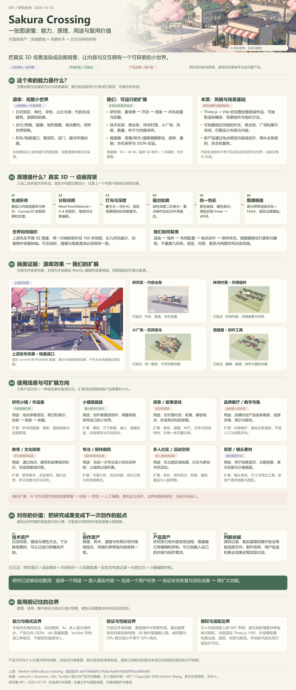

# GitHub 项目研究集

记录最近遇到的优秀 GitHub 项目：为什么值得研究、如何运行、关键实现，以及可复用的经验。这里是研究总入口，完整笔记、实验代码和截图放在对应子项目中。

> 子项目按固定编号持续收录，研究进度和演示入口随条目更新。

## 从这里开始

- **浏览研究**：从下方项目索引进入子项目，阅读摘要、运行说明和研究笔记。
- **新增项目**：阅读 [研究流程](docs/research-workflow.md)，或直接使用下方创建命令。
- **访问演示**：索引中填写演示链接后即可访问；多个 Web 的路径约定见 [部署说明](docs/web-deployment.md)。

<!-- PROJECTS:START -->
## 项目索引

已收录 **1** 个项目，按固定编号升序展示。

| 序号 | 项目 | 研究摘要 | 状态 | 演示 |
| --- | --- | --- | --- | --- |
| 001 | [Sakura Crossing · 樱花小街](projects/001-sakura-crossing/README.md) · [上游](https://github.com/Kenton-GMI/sakura-crossing) | 动画风格场景与产品复用研究：统一汇总源库能力、分层模块、渲染与交互原理、真实体验、个人价值及扩展路线；包含研究街、三场景实验、搭建器、中文导览、晴雨漫游与本机 AI 守灯证据。 | 研究中 | — |

### 项目预览

#### 001 · Sakura Crossing · 樱花小街

动画风格场景与产品复用研究：统一汇总源库能力、分层模块、渲染与交互原理、真实体验、个人价值及扩展路线；包含研究街、三场景实验、搭建器、中文导览、晴雨漫游与本机 AI 守灯证据。

##### 能力：构建可探索的动画风格小世界

- 上游用代码生成日式街区、建筑、招牌和道具，结合球形世界、步行/奔跑、地形碰撞、骑行、列车与铁路道口、店门及环境动画。上游构建和加载已验证，完整漫游与骑行未实测。
- 本地已把风格保留到研究街、商业街/林间村落/小广场、小镇搭建器、中文语音镜头导览和晴雨第一人称漫游；内容阅读收藏、物件编辑与 JSON 存档已有实际操作记录。
- 另有 AI 守灯游戏与真实 OpenAI/MiniMax 策略实验。模型调用由本机服务处理；静态网页展示资料和证据，云端模型游戏尚未部署。

##### 模块：从风格管线到业务与存档

- 渲染层：分段光照、冷紫暗部、深度描线、重点物件外壳描边、调色、色彩转换和抗锯齿；场景层：建筑、树木、道路、招牌、灯光与可复现布局配置。
- 交互层：地点 ID → 内容/动作，店门、阅读收藏、可编辑物件、撤销重做、本机存档和导入导出；导览层：语音时间统一驱动镜头、字幕与地点动作。
- 跨项目 Rain Kit：天气、湿地反射、水珠材质、BVH 漫游四项 API；樱花街已接入其中的天气、湿地与漫游。包可下载并独立安装，有初始化、更新、开关和释放接口；风格/导览尚未独立打包。

##### 原理：真实 3D、多层风格与受约束交互

- 基础几何与 Canvas 纹理生成形体 → 量化光照色阶 → 场景颜色/深度 → 深度二阶差分描线 → 冷暖调色及 linear→sRGB → FXAA。造型、构图、材质和灯光共同决定三渲二观感。
- 上游先在 XZ 平面组织世界，再映射到半径 160 米球面；可见地形、高度与碰撞查询必须一致。扩展街景按组件和配置组织，可独立复用渲染方法。
- 雨滴由 GPU 更新并查询高度图遮雨；湿地通过镜像相机额外渲染倒影；BVH 加速静态碰撞。AI 只提出有限策略，Schema 校验与确定性规则控制执行、状态和结果。

##### 使用场景：内容、创作、游戏与空间展示

- 已跑通：研究集资料发现与收藏、个人小镇搭建、参数化场景实验、中文镜头讲解、晴雨漫游；守灯游戏在本机结合规则模式与模型策略。
- 可扩展：作品集/研究小镇、轻量探索与叙事游戏、品牌展厅/数字市集、教育文化导览、专注陪伴庭院、多人社区/活动空间；也可复用为首页背景、封面与分镜素材。
- 每条方向都需要具体用户任务：找到并阅读资料、搭建并保存小镇、完成探索任务或理解一个知识点，再补内容、业务规则与验证指标。好看的场景只是体验的一部分。

##### 对你的价值：下一次创作有可运行的起点

- 技术资产：可沿用风格管线、可配置组件、天气/反射/漫游接口与释放流程；创作资产：同套积木可以重新组合村庄、街道和广场，保持统一视觉约束。
- 产品资产：研究街的内容闭环、搭建器的编辑与存档、讲解导览、模型策略与规则分工，可以组合进你的内容展示和小型互动产品。
- 判断依据：保留原始版本、授权、真实截图、性能口径、GPU 验证与模型记录。开发效率提升、商业转化、教学效果和付费意愿仍需真实用户与对照验证。

##### 扩展方向与边界：先复用，再增加复杂能力

- 近期：固定宿主接口和风格预设；增加场景模板、地点/内容/动作协议、对象尺寸、避让与道路连接；用一个完整用户流程验证内容和状态恢复。
- 后续：受约束的 AI 场景配置（生成草案→校验→预览→人工编辑）、内容后台、账号云存档、多人同步、任务/NPC 与游戏存档。上述能力不能从现有画面自动推断为已具备。
- 工程边界：搭建器当前 40×40 米、60 物件、1 米吸附且允许重叠；目标手机真机、长时性能与耗电待测。天气页需 WebGPU，模型服务不随静态部署公开。引入 MIT 声明保留，音乐和其他素材逐项授权；本地新代码与 Rain Kit 不统一视为 MIT。

标签：Three.js · 三渲二 · 程序化场景 · 创意前端 · AI 小镇



Sakura Crossing 研究总览引导图：能力、原理、真实效果、应用场景、扩展与个人价值（2026-10-10 阶段）

[研究说明](projects/001-sakura-crossing/README.md) · [上游仓库](https://github.com/Kenton-GMI/sakura-crossing)


<!-- PROJECTS:END -->

## 新增一个研究项目

需要 Node.js 22 或更新版本，无需安装第三方依赖。在仓库根目录执行：

```bash
node scripts/new-project.mjs --slug example-repo --name "项目名称" --source "https://github.com/owner/repo" --summary "一句话说明值得研究的原因"
```

命令会分配下一个编号，创建 `projects/001-example-repo/` 等目录，写入登记表并更新本页。`example-repo` 是用法示例，尚未作为真实项目收录。

也可通过 `npm run project:new -- ...` 调用；Windows PowerShell 下用 `npm.cmd run project:new -- ...`，确保参数原样传入。

随后补充子项目 README 和笔记，把截图放入该项目的 `assets/`，在 [projects.json](projects.json) 中填写图片与演示链接：

```bash
npm run catalog:sync
npm run check
```

## 目录约定

```text
1010_codex_project/
├── README.md                 # 对外入口：编号索引、摘要、截图、演示链接
├── projects.json             # 项目登记表，编号决定展示顺序
├── projects/                 # 001-slug、002-slug……各自独立研究
├── templates/project/        # 新子项目模板
├── docs/                     # 研究规范与 Web 部署说明
├── scripts/                  # 创建项目、同步索引、检查一致性
└── .github/workflows/        # 自动检查目录、索引与图片引用
```

子项目从 `001` 起递增，目录名采用 `编号-英文短名`。编号分配后保持不变，归档项目保留原编号；按编号升序展示，不因研究进度改变顺序。

## 维护方式

根 README 的项目索引和图片预览由 `projects.json` 生成。手动修改摘要、状态、图片或演示入口时，编辑登记表，再运行 `npm run catalog:sync`；详细研究内容直接编辑子项目文件。

保留上游仓库链接与研究时的版本记录。引入上游源码、图片或资源时遵守该项目许可证并保留必要声明；具体要求见 [研究流程](docs/research-workflow.md)。
