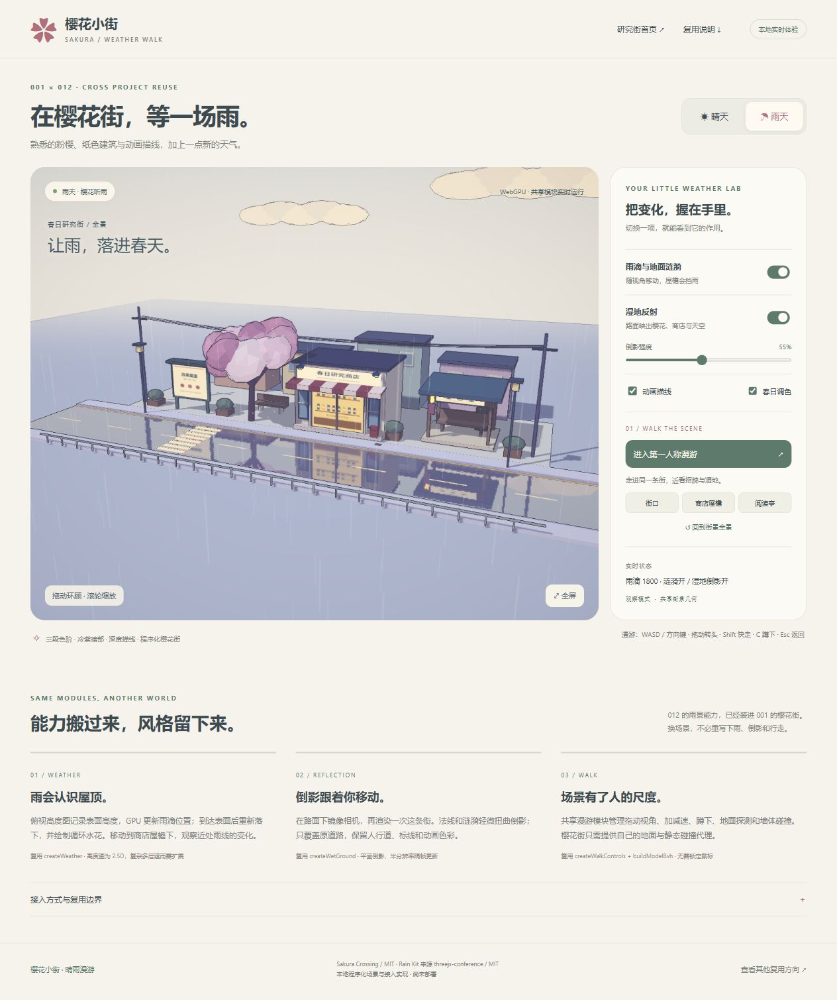
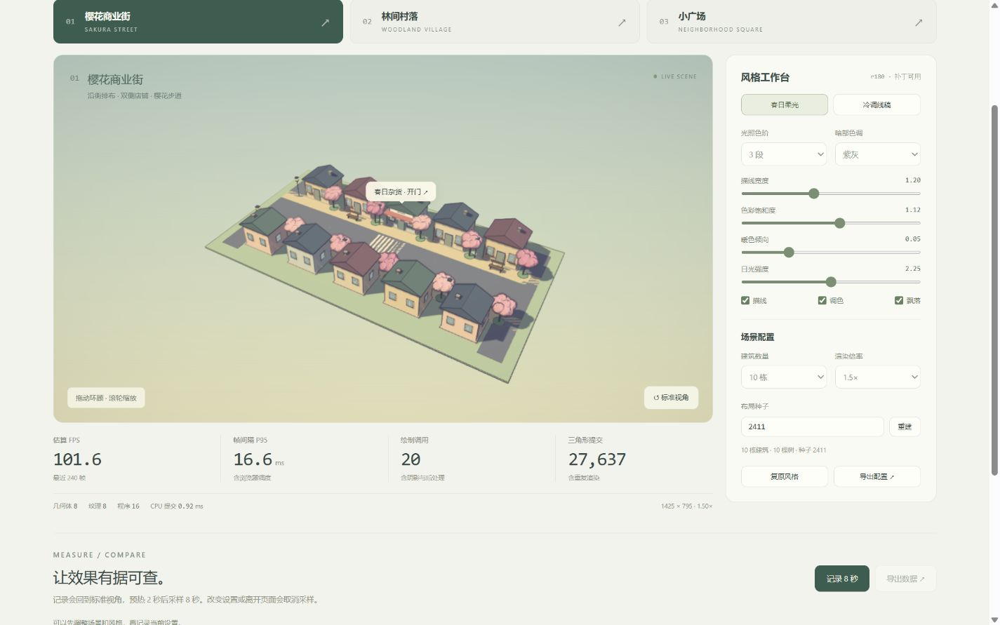

# 001 · Sakura Crossing · 樱花小街

研究如何用程序化 3D 场景获得二维动画背景的观感。已完成最小实验、可阅读收藏资料的研究街、三场景技术实验、能力理解与产品扩展页、最小小镇搭建器，以及街口到阅读亭的一分钟中文镜头导览。

## 两条研究线 · 完整研究全图（2026-10-12）

[一张完整 PNG](assets/scene-research-map.png)汇总 **雨夜城市与樱花小街** 的源库效果、能力分层、技术底层、四模块、真实跨项目晴雨接入、八项探索、应用方向、对你的价值、扩展路线、证据与授权。3840 × 20042 像素，含 12 张效果/作者发布图；概念题图、原理示意、实拍与后续方案分别标记。[SVG 源图](assets/scene-research-map.svg)内嵌原图，保留可编辑文字。

网页入口 [scene-map.html](web/scene-map.html) 支持十章跳转、1.5×/2×/3× 放大和下载；启动 `npm.cmd run dev:weather` 后打开 http://127.0.0.1:5188/scene-map.html。统一研究首屏和目录已接入。本次发布沿用这张原图与轻量预览；图内制作时的发布状态保留，当前范围与实测见 [本次发布说明](notes/scene-publication.md)。

[内容、来源与验证说明](notes/scene-map.md) · [完整内容 JSON](notes/scene-map-content.json) · [题图提示词](notes/scene-map-imagegen-prompt.txt)

## 完整研究摘要 · 2026-10-12

以已生成联合研究全图引导，两条源库能力、本地实现与后续方案分层说明。六组摘要保留完整正文，原始版本、API、实拍与证据在统一网页回查。

### 能力：两种视觉世界，以及已经跑通的探索

固定版本是一套 Three.js / WebGPU / TSL 场景工程。源库组合 GPU 雨丝、水花、屋顶遮雨、路面反射与涟漪、车漆滑落水珠、玻璃雨开场、霓虹后处理和第一人称 BVH 探索；它的直接能力是实时呈现场景并允许观察和交互。

完整城市的效果还依赖模型、车辆、视频招牌、烟雾、飞行器、环境光、GTAO、Bloom、雾、统一色调与空间音效。单独的下雨算法只负责其中一层；城市丰富度与艺术设计不能由一个粒子模块自动替代。

上游用代码生成日式街区、建筑、招牌和道具，结合球形世界、步行/奔跑、地形碰撞、骑行、列车与铁路道口、店门及环境动画。上游构建和加载已验证，完整漫游与骑行未实测。

本地已把风格保留到研究街、商业街/林间村落/小广场、小镇搭建器、中文语音镜头导览和晴雨第一人称漫游；内容阅读收藏、物件编辑与 JSON 存档已有实际操作记录。

另有 AI 守灯游戏与真实 OpenAI/MiniMax 策略实验。模型调用由本机服务处理；静态网页展示资料和证据，云端模型游戏尚未部署。

### 模块：渲染、环境、交互与业务分别负责什么

九组逻辑职责是：启动与宿主循环、场景/模型/灯光、相机与 BVH 控制、高度纹理、GPU 雨滴/水花、湿地镜像/雨纹、表面水珠、后处理与设备预算、DOM 说明/操作桥。它们是源码职责分组，不能把每一组都视为已发布的通用包。

渲染层：分段光照、冷紫暗部、深度描线、重点物件外壳描边、调色、色彩转换和抗锯齿；场景层：建筑、树木、道路、招牌、灯光与可复现布局配置。

Rain Kit 已提取 createWeather、createWetGround、createDropletMaterial、createWalkControls / buildModelBvh。四项各有宿主输入、参数、更新、开关与 dispose；同一实现用于原创研究台、独立最小消费者和樱花街接入。

交互层：地点 ID → 内容/动作，店门、阅读收藏、可编辑物件、撤销重做、本机存档和导入导出；导览层：语音时间统一驱动镜头、字幕与地点动作。

宿主提供 scene、初始化后的 WebGPURenderer、camera、canvas、UV、地面和碰撞代理；模块管理自己的雨缓冲、渲染目标与材质。借用的贴图默认不释放，宿主共享几何/BVH/renderer 由宿主管理。

城市素材、固定中文面板、模型服务、内容收藏、故事和玩法不在 Rain Kit 中。樱花街只接入天气、湿地和漫游三项；水珠仍在最小例子中体验，风格与导览也尚未独立成通用包。

### 原理：从 GPU 雨夜，到动画风格与受约束行动

Three.js 管理场景、几何、相机、纹理和资源；TSL 以 JavaScript 节点描述材质与计算，由节点系统生成 GPU 程序；WebGPU 执行渲染与计算。中文 DOM 面板改变真实参数，不绘制三维效果。

降雨先用俯视正交相机把最高表面的世界位置写入半浮点高度纹理。GPU 用雨滴 XZ 查对应 Y，移动粒子、比较表面并重生，再用面向镜头的实例平面批量画雨线。delta 积分降低帧率带来的速度差；水花独立周期，并非每颗粒子碰撞事件驱动。

湿地通过镜像相机额外渲染场景，隐藏地面并使用斜裁剪，按粗糙度与强度混合反射。程序雨纹扰动法线和采样 UV；水珠则由掩码有限差分改变法线/粗糙度，影响高光。Rain Kit 水珠为独立原创椭圆图案，不复制原复杂拖尾或玻璃折射。

BVH 加速静态几何射线，控制器处理步行、蹲下、地面与墙体滑行。循环顺序为相机输入 → 高度/GPU雨 → 材质时间 → 世界矩阵 → 镜像 → 主渲染/后处理。高度图只保留最高面，镜像只按平面实现，漫游不是刚体引擎。

基础几何与 Canvas 纹理生成形体 → 量化光照色阶 → 场景颜色/深度 → 深度二阶差分描线 → 冷暖调色及 linear→sRGB → FXAA。造型、构图、材质和灯光共同决定三渲二观感。

上游先在 XZ 平面组织世界，再映射到半径 160 米球面；可见地形、高度与碰撞查询必须一致。扩展街景按组件和配置组织，可独立复用渲染方法。

AI 只提出有限策略，Schema 与时效校验后由本地规则和连续控制执行；实时绘制、碰撞、状态与胜负由引擎负责。中文导览则用本地音频 currentTime 统一驱动镜头、字幕和店门，暂停与回看使用同一时间线。

### 使用场景：从背景表达，到内容、创作和互动任务

已跑通：研究集资料发现与收藏、个人小镇搭建、参数化场景实验、中文镜头讲解、晴雨漫游；守灯游戏在本机结合规则模式与模型策略。

网页背景、作品集或研究小镇可以复用环境和风格，地点绑定资料、作品、阅读/收藏入口。雨夜氛围服务内容表达；点击可达、文本阅读和静态替代体验仍由宿主产品设计。

产品材质展厅可以用自有授权模型，比较干湿表面、粗糙度、灯光与镜头，说明产品外观。还需商品信息、参数编辑、咨询或交付流程；水珠效果本身不能证明产品真实防水性能。

天气实验、教育文化导览或轻量探索游戏可以沿用雨棚观察、漫游、镜头与材质开关，再加入测量、课程内容、任务、NPC 和存档。已有守灯游戏与语音导览是 001 的本地扩展，不是原雨夜库自带玩法。

场景实拍也可作为封面、研究图、讲解背景或分镜素材；需要固定构图、清楚注明来源与许可。专注/陪伴庭院和多人活动空间仍属扩展方案，不能把美术氛围当作效果或用户收益已经验证。

每条方向都需要具体用户任务：找到并阅读资料、搭建并保存小镇、完成探索任务或理解一个知识点，再补内容、业务规则与验证指标。好看的场景只是体验的一部分。

### 对你的价值：技术资产、视觉语言、产品方法与依据

技术资产是现成可运行的天气、镜像、水珠、静态行走与生命周期接口。下一个项目从最小例子开始，先接正确的场景/相机/地面与版本，再调整视觉参数，减少重复验证同一底层方法。

创作资产是效果与风格可组合的经验：写实雨夜方法能进入粉樱动画街，说明你可以保持自己的造型、配色与内容。新模型的材质、灯光、UV 和地面仍需适配，没有保证任意资源一键达到同样效果。

产品资产来自研究街阅读收藏、搭建器编辑/存档、音频时间线导览与受规则约束的模型策略。你可以选择其中一条完整流程，让用户阅读资料、完成探索或制作场景，再逐步补后端。

研究资产是固定源码、原文、授权、开关对照、GPU 回读、tgz 安装与模型记录。它们帮助你判断可沿用的结论和仍要验证的部分；节省工时、转化、学习收益与付费意愿尚无真实对照数据。

### 可扩展方向：接清宿主，再完善场景与业务

近期优先固定宿主接口、风格/天气预设、场景模板、地点内容/动作协议、对象尺度与碰撞代理；再补可重复采样、真机、长时内存和耗电测试，以一条完整用户任务作为验收。

环境层可继续探索侧向风雨、多层遮雨、更复杂地面、动态碰撞与设备分级。这些会改变计算与预算，不能把当前最高面高度图或平面镜像直接称为完整流体、天气或刚体系统。

内容与创作层可扩展资产导入、材质编辑、道路连接、地形、内容后台与账号云存档。游戏层可加任务状态、交互反馈、角色与 NPC、玩法存档；多人需要房间/同步/治理的独立工程。

AI 可在受约束范围生成场景配置草案、建议预设或 NPC 策略；先校验 Schema/资产白名单/预算，再预览和人工编辑，由本地规则执行。当前 Rain Kit 没有 AI，完整游戏模型后端仍在本机。

工程边界：搭建器当前 40×40 米、60 物件、1 米吸附且允许重叠；目标手机真机、长时性能与耗电待测。天气页需 WebGPU，模型服务不随静态部署公开。引入 MIT 声明保留，音乐和其他素材逐项授权；本地新代码与 Rain Kit 不统一视为 MIT。

当前最高面高度图、单平面镜像、原创水珠法线与静态 BVH 控制都有近似边界。真实手机触屏、低性能设备、长时耗电、商业/教学成效仍待验证；作者线上版本与固定研究版本可能不同。

## 网页入口与发布范围

统一入口为 `research.html`，包含 13 个研究入口、5 组真实对照、9 项技术原理、4 个 Rain Kit API 模块和 30 份完整资料。静态发布提供本项目的摘要、笔记、研究街、技术实验、搭建器、中文导览和晴雨漫游；012 独立应用及 AI 游戏需要本机服务。必要的跨项目说明与实拍保存在 `references/`，不要求克隆其他项目才能构建 001。

本机启动：

```powershell
cd projects/001-sakura-crossing/web
npm.cmd ci
npm.cmd run dev:weather
```

访问 http://127.0.0.1:5188/research.html。[在线阅读与体验](https://yydshly.github.io/1010_codex_project/001-sakura-crossing/research.html)已部署并实际打开验证。运行和维护见 [Web 说明](web/README.md)，来源与范围见 [引用说明](references/README.md)。

前六个阶段的研究已整理为 [一张总览图](assets/research-overview.png)：能力、原理、真实效果、使用场景、产品扩展与复用价值；第七阶段的镜头导览见下方记录。启动 Web 后可在 `http://127.0.0.1:5180/overview.html` 放大阅读与下载；[SVG 源图](assets/research-overview.svg) 内嵌原图，保留可编辑文字，[内容数据](notes/overview-content.json) 可继续维护。

| 项目资料 | 内容 |
| --- | --- |
| 固定编号 | `001` |
| 上游仓库 | [Kenton-GMI/sakura-crossing](https://github.com/Kenton-GMI/sakura-crossing) |
| 固定研究版本 | [`de01898e89c7f6ab3fad93fa802f0f5ac66fbd81`](https://github.com/Kenton-GMI/sakura-crossing/tree/de01898e89c7f6ab3fad93fa802f0f5ac66fbd81) |
| 研究日期 | 2026-10-10 |
| 上游许可证 | 源码 MIT；附带音乐另有授权，本地未引入音乐 |
| 研究状态 | 静态研究与体验已上线；上游完整漫游仍未验证 |
| 在线演示 | [完整研究摘要与体验](https://yydshly.github.io/1010_codex_project/001-sakura-crossing/research.html) |

## 为什么研究

它把三件事结合起来：代码生成建筑、道具和招牌；统一材质与配色；用分段光照、深度描线和后处理获得动画感。上游还有可漫游的球形世界、列车、骑行和场景交互，但对本研究集最有价值的是可提取的渲染方法与美术约束。

程序化生成让修改内容更方便，仍需要设计布局和构图。这个项目适合创意首页、作品集、互动展示和小型探索场景，也适合学习如何让新内容保持统一风格。应用价值是本次基于源码的判断，尚未验证商业使用效果。

## 研究与实验进度

- [x] 固定上游 commit，阅读核心实现，核对许可证并保留原文。
- [x] 验证上游生产构建与页面加载；明确记录鼠标锁定导致的验证限制。
- [x] 分析程序化模型、三渲二管线、球面映射和场景组织。
- [x] 编写独立最小演示，完成浏览器操作和效果对照截图。
- [x] 将效果整理进网页，扩展告示牌、研究商店、阅读亭与资料发现流程。
- [x] 创建共用组件的三场景技术实验页，支持风格调节、数量切换与性能采样。
- [x] 整理七种产品方向、能力边界与复用步骤，接入网页并提供中文笔记和 JSON 下载。
- [x] 制作最小小镇搭建器：三类物件增删移动、旋转、撤销重做、本机保存和 JSON 导入导出。
- [x] 汇总一张高清研究图，嵌入上游发布图、本地扩展实拍，保留可复用的 SVG、内容数据与生成脚本。
- [x] 借鉴 005 桃源的统一时间线思路，加入街口、商店、阅读亭三站的 60 秒中文镜头与字幕导览，支持暂停、回看和自由探索。
- [ ] 完整操作上游世界，包括漫游、骑行与所有交互。
- [ ] 在真实触屏设备和低性能设备上验证。
- [x] 部署 001 静态网页，验证真实 HTTPS 地址与必要引用资料。

## 跨项目模块体验：晴雨漫游



新增 `weather.html`：直接安装 [012 雨夜街区研究快照](references/012-threejs-conference/README.md) 提取的同一个 Rain Kit 包，复用 GPU 雨滴、湿地反射与 BVH 第一人称漫游。沿用原研究街的建筑、粉樱、招牌、三段色阶、冷紫暗部、描线和调色；可以切换晴雨，独立关闭雨滴/倒影，调节反射强度，并到商店屋檐或阅读亭看雨。

在 `web/` 运行 `npm.cmd run dev:weather`，访问 `http://127.0.0.1:5188/weather.html`；原 `npm.cmd run dev` 的 `http://127.0.0.1:5180/weather.html` 也可访问。需要支持 WebGPU 的浏览器。操作：WASD / 方向键移动，拖动转头，Shift 快走，C 蹲下，Esc 返回；也可按住画面方向按钮移动。已验证桌面浏览器、390 × 844 仿真布局、墙体碰撞及原页面回归，真实触屏和低性能设备尚未验证。详细接入与边界见 [中文复用记录](notes/weather-reuse.md)。

## 当前网页：春日研究街


网页由可交互街景、效果图鉴、场景价值说明和研究资料四部分组成。完整街区包含告示牌、樱花树、研究商店、阅读亭、背景建筑、人行道、斑马线与路灯；保留分段光照、冷紫暗部、描线、调色和花瓣动画。

演示业务是“研究集内容发现”：街口查看效果 → 商店开门 → 阅读同一真实项目的三个研究章节 → 收藏资料 → 阅读亭继续查看或取消收藏。收藏保存在此浏览器的 `localStorage`，没有账号或服务端同步。三个章节不是三个独立项目，也不代表已验证商业转化。

点击场景地点、浮动标签或场景下方入口均可进入对应内容；无需第一人称移动。右上角开关作用于实时街景，页面下方的对照使用第一阶段真实截图。阅读页可下载完整原笔记。详细设计和验证见 [业务场景记录](notes/business.md)。

## 一分钟中文镜头导览

启动同一个 Web 后访问 `http://127.0.0.1:5180/`，点击街景下方“开始一分钟导览”。镜头依次走过街口告示牌（0–20 秒）、研究商店（20–40 秒）、阅读亭（40–60 秒），显示中文字幕，并在商店一站开启卷帘门与灯光。

暂停会冻结镜头、字幕与导览中的店门动画；进度条和章节入口调整后暂停，便于回看。点击“自由探索”，或直接拖动画面、滚轮缩放，会在当前位置接管视角。导览结束后自动回到自由探索；收藏与阅读沿用原有业务入口。打开阅读面板、街景离开视野或页面切到后台会暂停，回来后点击继续。

已加入 MiniMax `speech-2.8-hd` 生成的普通话“温暖少女”讲解。声音、字幕和镜头共用音频播放时间，暂停、自由探索、打开阅读面板或切到后台时一起停下；“讲解声音”按钮可以静音。语音已保存为本地文件，体验时无需账号或调用模型。实现与实测范围见 [镜头导览记录](notes/tour.md)，合成来源见 [语音生成记录](notes/tour-voice-generation.json)。镜头编排由本地重新编写，借鉴 [005 桃源研究快照](references/005-taohuayuan/README.md) 的时间线思路。

## 技术实验页



启动同一个 Web 应用后，访问 `http://127.0.0.1:5180/lab.html`。樱花商业街、林间村落与小广场共用组件和三渲二管线，可实时调整光照色阶、暗部色、描线、饱和度、暖色与日光，切换 10/50/100 栋和可复现种子，并记录、导出当前浏览器的性能数据。

参数变化会取消正在进行的采样，避免混合不同设置。详细指标定义、实际结果与限制见 [技术实验记录](notes/lab.md)。真实手机和低性能设备仍待测试。

## 能力理解与产品扩展页

访问 `http://127.0.0.1:5180/directions.html`，从研究街首页或技术实验页也可进入。页面整理能力理解、已有基础、七种产品方向与分层复用方法，支持按推进顺序筛选、方向直接链接和查看关联场景实验。

方向包括研究小镇、小镇搭建器、轻量探索游戏、品牌展厅、教育文化探索、专注庭院与多人空间。每个方向说明用户问题、用户流程、可复用基础、待补能力、最小方案与完成条件；产品方案尚未全部实现。

[产品方向数据](notes/product-directions.json)是网页与[中文研究笔记](notes/product-directions.md)的共同来源。网页提供这两份资料的下载；内容维护命令与字段约定见 [Web 复用说明](web/README.md#产品方向内容的复用)。

## 最小小镇搭建器


访问 `http://127.0.0.1:5180/builder.html`。可增删和拖动房屋、树木、道路，也可在清单选中后输入坐标或微调；支持 90° 旋转、撤销重做、镜头环顾、樱花/林间配色与描线/调色开关。

保存到本机后刷新自动恢复，重新加载回到上次保存；可导出、重新导入 JSON 备份。当前限制为 40 × 40 米、60 个固定尺寸物件，允许重叠，尚无自动路网、云端共享或角色玩法。格式、操作、复用与实际验证见 [搭建器记录](notes/builder.md)。

## 第一阶段：最小演示


第一阶段场景包含一条街、一家商店、一棵樱花树。以下截图与 [第一阶段实验记录](notes/experiment.md) 保留为渲染对照资料。当前 Web 默认运行上方的完整业务演示，沿用最小实验的渲染模块。

## 启动当前网页

从总仓库根目录启动：

```powershell
cd projects/001-sakura-crossing/web
npm.cmd ci
npm.cmd run dev
```

打开终端打印的 `http://127.0.0.1:5180/`，保持终端运行。完整安装、构建、操作和子目录验证命令见 [Web 说明](web/README.md)。

上述为本机开发地址；在线研究与体验请访问[已验证的 GitHub Pages 网页](https://yydshly.github.io/1010_codex_project/001-sakura-crossing/research.html)。

根索引已登记 `demo-ready` 与真实在线地址。该状态仅指本次静态研究与体验，模型 API 和 012 独立应用仍需本机服务。

## 关键发现

1. 动画感由分段光照、冷色暗部、描线、统一调色和构图共同产生。
2. 核心渲染模块可以独立于完整世界复用；本地演示不需要球面映射、列车或大量街区。
3. 关闭调色仍需保持正确的 linear → sRGB 转换，比较效果时才能避免误判。
4. 可见地形、碰撞与高度查询必须一致；截图不能证明上游路线真的可达。
5. 第一阶段未做帧率基准；技术实验页已提供帧间隔与定时采样，目标设备的规模预算仍需实机验证。

## 材料索引

- [研究笔记：能力、原理、场景和复用价值](notes/research.md)
- [实验记录：环境、实际验证、截图与限制](notes/experiment.md)
- [业务场景：内容发现、阅读与本机收藏](notes/business.md)
- [研究路线：渲染复用、可配置村庄与规模基准](notes/roadmap.md)
- [技术实验：三种配置、共用组件与实际性能记录](notes/lab.md)
- [能力理解与产品方向：七种用途、扩展方案与复用步骤](notes/product-directions.md)
- [可复用的产品方向内容数据](notes/product-directions.json)
- [最小小镇搭建器：编辑、保存协议与实际验证](notes/builder.md)
- [一分钟中文镜头导览：路线、暂停、回看与自由探索](notes/tour.md)
- [上游来源、改动与授权](web/THIRD_PARTY.md)
- [截图说明与效果对照](assets/README.md)
- [总研究索引](../../README.md)

## AI 小镇玩法：樱街守灯夜

新增可玩的樱花小镇守灯场景。玩家驾驶角色，模型协调队友、居民、纸灵和天气，并提供行动建议；普通规则模式保留作对照。详见 [AI 小镇设计、运行与验证](notes/ai-town.md)。

完整游戏在 `web/` 运行 `npm.cmd run build` 与 `npm.cmd run game`，默认本机 `http://127.0.0.1:5197/game.html`。真实模型复用已登录官方 Codex CLI，或使用本机 MiniMax 配置，网页不包含密钥。当前仅本地运行，未部署。
