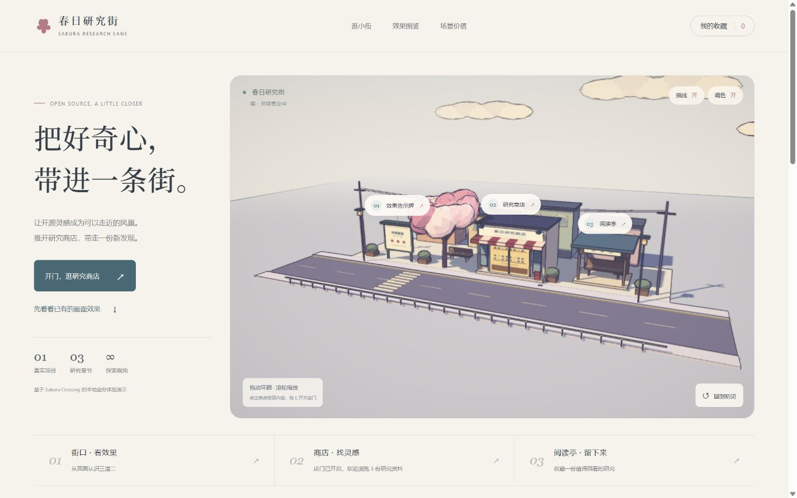
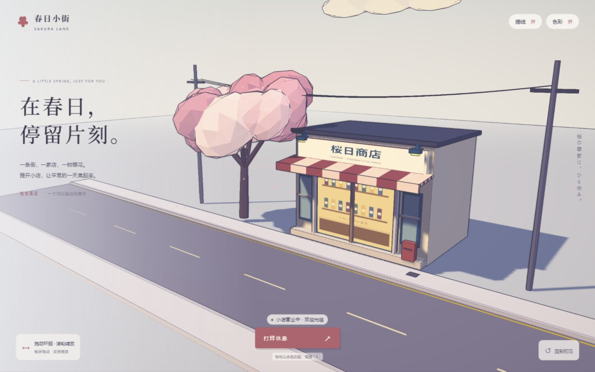
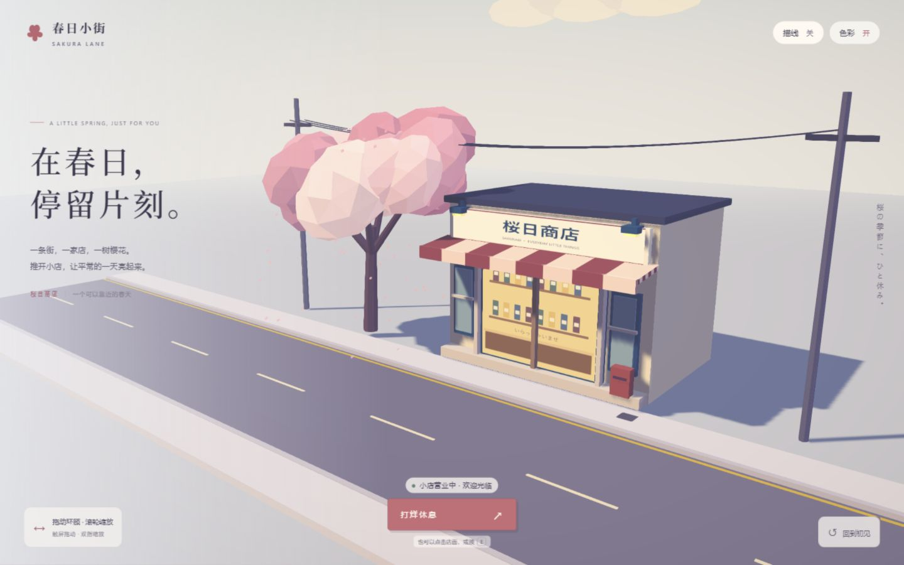
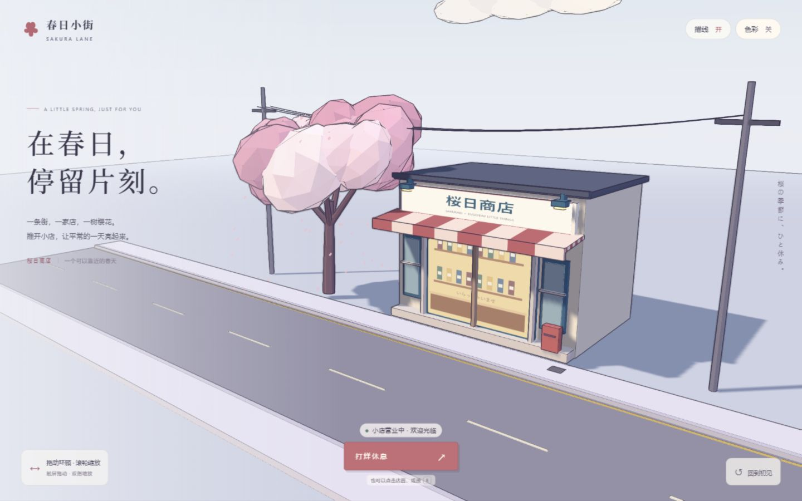
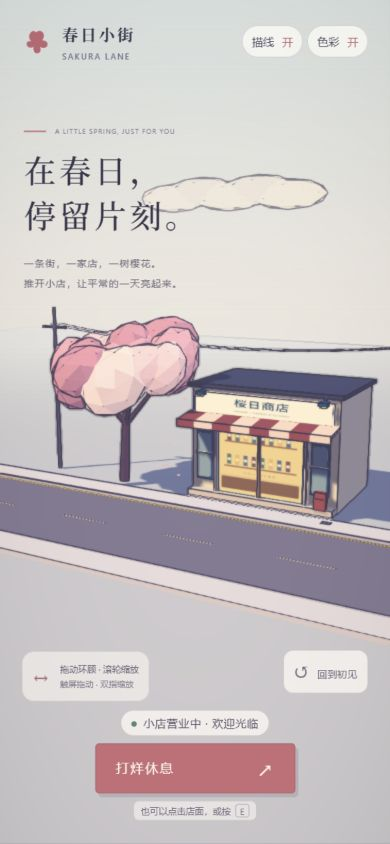

# 本地演示截图

## 统一研究入口（2026-10-11）

以下为本地浏览器真实截图。统一页将樱花小街、雨夜城市、模块提取与后续扩展汇总在同一入口，效果图来自实际渲染；未使用生成图替代运行证据。

| 文件 | 条件与用途 |
| --- | --- |
| [hub-home.jpg](hub-home.jpg) | 默认桌面窗口；研究首页、真实雨街封面、章节导航与复用结论 |
| [hub-live.jpg](hub-live.jpg) | 桌面页内载入樱花街雨天；同屏显示 WebGPU 状态及晴雨、雨滴、湿地反射控制 |
| [hub-mobile.jpg](hub-mobile.jpg) | 生产子路径首页，390 × 844 浏览器视口仿真 |
| [hub-reader-mobile.jpg](hub-reader-mobile.jpg) | 相同窄屏条件下的完整中文 API 阅读器，参数表可在自身区域滚动 |
| [hub-sunny.jpg](hub-sunny.jpg) / [hub-rainy.jpg](hub-rainy.jpg) | 同一个樱花街视角的实际晴雨画布；用于滑动对照与索引封面 |

页面其余对照复用此前的描线、湿地强度实拍和 012 原城市实拍。原城市辉光对照来自不同截图帧，页面明确说明；历史长图封面仍是概念插画，不作为运行证据。截图像素尺寸可能与浏览器视口不同，未验证手机硬件或真实触屏。

[入口内容](../notes/research-summary.md) · [本轮验证记录](../notes/research-hub-validation.md)

## 第七阶段 一分钟中文镜头导览

2026-10-11 本地浏览器真实渲染截图，沿用 001 程序化场景与三渲二管线，新增镜头导览、中文字幕与控制面板。未使用生成图或桃源的场景素材。

| 文件 | 条件 |
| --- | --- |
| [tour-street.jpg](tour-street.jpg) | 街口镜头，约 00:05 暂停 |
| [tour-shop.jpg](tour-shop.jpg) | 跳到商店并暂停在 00:20，卷帘门开启 |
| [tour-pavilion.jpg](tour-pavilion.jpg) | 跳到阅读亭并暂停在 00:40，显示本机收藏说明 |
| [tour-free.jpg](tour-free.jpg) | 从阅读亭切到自由探索，再实际拖动镜头 |
| [tour-complete.jpg](tour-complete.jpg) | 构建产物自动完成完整路线，01:00 / 01:00，镜头已释放 |

截图采集于浏览器当前桌面窗口，没有指定设备尺寸。手机与真实触屏硬件未验证。[导览实现与实测记录](../notes/tour.md)。

## 第六阶段 研究总览图

2026-10-10 将当前研究收束为一张长图，覆盖源库能力、本地扩展、六步渲染原理、世界组织、真实效果、七条产品方向、素材复用、个人价值，以及验证、性能和授权边界。源码依据、作者发布图、本地实测和后续设想明确标记；没有将 AI 配景作为运行证据。

| 文件 | 用途与来源 |
| --- | --- |
| [research-overview.png](research-overview.png) | 3840 × 8948 高清 PNG，可分享和放大阅读；中文文字由矢量排版生成 |
| [research-overview.svg](research-overview.svg) | 1920 × 4474 SVG，文字可编辑，图片内嵌，离线查看；显示中文需本机支持中文字体 |
| [overview-banner.png](overview-banner.png) | 内置 ImageGen 生成的概念插画，作为顶部配景；不是上游或本地实拍 |
| [upstream-crossing.jpg](upstream-crossing.jpg) | 固定上游 commit 中 `docs/hero-1-crossing.jpg` 的原文件，总览图中的铁路道口效果模块 |
| [upstream-shopping-street.jpg](upstream-shopping-street.jpg) | 同版本 `docs/hero-2-shotengai.jpg` 原文件，保留为补充参考，未放入当前总览图 |
| [overview-export.json](overview-export.json) | 导出尺寸与 PNG/SVG SHA-256，用于检查内容同步 |
| [overview-browser.jpg](overview-browser.jpg) | 默认桌面视口下的总览网页全页实拍，包含工具栏、完整图稿与说明 |

上游图来自 [固定版本 README](https://github.com/Kenton-GMI/sakura-crossing/blob/de01898e89c7f6ab3fad93fa802f0f5ac66fbd81/README.md)，是作者发布效果，不代表本地已操作完整上游世界。图中本地四帧分别来自 `business-cover.jpg`、`lab-forest.jpg`、`lab-square.jpg` 和 `builder-desktop.jpg` 的场景局部，不修改其场景内容。

内容来自 [overview-content.json](../notes/overview-content.json)，排版与输出由 [render-overview.mjs](../web/scripts/render-overview.mjs) 生成。插画的完整提示词保留在 [overview-imagegen-prompt.txt](../notes/overview-imagegen-prompt.txt)。浏览器的放大、下载和维护命令见 [Web 说明](../web/README.md#研究总览图)。

## 第五阶段 最小小镇搭建器

2026-10-10 的真实浏览器实拍，默认小镇含 4 栋房屋、6 棵树、3 段道路，描线与调色开启。可编辑对象沿用技术实验组件。

| 文件 | 条件 |
| --- | --- |
| [builder-desktop.jpg](builder-desktop.jpg) | 默认桌面视口 1280 × 720，滚动到工作区，展示组件、画布与选中物件设置 |
| [builder-mobile.jpg](builder-mobile.jpg) | 浏览器视口 390 × 844 仿真，工作区与完整小镇构图；未验证真实触屏硬件 |

截图可能扣除滚动条和浏览器边缘，不将视口尺寸视为图片像素尺寸。[搭建器操作与验证](../notes/builder.md)。

## 第四阶段 能力理解与产品扩展

2026-10-10 的真实网页截图。说明页沿用三场景实验的实拍图作为视觉参考，产品方案用文字说明；没有将规划中的游戏、搭建器或多人功能标成已实现。

| 文件 | 条件 |
| --- | --- |
| [directions-overview.jpg](directions-overview.jpg) | 默认桌面视口 1280 × 720，能力理解开头与三个现有场景入口 |
| [directions-products.jpg](directions-products.jpg) | 默认桌面，七个方向的筛选与探索游戏详情 |
| [directions-mobile.jpg](directions-mobile.jpg) | 浏览器视口 390 × 844 仿真，教育文化方向详情；未验证真实触屏硬件 |

视口尺寸是验证条件，截图导出可能扣除滚动条与浏览器边缘，不将视口尺寸作为图片像素尺寸。

[理解与扩展页验证记录](../notes/product-directions-validation.md)

## 第三阶段：三场景技术实验

以下 JPEG 为 2026-10-10 在本地生产子目录下的真实 WebGL 页面截图，使用共用组件、默认风格、10 栋建筑和种子 2411。桌面截图滚动到工作区，保留场景切换、风格参数与实时性能指标；指标只代表截图时的浏览器状态。

| 文件 | 条件 |
| --- | --- |
| [lab-street.jpg](lab-street.jpg) | 验证视口 1440 × 900，图片 1425 × 891；樱花商业街与风格工作台 |
| [lab-forest.jpg](lab-forest.jpg) | 验证视口 1440 × 900，图片 1425 × 891；林间村落，同一组组件与管线 |
| [lab-square.jpg](lab-square.jpg) | 验证视口 1440 × 900，图片 1425 × 891；围合小广场与中央水景 |
| [lab-mobile.jpg](lab-mobile.jpg) | 验证视口 390 × 844，图片 375 × 812；小广场窄屏布局，控制面板在下方；未验证真实触屏硬件 |

[技术实验与实际采样](../notes/lab.md)

## 第二阶段：完整研究街网页

以下截图来自同日扩展后的本地生产构建，保留三渲二效果。新增图片用于根索引封面和业务记录；没有覆盖第一阶段的效果对照素材。

| 文件 | 条件 |
| --- | --- |
| [business-cover.jpg](business-cover.jpg) | 1440 × 900，首页完整街景，店门打开，描线与调色开启 |
| [business-shop.jpg](business-shop.jpg) | 1440 × 900，研究商店面板，展示同一真实项目的三个章节 |
| [business-effects.jpg](business-effects.jpg) | 1440 × 900，效果图鉴与业务路径页面 |
| [business-mobile.jpg](business-mobile.jpg) | 390 × 844，窄屏首页与街景，店门打开；页面可继续纵向滚动 |

[业务设计与验证记录](../notes/business.md)

## 第一阶段：最小演示

以下为 2026-10-10 在 Codex 内嵌 Chromium 中运行本地生产构建时截取的 JPEG，不是上游截图或生成的效果示意。截图包含界面和实际 WebGL 场景；花瓣位置会随动画变化。

| 文件 | 条件 |
| --- | --- |
| [cover.jpg](cover.jpg) | 1440 × 900，店门开启，描线与调色开启 |
| [mobile.jpg](mobile.jpg) | 390 × 844，店门开启，描线与调色开启；仅代表窄屏布局，不代表真实触屏硬件验证 |
| [ink-off.jpg](ink-off.jpg) | 1440 × 900，店门开启，描线关闭、调色开启 |
| [grade-off.jpg](grade-off.jpg) | 1440 × 900，店门开启，描线开启、调色关闭；sRGB 输出仍保留 |

## 描线对照

| 开启描线 | 关闭描线 |
| --- | --- |
|  |  |

## 调色与窄屏

## 中文语音导览

2026-10-11 新增的 MiniMax 讲解成品位于 [tour-zh.mp3](../web/src/tour/audio/tour-zh.mp3)，32 kHz 单声道 MP3，约 961 kB。六段讲解在 60 秒时间线内完整播放，段间留有观察场景的停顿。音色为 MiniMax 系统“温暖少女”；讲解稿为本研究原创，详细参数与文件摘要见 [生成记录](../notes/tour-voice-generation.json)。

[tour-voice-pavilion.jpg](tour-voice-pavilion.jpg) 是带语音版本的实际本地网页截图：选择阅读亭后，媒体、字幕与镜头同停在 00:40，界面显示“中文语音 + 字幕”和声音开关。截图本身不能证明听感，播放器时间与暂停状态的实测见 [导览记录](../notes/tour.md)。

[tour-voice-complete.jpg](tour-voice-complete.jpg) 是语音版生产构建自然顺播一分钟后的实拍：01:00 / 01:00，完成提示，镜头已释放。媒体同时停在 60 秒，原始 DOM 采样见 [完成记录](../notes/tour-voice-browser.json)。

[返回项目说明](../README.md)

## AI 小镇游戏实拍

- `ai-town-decisions.png`：真实 OpenAI 两轮分工后的获胜画面、角色位置和决策记录。对应 `../notes/ai-town-openai-session.json`；不是概念图。
- `ai-town-ready.png`：修复后的 OpenAI 准备局，计时为 04:00，入场按钮可用，留给玩家自己驾驶。

## 晴雨漫游实拍（2026-10-11）

- `weather-sunny.jpg` / `weather-rainy.jpg`：同一个 `weather.html` 页的晴天与雨天完整截图；雨天实际渲染 GPU 雨线、原建筑/樱花的路面倒影，标线和人行道仍可见。
- `weather-walk.jpg`：进入阅读亭后的第一人称实拍，保留动画描线、色阶与中文控制。
- `weather-mobile.jpg`：390 × 844 浏览器视口仿真，全页没有横向溢出；不是实际手机硬件测试。
- `weather-reflection-zero.jpg` / `weather-reflection-strong.jpg`：生产子目录雨天场景，反射强度 0% / 120% 的实际对照。
- `weather-style-off.jpg`：晴天关闭描线与调色的实际对照，之后已恢复默认风格。

全部为本地浏览器截图，未使用生成图片代替功能验证。操作、碰撞与包摘要检查见 [接入记录](../notes/weather-reuse.md)。
