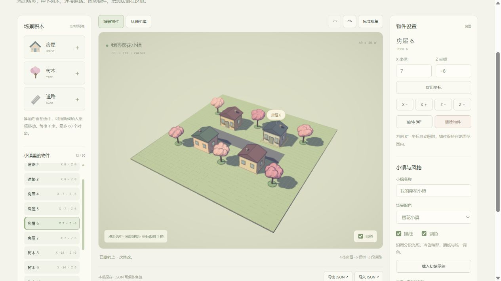

# 三渲二小镇搭建器 · 最小创作实验

2026-10-10，本地实现并验证。启动 Web 应用后访问 `http://127.0.0.1:5180/builder.html`。尚未部署；没有在线共享服务。



## 当前可以做什么

在 40 × 40 米平地上添加、删除和移动房屋、树木、道路。默认示例包含 4 栋房屋、6 棵树、3 段道路；最多 60 个对象是这个版本的编辑上限，没有据此声明目标设备的性能容量。

点击左侧组件添加，画布点击选中后直接拖动；左侧清单、右侧坐标与 X/Z 微调按钮提供另一条完整操作路径。位置吸附到 1 米网格，足迹保持在地面范围内，旋转以 90° 为单位。方向键微调，Delete 删除，Ctrl+Z 撤销，Ctrl+Shift+Z 或 Ctrl+Y 重做，Esc 取消当前拖动。历史保存最近 50 次修改；刷新后不恢复撤销历史。

切换“环顾小镇”可拖动镜头、滚轮缩放，“标准视角”回到初始构图。编辑与镜头操作分开。支持樱花、林间两种配色以及描线、调色开关，默认完整三渲二效果；网格是辅助视图，未写入存档。

## 保存和复用

“保存小镇”将名称、布局、配色和风格存到当前浏览器的 `localStorage`，键为 `sakura-town-builder:save:v1`。刷新自动恢复，重新加载回到上次保存；重新加载前的修改可以通过撤销找回。未保存的编辑不会覆盖旧存档。不同端口、域名、浏览器的存储相互独立，可用 JSON 备份搬运。

“导出 JSON”下载 `sakura-town.json`，导出当前布局，不要求先保存。“导入 JSON”先校验再替换当前小镇，可撤销，导入后仍需保存才能成为本机存档。文件上限 128 KiB；错误文件保留当前小镇。存储无法访问或写入失败时提示导出备份，编辑内容仍留在当前页面。

```json
{
  "format": "sakura-town",
  "version": 1,
  "name": "我的小镇",
  "theme": "spring",
  "style": { "ink": true, "grade": true },
  "nextId": 2,
  "objects": [
    { "id": "item-1", "type": "house", "x": 0, "z": 0, "rotation": 0, "seed": 73 }
  ]
}
```

稳定对象 ID 不能重复，编号小于 `nextId`。类型仅有 `house/tree/road`；坐标为整数，旋转 `0..3` 表示四个方向，种子控制同类组件的细节和配色。名称最长 40 字，支持空小镇。版本、类型、有限数值、边界和对象数均经过校验。这是搭建器自己的运行配置，与技术实验导出的测量配置、产品方向描述 JSON 分开；三种数据不能相互直接导入。未来修改协议需明确迁移规则。

## 实现与可扩展部分

`src/builder/model.js` 管理配置、校验、编辑动作、撤销历史和存储，独立于 Three.js。`world.js` 用 `lab/components.js` 的同一组房屋、树木、道路生成每个对象，并维护选择代理和足迹标记。拖动只更新对象组的位置和朝向，几何体保持复用；类型、种子或主题变化时才重建对应外观。删除或重建时释放对象资源。

`main.js` 连接输入、界面、射线拾取、地面交点、镜头和渲染；`style.css` 提供桌面与窄屏界面。标准视角根据小镇八个边界角点和屏幕比例计算镜头距离，雾的距离随之调整，避免竖屏裁掉场景或将远镜头画面冲淡。继续沿用固定 Three.js r180 的分段光照、冷色暗部、深度描线、调色与 FXAA 管线。本页内部像素预算为 220 万、缩放上限 1.5、阴影贴图 1024；没有将单次体验当作设备基准。

新增组件先加入类型与边界定义、校验规则、生成器和界面入口，再验证保存往返。后续可扩充尺寸与配色参数、多个模板、道路连接与避让提示、物件分组和地点内容绑定。AI 草案应先生成这个受约束的配置，校验后预览；AI 接入尚未实现。

本版本允许物件重叠，添加时尝试寻找空位置，拖动不做碰撞或自动避让；道路由固定片段拼接，不自动生成路网。尚无地形编辑、外部模型导入、角色行走、NPC、任务、多人同步、网页作品导出或云端共享。大型场景需要另行研究编辑粒度、实例化与性能预算。真实触屏硬件、低性能设备和存储权限拒绝的浏览器分支尚未实机验证。

## 实际验证

本地生产子目录 `/1010_codex_project/001-sakura-crossing/builder.html` 已在 Codex 内嵌 Chromium 中验证三类组件添加、坐标/按格移动、删除、撤销重做，以及房屋的画布直接拖动、旋转。拖动房屋从 `(7,-6)` 移到 `(12,-3)`，撤销恢复原坐标。删除树木和道路后撤销可找回。

保存 16 个对象的林间布局、关闭描线，新增对象后重新加载恢复为 16 个，刷新也恢复相同状态。实际输入名称后保存并导出，JSON 包含修改后的名称、位置与旋转；载入默认示例后重新导入备份，恢复名称、16 个对象、林间配色和风格。故意导入产品方向 JSON，页面提示格式错误，当前名称和布局保持原样。

390 × 844 浏览器视口仿真下，组件添加、X 微调和两次撤销通过，无横向溢出，标准视角完整容纳场景；这不代表真实触屏硬件验证。环顾模式可改变镜头，标准视角恢复。技术实验的街道、森林、广场均正常切换，控制台无警告或错误。技术实验与产品说明页的搭建器入口在生产子目录下可达；产品方向页显示当前已交付范围与后续缺口。

`npm.cmd run test:builder` 验证配置往返、边界、旋转、历史、空小镇、60 个上限、错误格式与存储异常；并在 Three.js 场景中验证移动复用几何体、同 ID 类型变更和删除后的资源释放。`npm.cmd run test:lab` 校验共用组件的三种配置与统计。生产构建通过，Three.js 主块约 549 kB 提示仍存在；需要在目标设备上继续评价加载与运行。

## 来源

上游固定版本为 `de01898e89c7f6ab3fad93fa802f0f5ac66fbd81`，引入渲染代码适用 MIT，版权 Kenton Wang 2026，原文和具体映射见 [来源说明](../web/THIRD_PARTY.md)。搭建器的模型、交互、界面和校验由本地编写，没有新增外部模型、图片、音乐或字体；本地新代码未另行指定许可证。

[返回笔记索引](README.md)
