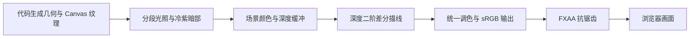

# Sakura Crossing 研究：能力、原理与复用价值

研究日期：2026-10-10。上游：[Kenton-GMI/sakura-crossing](https://github.com/Kenton-GMI/sakura-crossing)。固定版本：[`de01898e89c7f6ab3fad93fa802f0f5ac66fbd81`](https://github.com/Kenton-GMI/sakura-crossing/tree/de01898e89c7f6ab3fad93fa802f0f5ac66fbd81)。以下描述以此版本的源码为准，不代表已验证所有上游交互。

## 定位与能力

这是一个使用 Three.js 和 Vite 编写的完整创意前端作品。真实 3D 小镇经过风格化渲染，看起来接近二维日式动画背景。最直接的复用方式是修改场景源码或抽取渲染模块。

| 能力 | 源码依据 | 验证边界 |
| --- | --- | --- |
| 行走、奔跑、碰撞与地形跟随 | `src/core/player.js` | 已阅读实现；本次未完整漫游上游世界 |
| 售货机、卷帘门、猫、列车触发 | `src/world/vending.js`、`shop.js`、`props.js`、`index.js` | 已确认相关源码存在；未逐个操作所有上游交互 |
| 电动摩托上下车与骑行 | `src/world/ebike.js`、`src/core/player.js` | 已阅读关键控制逻辑；上游骑行未实测 |
| 列车与铁路道口联动 | `src/world/train.js`、`src/world/index.js` | 当前实现由列车在环线上的实际位置驱动道口状态，不能仅按 README 的定时描述理解 |
| 星球视角 | `src/main.js`、`src/world/planet.js` | 上游页面可加载，按 P 后视角状态提示有响应 |
| 代码生成模型与招牌 | `src/world/`、`src/core/textures.js` | 已核对生成代码；街区布局仍由作者设计 |

上游模型生成使用可复用组件和固定随机种子。它没有提供“输入自然语言自动生成任意小镇”的运行时功能。程序化生成降低素材依赖，但不会替代布局、构图、配色和设计判断。

## 三渲二渲染原理

1. **光照色阶**：`toon.js` 使用 `MeshToonMaterial` 与最近邻采样的渐变纹理，让光照落在少量明暗档位；通过 `onBeforeCompile` 修改 toon BRDF，把暗部推向冷紫色。
2. **有颜色的阴影**：暖主光、强冷补光、较弱反弹光和紫色地面半球光共同维持暗部细节。它的动画感由色彩和明暗组织共同产生。
3. **屏幕空间描线**：`post.js` 读取线性化深度，计算水平、垂直方向的二阶差分，并按深度归一化；凸轮廓更重，凹角更轻，远处描线衰减。它是一种风格化近似，具体表现还与镜头、阈值、分辨率有关。
4. **重点物体描边**：`outline.js` 使用背面外壳，在裁剪空间偏移轮廓，让重点道具获得较稳定的屏幕宽度。
5. **统一后处理**：调色把暗部偏紫、高光偏暖，略抬黑位，随后执行 linear → sRGB 和 FXAA。色彩转换即使关闭风格化调色也必须保留，否则会把色彩空间错误误认为风格差异。

原始渲染文件：[toon.js](https://github.com/Kenton-GMI/sakura-crossing/blob/de01898e89c7f6ab3fad93fa802f0f5ac66fbd81/src/core/toon.js)、[post.js](https://github.com/Kenton-GMI/sakura-crossing/blob/de01898e89c7f6ab3fad93fa802f0f5ac66fbd81/src/core/post.js)、[outline.js](https://github.com/Kenton-GMI/sakura-crossing/blob/de01898e89c7f6ab3fad93fa802f0f5ac66fbd81/src/core/outline.js)。

## 世界组织与球面映射

上游先在平面 XZ 坐标搭建场景，集中维护碰撞体、高度查询和交互对象，再在 `bakeToPlanet` 阶段映射到半径 160 米的球面。长几何需要先细分，避免轨道的直线弦穿过球体；带转轴的动画物件保持刚性并重新放置。赤道上的环形铁路可以通过整体旋转驱动列车。

山坡的可见几何与行走高度读取同一套格点数据，降低“看起来是路，实际上走不过去”的风险。湖水、沟渠与山坡采用不同方法，以适配不同尺度的地形。最值得学习的是可见几何、碰撞和高度查询之间的约束，而不是只看截图判断实现正确。

原始文件：[planet.js](https://github.com/Kenton-GMI/sakura-crossing/blob/de01898e89c7f6ab3fad93fa802f0f5ac66fbd81/src/world/planet.js)、[hills.js](https://github.com/Kenton-GMI/sakura-crossing/blob/de01898e89c7f6ab3fad93fa802f0f5ac66fbd81/src/world/hills.js)、[world/index.js](https://github.com/Kenton-GMI/sakura-crossing/blob/de01898e89c7f6ab3fad93fa802f0f5ac66fbd81/src/world/index.js)。

## 场景和效果的使用价值

| 使用方向 | 价值 | 额外工作 |
| --- | --- | --- |
| 创意首页、作品集 | 可探索、具有统一视觉记忆点 | 内容承载、可访问性、移动端和性能 |
| 品牌或活动展示 | 用空间、招牌、道具讲述主题 | 重新设计场景、信息路径与交互 |
| 轻量探索游戏 | 已有移动、碰撞、交互、骑行思路 | 任务、存档、反馈和游戏规则 |
| 风格化背景实验 | 用镜头和参数比较构图、描线、光照 | 拍摄工具与美术迭代 |
| 学习 Three.js | 串联模型生成、着色、后处理与场景组织 | 先缩小范围，避免直接接手整个世界 |

这些是基于源码的应用判断，不是已完成的商业案例。

## 对本研究集的意义

- **可迁移的渲染方法**：先提取色阶、描线和调色，随后换成自己的场景；本地最小演示验证这条路径。
- **一致的美术规则**：配色、材质和建筑组件集中管理，避免新增内容逐渐失去风格。
- **AI 协作的约束与证据**：`CLAUDE.md` 描述可执行的美术边界，`NEXT.md` 记录修改理由、故障和路线检查方法。值得借鉴的是写清规则、保留迭代依据和验证真实行为；不能仅凭这些文件断言整个项目的生成过程。

## 成本、局限与授权

上游 README 记录约 174 万三角形、1.9 万网格，并指出绘制调用是主要瓶颈。这是作者报告的规模，本次没有独立测量上游性能；`NEXT.md` 包含不同阶段的数据，不能把旧阶段数据当作最终版本的实测值。

当前完整体验主要面向键盘与鼠标。首次上游复现时，生产构建通过，页面可加载，但 Codex 内嵌浏览器在请求鼠标锁定后记录 Chromium `UnknownError`，菜单未关闭，因此不能声称完整漫游和骑行已验证。该现象也不能据此归因为场景性能问题。

上游源码适用 MIT；附带音乐另有授权。本地只引入明确列出的渲染代码与部分调色值，不引入音乐、完整世界或上游截图。详细来源与原始许可证见 [THIRD_PARTY.md](../web/THIRD_PARTY.md)。

## 本地实验选择

第一阶段实验限定为一条街、一家店、一棵樱花树、一个店门交互点。保留三渲二核心，采用平面场景与轨道镜头。列车、球面映射、摩托和大量街区均不属于此次实验范围。

选择轨道镜头，是为了把验证重点放在美术与渲染上，同时支持鼠标、触摸和键盘操作店门，减少对鼠标锁定的依赖。真实结果、截图与未验证项见 [最小演示实验记录](experiment.md)。

第二阶段将旧效果整理进网页，并扩展完整街景，用研究集内容发现演示产品应用。路径是查看主题、开门浏览、阅读真实笔记、本机收藏与回看，详见 [业务场景记录](business.md)。这验证了可操作流程，尚未测量商业转化效果。

后续已完成三场景实验与最小搭建器，当前研究收束为 [总览长图](../assets/research-overview.png)。总览额外引入固定版本 README 的上游发布图用于效果参考，明确与本地实拍和 AI 概念配景区分；上文的最小实验引入范围保留为当时记录。当前素材来源见 [THIRD_PARTY.md](../web/THIRD_PARTY.md)。
