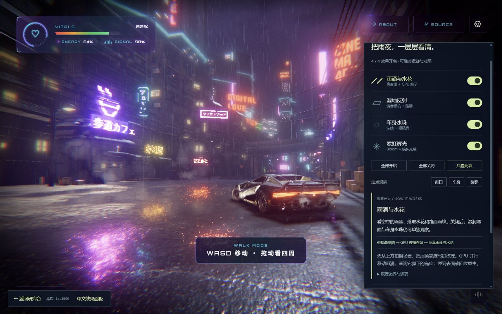
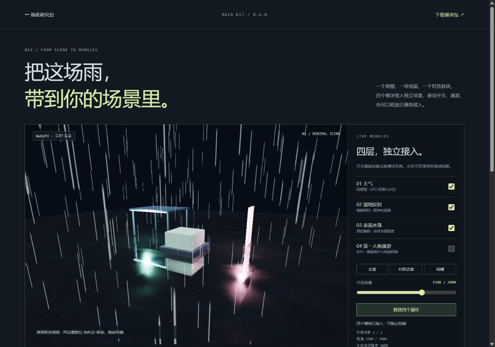

# 012 · Threejs-Punk · 雨夜渲染研究台

**统一入口：[樱花小街 × 雨夜渲染 · 场景研究手册](../001-sakura-crossing/web/research.html)**。运行 001 的 `npm run dev:weather` 后打开 http://127.0.0.1:5188/research.html，可集中阅读两条研究线、比较效果、打开全部演示、阅读完整 API 与下载模块。天气、湿地与漫游现已实际接入樱花街，详见 [跨项目验证](../001-sakura-crossing/notes/weather-reuse.md)。本页与原城市中文面板均提供回到统一入口的链接；独立演示服务仍使用 5192 / 5195。

已加入第一人称自由漫游，提供 **原库完整城市的中文效果面板** 与 **可逐层对照效果的原创街区**。在原库城市中，可边漫游边开关雨滴、湿地反射、车身水珠与辉光，查看对应原理，也可一键定位车身和倒影。原库保留模型、车辆、视频招牌、玻璃开场、烟雾和飞行器；原创街区保留十字路口、市集、站台与 BVH 行人碰撞。

天气、湿地反射、原创水珠和漫游已提取为 [Rain Kit 模块包](web/modules/rain-kit/README.md)。提供中文 API、独立最小场景、本地 tgz 和可复制宿主代码；原研究台已使用同一实现。真实包在独立目录安装、构建并打开验证，不依赖原街区或城市素材。



| 项目资料 | 内容 |
| --- | --- |
| 固定编号 | `012` |
| 上游仓库 | [ektogamat/threejs-conference](https://github.com/ektogamat/threejs-conference) |
| 研究版本 | [`8cc20593b2270e2ce832e7b7b44356705daddec4`](https://github.com/ektogamat/threejs-conference/tree/8cc20593b2270e2ce832e7b7b44356705daddec4) |
| 研究日期 | 2026-10-11 |
| 来源与授权 | 六个算法/控制模块按 MIT 改编；原库与独立授权素材只在忽略的 `vendor/` 本机运行，见 [逐项说明](web/THIRD_PARTY.md) |
| 实际状态 | 原库街区已本机运行；原创实验支持第一人称漫游与效果对照；兼容改动均有记录 |
| 本地演示 | [雨夜研究台](http://127.0.0.1:5192/) · [最小模块接入](http://127.0.0.1:5192/minimal.html) · [直接进入原库](http://127.0.0.1:5195/) · [GPU 碰撞检查](http://127.0.0.1:5192/verification.html) |
| 在线演示 | 尚未部署 |

## 能力与演示场景

| 观察场景 | 能看到的效果 | 可操作的对照 |
| --- | --- | --- |
| 霓虹街巷 | 雨丝、发光招牌、薄雾、反射与统一色调 | 三种色彩预设、Bloom 开关、镜头导览 |
| 屋顶落雨 | 雨棚截住落雨，水花贴在表面 | 实时 GPU 高度图、降雨开关、500–5000 可见粒子 |
| 湿地倒影 | 车辆与招牌映在路面，涟漪扰动反射 | 镜像反射开关 |
| 车身水珠 | 水珠使金属表面高光产生细微凸起与变化 | 水珠开关；关闭雨与 Bloom 后近景比较 |

原创实验中的建筑、车辆、招牌、纹理与水花图集由代码生成。观察模式使用 OrbitControls；第一人称模式改编上游 BVH 控制器，支持 WASD、Shift 快走、C 蹲下、鼠标拖动、可选鼠标锁定、全屏与方向按钮。建筑、车辆和边界有碰撞代理。市集、站台、避雨亭提供地点快捷入口。

点击顶部“原库完整体验”直接进入本机原库；ENTER 后桌面会展开中文效果面板，也可用 P 或左下角按钮展开 / 收起。面板有四个开关、全部开启 / 关闭、只看此项、街口 / 车身 / 倒影定位、反射强度与可见雨滴参数，以及当前技术的观察方法、原理流程、边界和源码链接。开关后可继续 WASD 移动，原库画布不被替换。

水珠改为独立于降雨；关闭时同时收零车漆和玻璃的水珠法线，打开时保留原图案和距离淡出。辉光控制 Bloom 与设备预算允许的镜头光晕；反射开关同时停止镜像更新。关闭这些效果后，原材质、灯光和其他后处理仍保留，详见 [原库面板接入记录](notes/upstream-controls.md)。

左下角“返回研究台”回到中文说明和原创实验街区。页面切换释放场景。本机适配还包括 Vite 8、localhost HTTP、12 FPS 视频 Canvas 上传，以及鼠标锁定被拒绝时的拖动降级，不声称文件与上游逐字节相同。

## 技术底层与原理

**雨滴碰撞**：俯视正交相机把世界位置写进半浮点高度纹理；GPU 计算着色器移动雨滴，以 XZ 查询对应 Y，触及最高表面后回收重生。实例化平面批量绘制朝向镜头的雨丝。高度图是一种 2.5D 近似，不能完整解决多层空间或侧向风雨。

**湿地反射**：镜像相机再渲染一次场景，用斜裁剪面过滤地面以下内容。反射纹理按粗糙度混合到地面，程序化涟漪扰动法线与采样坐标。它是视觉合成，尚非真实流体模拟。

**表面水珠**：原创椭圆掩码驱动有限差分法线与粗糙度，不创建逐颗水滴几何。它演示上游材质思路，未复制上游的滑落图案、拖尾和玻璃折射。

**渲染分工**：Three.js 管场景和资源，TSL 以 JavaScript 节点描述着色器，WebGPU 执行渲染与粒子计算，DOM 承载中文说明和控制。半分辨率反射、隔帧高度更新与半分辨率 Bloom 控制成本。

详细代码数据流、源码证据与边界见 [研究笔记](notes/research.md)。

## 可复用价值与扩展方向

### 已提取的模块

| 模块 | 公开函数 | 已有接入能力 |
| --- | --- | --- |
| 天气 | `createWeather` | 高度图与 GPU 降雨组合；停雨、雨量、可见数和容量预算 |
| 湿地 | `createWetGround` | 镜像更新、反射强度、雨纹、实例预算与贴图借用 |
| 水珠 | `createDropletMaterial` | 原创图案；UV、底色、金属度、粗糙度、强度与速度 |
| 漫游 | `createWalkControls` / `buildModelBvh` | WASD、拖动、触屏轴、蹲下、碰撞与输入清理 |

[最小接入示例](http://127.0.0.1:5192/minimal.html) 可开关、漫游、释放并重新接入。其他子项目可复制整个模块目录，或安装 [tgz](web/public/downloads/research-rain-kit-0.1.0.tgz)，从 `@research/rain-kit` 导入。锁定 Three.js 0.185.1 与 three-mesh-bvh 0.9.13；传统 WebGLRenderer 项目需要适配。接入代码、循环顺序、资源责任及边界见 [快速说明](web/modules/rain-kit/README.md) 和 [中文 API](web/modules/rain-kit/API.md)。



### 后续应用方向

对当前研究集，它补充了樱花小街之外的天气、湿润材质、镜面反射与 GPU 并行计算经验。优先复用各层的 `update`、setter、`dispose` 接口与效果对照方法，再接入已有内容和交互。

- **雨夜研究街**：为现有小街加入雨量、夜间招牌和湿地；需适配 WebGL / TSL 渲染接口。
- **产品材质展厅**：围绕自有车辆或产品切换干湿表面、灯光和镜头；需补产品信息与材质参数编辑。
- **天气实验台**：增加固定采样、设备预算和结果导出，形成可重复的效果比较。
- **轻量探索游戏**：已有 BVH 漫游基础，可继续补任务、存档与物体交互。

产品信息、任务与结果导出尚未实现，业务效果与商业收益尚未验证。

## 本地运行与验证

实际运行环境：Windows、Node.js 22.15.0、npm 10.9.2、Three.js 0.185.1、Vite 8.3.4；Codex 内置浏览器显示 WebGPU 后端。

```powershell
cd F:\codex_project\1010_codex_project\projects\012-threejs-conference\web
npm.cmd ci
npm.cmd run dev
```

`npm.cmd run dev` 同时启动研究台 5192 和原库 5195。首次运行从 GitHub 下载固定版本到忽略的 `vendor/` 并独立安装依赖；之后复用。仅启动原创实验用 `npm.cmd run dev:lab`，仅启动原库用 `npm.cmd run dev:upstream`。

研究台生产构建使用 `npm.cmd run build`，预览使用 `npm.cmd run preview`，端口 5194。原库构建用 `npm.cmd run dev:upstream -- --build`，产物仍在忽略目录内。没有模型 API 或环境变量；启动后两个场景的资源都由本机提供。

已实际验证四视角、四层开关、粒子数量、导览启停、重置、原理标签键盘切换、笔记下载，以及 390 × 844 手机尺寸布局。真实 GPU 检查在加入、移除和恢复雨棚三种状态均通过，保留 [回读结果](notes/gpu-verification.json)。构建与根目录完整性检查通过，详细过程和限制见 [实验记录](notes/experiment.md)。

新增漫游的五项碰撞测试与原库控制桥的五项检查通过。原库中文面板已实际验证四项对照、开关后的键盘移动、P 快捷键、三机位、参数输入与 390 × 844 布局，详见 [漫游升级记录](notes/walk-upgrade.md) 和 [中文面板验收](notes/upstream-controls.md)。页面 FPS 只表示当前窗口采样，不能作为跨设备基准。真实手机设备、WebGL2 兼容后端与公开部署仍待验证。

模块提取后共有 15 项自动检查通过，GPU 雨棚三状态回读、独立场景四项操作、释放再接入、tgz 独立安装与构建已实测，见 [模块提取与验收](notes/module-extraction.md)。打包使用 `npm.cmd run pack:kit`，独立消费者检查使用 `npm.cmd run test:kit-consumer`；包没有发布到 npm。

## 研究材料

- [Web 应用说明](web/README.md)
- [能力、原理与复用价值](notes/research.md)
- [模块快速接入](web/modules/rain-kit/README.md) · [中文 API](web/modules/rain-kit/API.md) · [提取与验收](notes/module-extraction.md)
- [实验记录](notes/experiment.md) · [真实截图](assets/README.md)
- [来源、改动与授权](web/THIRD_PARTY.md)
- [总项目索引](../../README.md)
