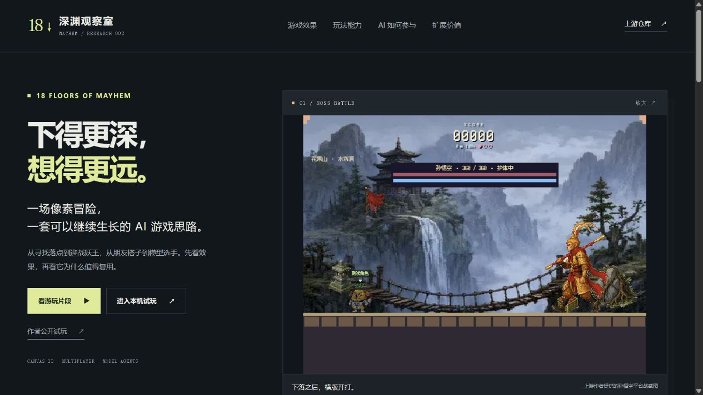
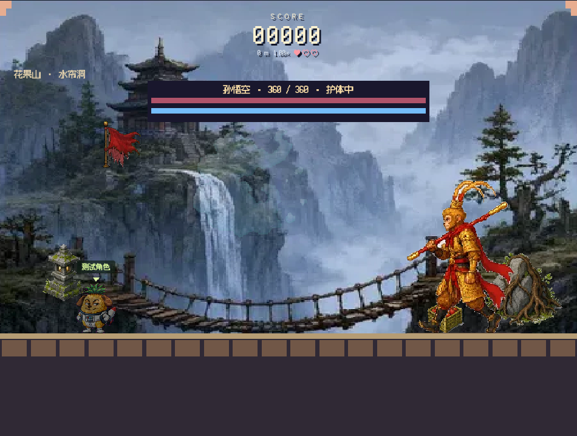

# 002 · 18 Floors of Mayhem · 像素下落与妖王战

这是一个可运行的浏览器像素游戏工程，包含程序地图、战斗、多人房间和模型 Agent。已完成源码分析、196 项上游测试和本地界面查看，并制作中文交互展示页「深渊观察室」。

## 2026-10-12 · 完整研究汇总

本次将我们形成的理解汇总到 [研究手册](web/README.md)：六类完整摘要、八类模块、五步 AI 执行链、三组实测、六种角色方向、应用场景、个人价值、扩展路线、问答与来源。入口：[在线研究手册](https://yydshly.github.io/1010_codex_project/002-18-floors-of-mayhem/research.html)。本机入口 `http://127.0.0.1:5182/research.html`；已完成 GitHub Pages 部署与公网核对。

核心理解：原库提供完整玩法与 AI 接入思路；模型选择有限策略，确定性规则负责动作和胜负。我们用这个方法，独立实现了机甲动态指挥和樱街守灯夜，验证敌军、教练、伙伴、NPC 与环境事件的不同用途。这些扩展不当作上游功能，也不能从单局推断长期或商业收益。


引导图沿用此前总览图的纸面绿色风格，为本项目重新排版；嵌入六张已有效果图，包括上游作者 Boss 资料和我们的本地大厅、模型观察室、机甲战场/动态指挥、小镇实拍。保留 [高清 PNG](assets/research-overview.png)、[矢量 SVG](assets/research-overview.svg)、[完整文字汇总](notes/research-summary.md)与跨项目证据快照。

网页可公开阅读、搜索资料、切换案例、放大图片、下载原始 JSON；真实游戏房间和模型接口仍需本机服务。历史章节中“尚未实现/尚未部署”描述初次研究阶段，本次最新结论以该汇总及发布验证记录为准。

## 先看效果

从 [Web 应用](web/README.md) 启动展示页：`cd projects/002-18-floors-of-mayhem/web`，执行 `npm.cmd run dev`，打开 `http://127.0.0.1:5182/`。

页面按「游戏效果 → 玩法能力 → AI 决策原理 → 扩展价值」组织内容，支持六类画面切换、动态片段暂停、图片放大、四种玩法说明和 AI 五步交互。原游戏在本机 3182 端口运行时，会出现试玩入口。展示页中的五步模型流程仍是说明示意；新增 [真实 AI 对战观察室](notes/ai-battle.md) 已接入 MiniMax 和当前 Codex 登录的 OpenAI，支持三方对照、决策与动作证据、逐步观察和实测回放。在 `web/` 执行 `npm.cmd run battle`，打开 `http://127.0.0.1:3183/`。



展示页已构建并完成桌面、手机尺寸和子路径检查；详细证据见 [展示页验证](notes/showcase.md)。静态研究与效果页已发布；模型房间仍仅本机。

| 项目资料 | 内容 |
| --- | --- |
| 固定编号 | `002` |
| 上游仓库 | [https://github.com/andyhuo520/18-floors-of-mayhem](https://github.com/andyhuo520/18-floors-of-mayhem) |
| 研究版本 | [`99d7215966762a13b17b54d36f9ae3e3b96f98df`](https://github.com/andyhuo520/18-floors-of-mayhem/tree/99d7215966762a13b17b54d36f9ae3e3b96f98df) |
| 上游提交时间 | 2026-09-24 06:58:34 UTC |
| 研究日期 | 2026-10-10 |
| 上游许可证 | 源码 MIT；图片、音频、字体与视频分别按来源说明 |
| 研究状态 | 研究中；真实模型决策与执行已验证；模型胜率、真人完整通关与公网联机待验证 |
| 本研究集演示 | [完整研究手册](https://yydshly.github.io/1010_codex_project/002-18-floors-of-mayhem/research.html)；静态发布，模型与房间仍在本机 |
| 作者试玩入口 | [Combos](https://combos.game/play?post_id=09d6a46e602dfeffd3f77178a6091f8c)，本次未验证实际游玩与公网联机 |

## 为什么研究

最值得借鉴的是完整的“行动 → 规则判定 → 反馈 → 奖励”循环、共享房间协议，以及“模型策略 + 本地执行器”的 Agent 架构。它能补充已有樱花小街的任务和参与机制；应用价值是本次研究判断，尚未验证商业效果。

## 研究目标

- [x] 固定上游版本，核对来源与运行要求，保留许可证原文。
- [x] 运行 196 项上游测试，全部通过。
- [x] 查看大厅、单人短局、结算、重开和 AI 配置，保存真实截图。
- [x] 分析游戏状态、地图生成、渲染、房间与模型 Agent。
- [x] 提出对樱花小街的复用路线；后续守灯夜与机甲原型已实测，多人小镇待实现。
- [ ] 真人完整通关、真实触屏设备与公网联机。
- [x] 真实 MiniMax / OpenAI 与规则 CPU 同房对照、模型决策、按键、落地和回放。
- [ ] 多局胜率、实际费用与复盘收益。
- [x] 编写自有中文 Web 展示页，验证交互、响应布局和原游戏本机入口。
- [x] 部署自有静态研究与效果页，并验证 HTTPS 页面、引导图与原文阅读。

## 运行与复现

本次上游检出在忽略提交的 `vendor/upstream/`，未修改上游代码。环境为 Windows PowerShell、Node.js `v22.15.0`、npm `10.9.2`。首次获取时从总仓库根目录执行：

```powershell
git clone --depth 1 --filter=blob:none --sparse https://github.com/andyhuo520/18-floors-of-mayhem.git projects/002-18-floors-of-mayhem/vendor/upstream
cd projects/002-18-floors-of-mayhem/vendor/upstream
git sparse-checkout set public shared worker test tools docs
git rev-parse HEAD
npm.cmd ci
npm.cmd test
$env:PORT = '3182'
npm.cmd start
```

上述步骤实际执行通过，当时 HEAD 已是记录版本。未来上游若变化，应先获取并检出固定 commit；该未来版本切换步骤未单独验证。打开 `http://127.0.0.1:3182/`，保持终端运行。本地应用不需要常规前端打包；Combos 发布构建需要个人绑定文件，本次未执行。

本机地址只供本机访问，其他设备与公网可达性尚未验证。详细边界见 [验证记录](notes/verification.md)。

## 关键发现

1. 支持下落机关、九章精英与 Boss、轻重攻击与角色技能、单人、人机、朋友房间、协作和观战。
2. 原生 Canvas 2D 组合程序背景、生成图集、天气与特效；与 001 的 Three.js 三渲二渲染不同。
3. 浏览器发按钮输入，服务端裁定位置与伤害；Node 与 Worker 共享 Room 协议。
4. 普通电脑是规则算法；模型 Agent 选择落点和道具策略，本地执行器负责控制，Boss 主要使用规则控制器。
5. “81 难”是九章各九条命名配置，章末 Boss 共九个；不能理解成 81 个独立制作的完整关卡。旧独立试炼源码仍保留，但本地入口重定向到首页。
6. 赛后“学习”是提示词记忆，未训练模型权重，也未证明记忆稳定提高分数。
7. 对已有研究街，优先借鉴任务状态、事件与奖励，再考虑多人和 NPC Agent；任务与行动 NPC 在守灯夜独立实现，多人小镇仍为方案。

六个问题、适用场景、实现证据与价值判断见 [完整研究](notes/research.md)，推进条件见 [复用路线](notes/reuse-roadmap.md)。

## 图片与演示




第一张是本次本地运行截图，第二张原样来自上游 `docs/孙悟空平台战.png`，作为作者效果资料。更多本地截图与来源见 [图片说明](assets/README.md) 和 [授权记录](THIRD_PARTY.md)。

自有中文展示页在 [web](web/README.md)，与未修改的上游游戏分开维护。展示页与完整研究页已经发布，登记表 `demo` 指向已核对的 HTTPS 研究入口。

## 研究材料

- [研究笔记与实验记录](notes/README.md)
- [六个问题的完整研究](notes/research.md)
- [实际验证与未验证边界](notes/verification.md)
- [真实 AI 对战、决策与执行实测](notes/ai-battle.md)
- [中文展示页与交互验证](notes/showcase.md)
- [复用路线与扩展方向](notes/reuse-roadmap.md)
- [上游来源与授权](THIRD_PARTY.md)
- [总项目索引](../../README.md)
- [研究流程](../../docs/research-workflow.md)
