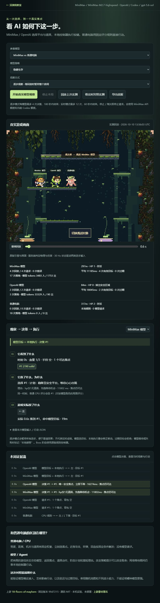

# AI 对战实测：看决策怎样变成动作

2026-10-10 已接通真实 MiniMax 与 OpenAI，并运行三方同房对照。不是固定回复或模型桩。打开本机观察室 `http://127.0.0.1:3183/`，默认回放已保存的实测，不发模型请求；点击「开始真实模型观察」才使用额度。

## 使用

在 `projects/002-18-floors-of-mayhem/web/` 执行 `npm.cmd run battle`。需要先按项目 README 获取固定版本上游并执行 `npm ci`。启动器复用已运行的 3182 游戏服务，或自动启动它；3183 提供自有观察室、同源模型桥接和实验房间。

MiniMax 从用户指定的 `F:/codex_project/.env.minimax` 读取 `MINIMAX_API_KEY`、`MINIMAX_API_BASE`，可选 `MINIMAX_MODEL`；可用 `MAYHEM_MINIMAX_ENV` 指定另一文件。密钥留在本机服务端，不进入前端或战报。此次使用 `MiniMax-M2.7-highspeed`。OpenAI 由已安装的 Codex CLI `app-server` 复用其 ChatGPT 登录，运行临时文本决策线程；未读取或导出 OAuth token。此次 CLI 返回的默认模型是 `gpt-5.6-sol`，不等同于当前聊天所用模型。

官方接口依据：[MiniMax OpenAI 兼容接口](https://platform.minimax.io/docs/api-reference/text-chat-openai)、[Codex App Server 与托管登录](https://developers.openai.com/codex/app-server)。本次实际执行了连通性请求与比赛决策，未仅凭模型列表判定可用。

## 两种观察方式

- **逐步观察**：等待模型时暂停整个房间，包含 CPU；模型返回后继续真实引擎的物理和输入。最多每模型 4 次请求，游戏时间约每 2 秒再次观察，最多 180 秒墙钟时间。提前淘汰即停止该模型，全部模型完成或淘汰后再执行一段即结束。用于看因果，不能当作实时成绩。
- **实时对照**：世界不停，网络等待时本地控制器接管。最多每模型 12 次请求，最多 60 秒墙钟观察（含建立连接与倒计时的少量额外时间）。游戏逻辑时间与墙钟时间不同，提前停止不等于正式比赛结束。
- **实测回放**：用存下来的服务端游戏状态重放原版画面，进度条可拖动；不是重新调用模型。证据流中的模型决策可点击，显示原始观察、行动 JSON、实际按键与后续落地。可切换 CPU 查看固定评分，也可导出完整 JSON。

本次采用 timed 竞速房间；不是九章 Boss 通关或完成大乱斗胜负评测。模型决定落点和道具，本地执行器会修正空中对位；Boss 阶段仍由规则控制器执行。模型返回的 why 是简短行动理由，不是内部推理过程。统计「有效目标」表示通过观察范围和当前可达性校验，不保证一定落到目标。

## 实际结果

逐步观察记录：[`ai-battle-step.json`](../assets/ai-battle-step.json)，开始时间 13:56:03 UTC；手动停止，最后采样游戏时间约 25.6 秒。这次发现一个提前淘汰导致自动完成条件等待的问题，已修复并加入测试。

| 选手 | 成功回复 | 通过目标校验 | 平均等待 | 停止时状态 |
| --- | ---: | ---: | ---: | --- |
| MiniMax-M2.7-highspeed | 4 | 4 | 11,185 ms | 297 米、1 血、存活 |
| OpenAI / Codex gpt-5.6-sol | 2 | 2 | 18,045 ms | 84 米、掉出安全区域淘汰 |
| 普通 CPU | 0 模型请求 | 不适用 | 本地规则 | 317 米、2 血、存活 |

可验证的行动链：

1. 两个模型首次均选择 #1；服务端记录本地执行器按左，约 0.55 秒落到 #1。
2. 游戏时间约 2.0 秒，MiniMax 选 #2，同一角色局面按 CPU 评分会选 #4；OpenAI 选 #4，同一角色局面 CPU 会选 #2。三个角色位置不同，不能把两种反事实评分当成完全相同局面。
3. MiniMax 第 4 次选择 #6，服务端约 6.72 秒记录落到 #6。第 2 次选 #2 后实际落到 #4/#3，体现执行器修正与未命中目标，不能宣称全部选择都成功到达。
4. OpenAI 第二次选 #4 后先落到 #2，随后淘汰。没有因为使用大模型就保证更强。

实时记录：[`ai-battle-realtime.json`](../assets/ai-battle-realtime.json)，开始时间 13:51:29 UTC，观察达到墙钟上限时停止，最后采样游戏时间约 36.8 秒。MiniMax 5 次成功回复、平均 9,816 ms；OpenAI 3 次、平均 15,142 ms；8 个落点回复均已过期，被拒绝并交回本地控制器。剩余请求在停止时取消。没有掩盖实时延迟问题，也没有把接管动作说成模型成功控制。

Token 记录是接口报告的数量，不是费用估算；Codex 输入包含平台上下文开销。未测价格、稳定胜率、复盘收益或跨局记忆。

## 实现与来源

上游固定 SHA `99d7215966762a13b17b54d36f9ae3e3b96f98df`、源码 MIT；没有修改 `vendor/upstream/`。观察室复用 `Room`、游戏引擎、`Agent`、`observe`、`controllerTick`、`cpuInput` 与原始渲染资源。自有模块在 `web/src/battle*`、`web/scripts/model-bridge.mjs`、`lab-rooms.mjs`、`battle-server.mjs`。实验房间新增全房暂停；通过响应时追加 CSS/消息桥接将原版画面嵌入观察室，回放兼容性修正只作用于自有服务响应。上游素材署名仍见 [授权记录](../THIRD_PARTY.md)。

两类选手都使用普通 WebSocket 输入包，服务端裁定物理与伤害。实验中双方按约 30 Hz 服务端快照执行输入；上游离线 CPU 原本每物理帧调用，不能把此次采样等同于所有原版 CPU 表现。模型能力限于上游动作协议：落点、使用/投掷道具、目标与计划；未加入模型拳击或独立 Boss 推理。

## 验证证据

- 真实浏览器三方比赛：两家真实接口回复、目标校验、控制输入、落地、淘汰、停止请求。
- 回放、选手切换、CPU 固定评分、决策点击、原始 JSON 与导出检查。
- 新增 6 项 Node 测试：幻觉/过期目标拒绝、暂停范围、提前淘汰的完成条件、Codex 失败与工具请求处理、MiniMax 官方地址校验，以及真实 WebSocket Room 暂停/恢复物理时间；全部通过。
- `npm.cmd run check`、`npm.cmd run build` 与根 `npm.cmd run check` 通过。

还未验证：大乱斗完整胜负、Boss 模型策略、真人完整通关、公网联机、规模化多局评测、复盘收益。尚未部署。
