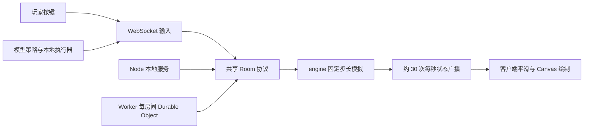

# 18 Floors of Mayhem：六个问题的研究

> 阶段说明：此文件保留 2026-10-10 初次源码研究。模型 API 后来已实测；机甲和小镇独立扩展已实现。最新结论见 [完整研究汇总](research-summary.md)，原始证据见对应案例记录。

> 后续实测：真实 MiniMax / OpenAI 已接入，可查看决策、按键与落地；实时延迟和逐步观察结果见 [AI 对战实测](ai-battle.md)。以下关于模型竞技收益的判断仍不构成胜率结论。

研究日期：2026-10-10。固定上游 commit：`99d7215966762a13b17b54d36f9ae3e3b96f98df`。本文以当前源码为主，开发历史只解释迭代。应用场景与扩展价值属于研究判断，尚未获得用户研究或商业数据支持。

## 1. 能力是什么

它提供一整套浏览器游戏工程：前端游戏、共享规则、本地 WebSocket 服务、云端房间后端、素材处理、回归测试，以及独立的视频剪辑工程。主游戏运行依赖只有 `ws`，前端使用原生 HTML/CSS/JavaScript 与 ES modules，没有 React、Phaser 或 Unity。

| 能力 | 当前实现 | 验证范围 |
| --- | --- | --- |
| 下落与机关 | 种子地图、移动/易碎/弹簧/传送带/尖刺/跷跷板、危险线和补给 | 源码、测试、单人短局 |
| 九章战斗 | 探索、精英、封闭平台 Boss 战、轻重击、投掷、射击、方向组合技能、秘宝与战利品 | 源码与自动测试；未真人完整通关 |
| 参与方式 | 单人、四个规则电脑、朋友房间、协作、乱斗、限时赛与观战 | 源码与真实本地 WebSocket 自动测试 |
| 外观与反馈 | 五个固定角色、自定义捏脸、场景巡游、音效、称号、领奖台与海报 | 大厅/结算已查看；海报下载未实测 |
| 本机记录 | 单槽手动存档、个人最佳、图鉴进度和模型战绩 | 源码与测试；无云端账号存档 |
| 模型实验台 | 模型、人格、可选画面观察、决策流、Token/延迟统计、赛后复盘 | 配置界面、源码和模拟接口测试；真实模型未实测 |

房间最多 12 位实际玩家，AI 配置界面目前提供 6 个席位，观众不占实际玩家席位。自动测试的 12 客户端不是 12 位真人公网体验证明。

必须区分普通电脑与模型 Agent。`cpu.js` 使用平台评分、移动控制与战斗规则，无需 API key；`ai/agent.js` 调用外部模型选择落点和道具策略。适配器包含 GLM、DeepSeek、OpenAI、Anthropic、TypeSafe 与自定义端点，但预置模型名不代表当前实际可用，需通过拉取模型列表和测试连通检查账号与接口。

## 2. 效果是什么

效果来自像素角色、细致的场景底图、程序天气、前景巨物、动作图集、受伤与死亡反馈、复古音频和结算仪式。大厅巡游九章场景；下落阶段以深井画面阅读落点，章末切入横版平台战。角色技能和 Boss 起手、攻击、受击、破防、倒地通过状态驱动。

本次实际查看了首次引导、大厅角色选择与场景巡游、单人倒计时、危险线淘汰、19 米/190 分结算、称号与原角色头像、重开/返回大厅、AI 六席配置。浏览器 warn/error 日志为空；短局未证明长时间控制手感或完整关卡难度。Boss 图片使用作者提供的截图，明确不是本次通关截图。

“81 难”的准确解释：当前主流程 `CAMPAIGN_TRIALS` 是九章各九条命名配置，每章六个探索段、两个精英段和一个 Boss 条目，共九个章末 Boss。探索复用地图并改变环境约束，不是 81 个独立制作的完整关卡。首次 Boss 要求深度至少 36 层、游戏时间至少 60 秒，再经过 3 秒入场；后续深度门槛相隔 36 层。九位 Boss 击败后会通关结算，因此旧界面的“没有终点”不能描述所有当前主流程。

旧 `trial-engine.js` 还保留九种 Boss × 九类约束的独立试炼组合，其测试仍执行，但本地 `/trials.html` 已重定向到首页。不能用旧模块测试数宣称首页提供了 81 个独立 Boss。

## 3. 底层原理是什么

### 渲染

主画布逻辑尺寸 `900 × 680`，程序背景在 `300 × 227` 缓冲画布绘制，关闭图像平滑后放大；生成场景、角色和特效图集作为素材层参与绘制。背景缓存目标约 30Hz，角色和物理按各自时钟推进。分层视差、天气、粒子、落地形变与受伤抖动提供动态感，并限制粒子/日志数量。

这是 Canvas 2D 图像组合。效果取决于源图、动作、配色、分层与运动，不是只给页面加一个像素滤镜，也不是 Three.js 三渲二。素材优先与程序绘制回退共存，生成图片不参与物理判定。

### 物理、地图与状态机

`makeGame` 构造纯数据状态，`step(game, inputs, dt = 1/60)` 推进模拟。单人局用 `requestAnimationFrame` 收集时间并通过累加器执行固定步长；多人局由服务端时钟推进。状态包括位置、速度、生命、无敌、装备、平台、弹幕、章节和事件，渲染读取状态呈现。

地图采用公共种子与线性同余随机数，按路线模板生成前方平台并回收过期对象。相邻平台偏移、危险区侧路与有界事件有测试，但不意味着所有操作与机关时刻都保证存活。基础滚动速度是 `80 + 180 × (1 − exp(−camera / 6000))`，再乘难度系数；镜头由共享滚动推进，不由领先玩家拖动。

章节、协作、乱斗、Boss、技能与奖励模块共同修改游戏状态。Boss 场封闭地板，蓝色架势与红色生命分开，破防产生实际停攻和伤害窗口。事件序号驱动 HUD、声音、战报和结算，避免只画特效而没有真实规则。

### 联机

浏览器只发送按钮输入，由服务端裁定位置与伤害。`shared/room.js` 管理房主、加入、倒计时、模式、输入、重连和广播；Node 本地服务与 Worker 共用规则。目标约 60Hz 模拟、每两帧广播完整状态一次，实际频率受环境影响。完整状态方便调试，更大规模需要评估消息大小、序列化和网络成本；视觉平滑不等于完整公网延迟补偿。

重连使用随机私密令牌，每位玩家每局累计最多 8 秒等待，期间暂停比赛。令牌只在页面内存，刷新不恢复；服务器重启不恢复对局。Durable Object 持久化的是房间码占用，对局核心状态仍在内存，不能当成自动持久化的游戏数据库。

### 模型 Agent

Agent 是普通 WebSocket 玩家，经过同样服务端规则。观察器输出生命、背包、可达平台、危险和可见对手；可选 JPEG 画面用于视觉模型。模型返回目标平台 ID、道具动作、目标对手、短计划与理由。

模型负责较慢的策略选择，本地执行器依据最新状态包控制移动与落点，应对模型尚未回答、目标失效和危险线接近。Agent 默认间隔 800ms，界面按席位从 700ms 起配置；通常请求结束后再安排下一次，不是稳定每秒若干次调用。Boss 阶段直接转给 `bossCpuInput`，主要由规则策略驱动。

赛后根据名次、距离、伤害和道具使用生成短总结，保存本机，下局加入提示词；上一决策短计划也作为记忆传回。这是提示词记忆，没有训练模型权重，也未证明复盘一定提高分数。已有决策流、调用量、Token、耗时和本机战绩适合做观察工具，但不是通用模型榜单。

API key 位于页面内存，每次调用提交给本地 `/ai/complete`，服务再转给指定厂商；并不是 key 从未进入浏览器。Worker 没有此转发端点，公开试玩不能自动获得本地模型竞技能力。

### 制作工作流

Codex 与 Combos CLI 用于开发时迭代代码和素材。`art-jobs` 保留提示词、任务输入、生成结果和来源，切图工具分格、去背景和裁剪；`video` 是独立 Remotion 工程。游戏运行使用既有素材，不需要重新调用图片生成模型。

任务记录可追溯，不等于全部生产流程一键复现：素材生成仍依赖账号、模型和额度，历史说明提到的某些适配脚本未出现在当前 `tools/`。源码 MIT 也不自动覆盖全部生成图片、音频、字体与真人视频。

## 4. 使用场景是什么

| 场景 | 适用原因 | 待补/待验证 |
| --- | --- | --- |
| 学习 H5 游戏 | 渲染、物理、状态、规则、联机与结算形成完整循环 | 较大界面编排模块仍需理解与拆解 |
| 朋友/社群活动 | 房间码、协作、观战与称号适合短局互动 | 实际设备可达性、公网可靠性与活动容量 |
| 主题互动或作品集 | 可更换角色、章节、奖励与海报主题 | 自有素材授权、手机性能与内容质量 |
| 教学/科普闯关 | 章节配置与事件可承载任务反馈 | 学习内容、无障碍与教学效果 |
| AI 演示与实验 | 决策导致可见结果，并有日志与赛后复盘 | 固定种子、统一控制器、多局重复、预算与统计 |

这些是应用判断，尚无本次用户留存、商业转化或教学效果数据。大型在线服务需要的账号、匹配、持久化、公网运营和高并发仍需另行设计。

## 5. 可扩展方向是什么

优先扩展可测的玩法与配置：关卡配置/编辑器 → 角色成长与任务 → 可重复 AI 实验 → 稳定公网房间与云端数据。更换主题容易出视觉效果，但新增图片未必增加实际玩法。

AI 最值得做的对照是同一地图种子、同一执行器和预算下比较：规则基线、模型无记忆、模型带记忆；再比较结构化状态与附图观察。记录胜率、深度、失误原因、延迟与 Token，通过重复局区分策略收益和偶然性。当前单局战绩不足以比较模型整体能力。

工程可继续拆分较大的 `app.js`/`style.css`，补充内容 schema、资产清单、回放与结果导出。公网方向需要独立研究认证、模型转发边界、请求限制、持久化和重启恢复。以上尚未实现。

## 6. 对你的价值是什么

当前研究集已有 001 樱花小街、风格实验和小镇搭建器。001 侧重场景生成与三渲二表达，002 补充任务、参与、竞争/协作、奖励与 Agent 决策循环。

最容易形成可见成果：给研究街增加“访问三个地点并收集资料 → 达成进度 → 获得称号 → 本机保存”。借鉴事件、任务状态和结算逻辑，不必引入整套战斗、像素美术和物理。

下一层是共享房间协作完成街区任务，共用协议与权限思路，小镇坐标、碰撞、同步对象和交互需要另行实现。再下一层是 NPC Agent：把可访问地点与任务资源变成观察，让模型选目标、本地执行导航、事件反馈结果。

两个项目的渲染器不同，可复用任务与消息逻辑，像素图集不能直接成为 Three.js 的 3D 组件。研究回报是可复用实现和工程经验，尚不能推断商业收益。建议先完成一个可验证的街区任务循环，详见 [复用路线](reuse-roadmap.md)。

## 固定版本证据

- [README](https://github.com/andyhuo520/18-floors-of-mayhem/blob/99d7215966762a13b17b54d36f9ae3e3b96f98df/README.md) · [engine](https://github.com/andyhuo520/18-floors-of-mayhem/blob/99d7215966762a13b17b54d36f9ae3e3b96f98df/public/engine.js)
- [campaign：九章与 81 条配置](https://github.com/andyhuo520/18-floors-of-mayhem/blob/99d7215966762a13b17b54d36f9ae3e3b96f98df/public/campaign.js) · [Boss 平台战](https://github.com/andyhuo520/18-floors-of-mayhem/blob/99d7215966762a13b17b54d36f9ae3e3b96f98df/public/fall-boss.js)
- [app：输入与渲染编排](https://github.com/andyhuo520/18-floors-of-mayhem/blob/99d7215966762a13b17b54d36f9ae3e3b96f98df/public/app.js) · [程序像素画](https://github.com/andyhuo520/18-floors-of-mayhem/blob/99d7215966762a13b17b54d36f9ae3e3b96f98df/public/pixel-world.js)
- [共享房间](https://github.com/andyhuo520/18-floors-of-mayhem/blob/99d7215966762a13b17b54d36f9ae3e3b96f98df/shared/room.js) · [Node 服务](https://github.com/andyhuo520/18-floors-of-mayhem/blob/99d7215966762a13b17b54d36f9ae3e3b96f98df/server.js) · [Worker](https://github.com/andyhuo520/18-floors-of-mayhem/blob/99d7215966762a13b17b54d36f9ae3e3b96f98df/worker/index.js)
- [Agent](https://github.com/andyhuo520/18-floors-of-mayhem/blob/99d7215966762a13b17b54d36f9ae3e3b96f98df/public/ai/agent.js) · [控制器](https://github.com/andyhuo520/18-floors-of-mayhem/blob/99d7215966762a13b17b54d36f9ae3e3b96f98df/public/ai/controller.js) · [模型适配](https://github.com/andyhuo520/18-floors-of-mayhem/blob/99d7215966762a13b17b54d36f9ae3e3b96f98df/public/ai/providers.js)
- [开发历史](https://github.com/andyhuo520/18-floors-of-mayhem/blob/99d7215966762a13b17b54d36f9ae3e3b96f98df/docs/DEVELOPMENT_HISTORY.md) · [上游素材声明](UPSTREAM_ASSET_CREDITS.md) · [MIT 原文](UPSTREAM_LICENSE.txt)
