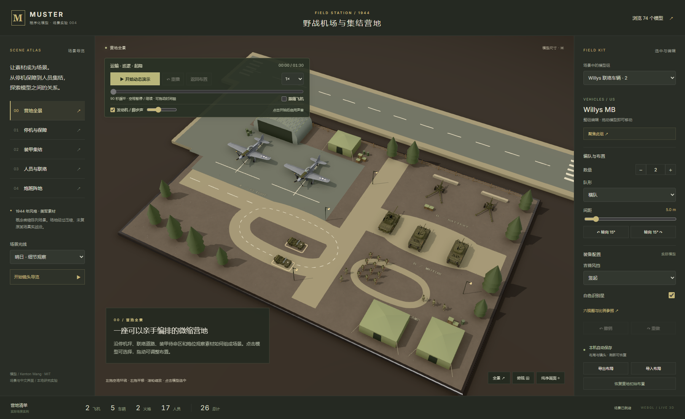
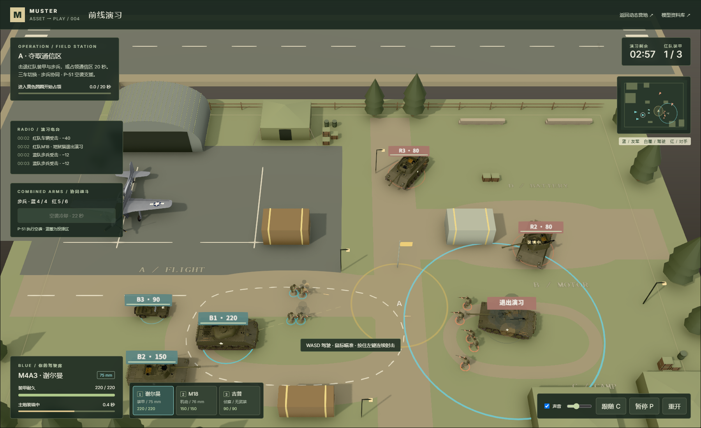
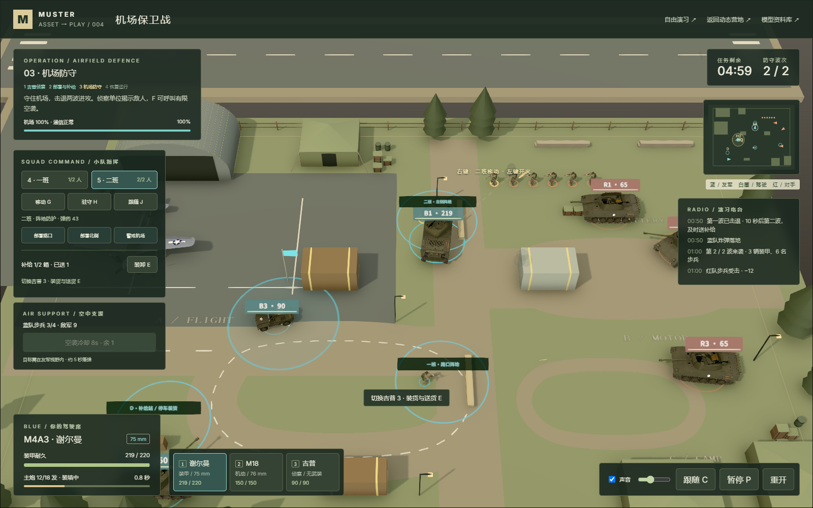
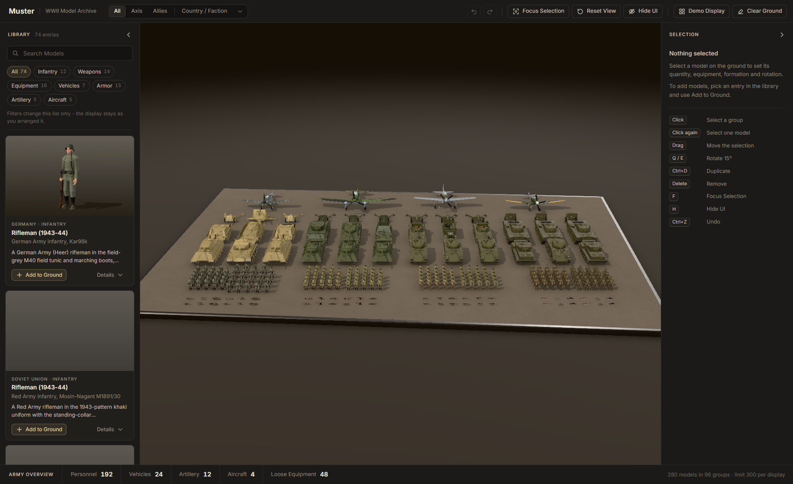
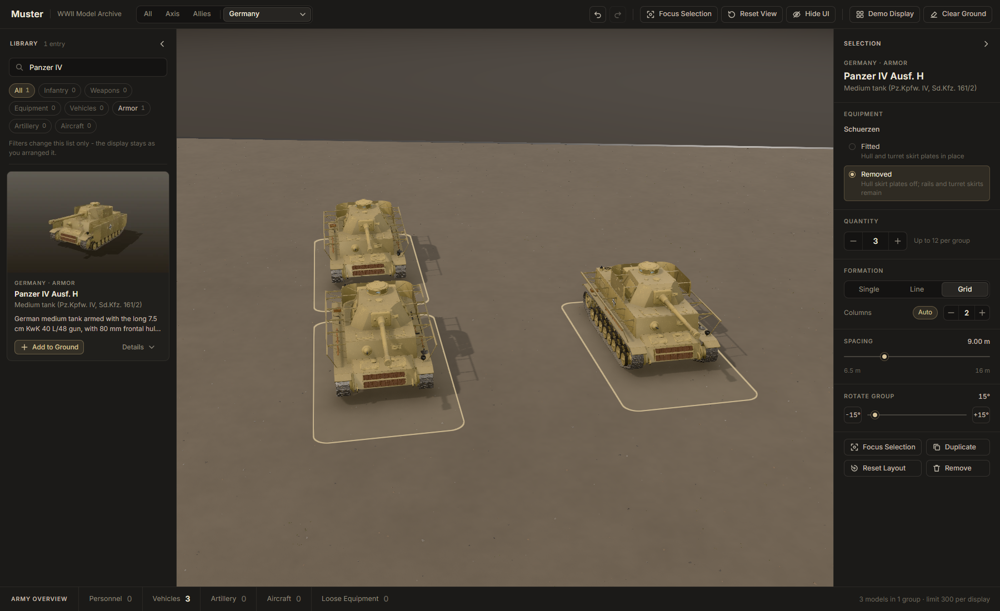
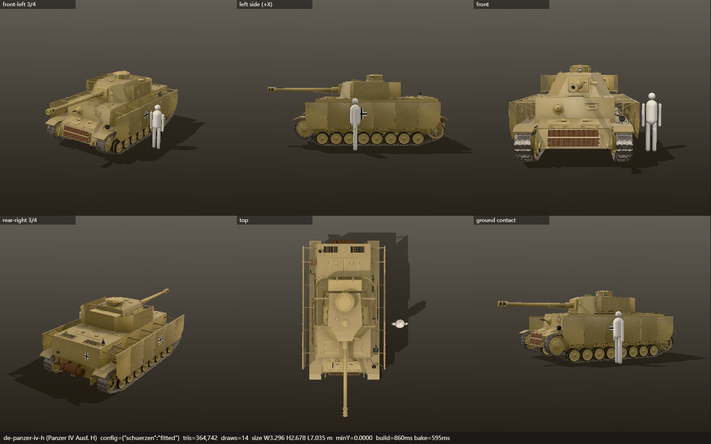

# 004 · Muster · 场景与玩法研究

研究如何把程序化模型组织成可配置、可编辑的资产系统，并发展为可玩的场景与协同任务。已固定上游版本、修复构建；研究首页汇总完整理解、原理与证据，直接接入动态营地、机场保卫战、陆空自由演习、原版展柜和六视图工具。

| 项目资料 | 内容 |
| --- | --- |
| 固定编号 | `004` |
| 上游仓库 | [Kenton-GMI/muster-ww2](https://github.com/Kenton-GMI/muster-ww2) |
| 固定研究版本 | [`7d2fa86ebc3b999eaf085831cdcd5dccefea63d4`](https://github.com/Kenton-GMI/muster-ww2/tree/7d2fa86ebc3b999eaf085831cdcd5dccefea63d4)，未使用 tag |
| 研究日期 | 初次分析 2026-10-10；收录、修复与本轮验证 2026-10-11 |
| 上游许可证 | MIT；保留 Kenton Wang 版权与完整原文，字体和依赖另见授权说明 |
| 研究状态 | 本地构建与浏览器验收通过；GitHub Pages 发布与 HTTPS 实测准备中 |
| 在线演示 | 本次接入既有 GitHub Pages，实际 HTTPS 验证后登记公开地址 |

## 研究与体验首页

新增 [九维完整摘要与发布说明](notes/research-hub-publication.md)：详细整理能力、74 条资源、八个页面与模块、底层实现、营地和战斗任务效果、使用场景、现有项目价值、扩展优先级与实测边界。首页和根项目索引共同使用下面的总览图，引导图保留制作阶段原样；最新线上状态以 [发布记录](notes/publication-verification.json) 为准。

新增 [中文一图总览](assets/research-hub-overview.png)（3840 × 4886）：用九个模块汇总能力、资源、原理、实际探索、使用场景、个人价值、扩展路线与验证边界，直接嵌入原版展柜、六视图、营地、车队、巡逻、飞机起落架、协同演习和机场补给等十张原始截图。它是本地程序排版的信息图，原始运行截图继续独立保留。首页可预览、打开和下载原图；[可编辑 SVG](assets/research-hub-overview-source.svg) 与 [制作记录](notes/research-hub-infographic.md) 说明来源、生成尝试和复现方法。

本地入口为 `http://127.0.0.1:5198/`（开发端口5199）。首页按“认识素材 → 观察营地 → 游玩机场任务 → 深入原理与证据”引导，回答能力、效果、底层原理、使用场景、扩展方向和对现有项目的价值。上游能力、本地扩展与待开发方向分开说明。

五个真实应用可以在首页切换加载：动态营地、机场保卫战、协同自由演习、74条模型资料库、六视图审查。每次只运行一个内嵌场景；动态体验支持首页暂停 / 继续，滚出体验区也会暂停并停声。保留独立打开与全屏操作，以及模型配置、起落架和补给任务的实际截图对照与声音采样。

相关网页入口共8个：

| 页面 | 用途 |
| --- | --- |
| `index.html` | 引导、六问、真实体验、效果对照、原理、价值、资料总入口 |
| `research.html` | 全部研究、运行说明、上游规范、来源和许可证的全文阅读与搜索 |
| `evidence.html` | 全部实际截图、声音、布局和JSON原始报告，按阶段检索 |
| `camp.html` | 场景布置、营地动画与同步声音 |
| `airport.html` | 四阶段机场保卫任务 |
| `battle.html` | 协同自由演习 |
| `archive.html` | 完整上游模型展柜 |
| `harness.html?asset=germany/panzer-iv-h&ref=1` | 六视图模型与比例审查 |

`npm.cmd run dev` / `build` 自动同步源笔记和媒体至网页资料包；完整清单位于 `research/manifest.json`，保留每项来源路径与SHA-256。覆盖范围和复验命令见 [网页汇总记录](notes/research-hub.md)，不把摘要代替完整资料。

## 为什么研究这个资产系统

Muster 把几何建模、程序化材质、资料卡、配置控件和场景布局结合成一个真实应用。最有价值的是统一资产协议、配置兼容约束、编队及组内编辑、多角度模型审查。

对现有樱花街和小镇搭建器，适合借鉴资产接入与成组编辑方法，继续使用小镇的三渲二风格。该判断基于实现分析，尚未验证商业效果。完整分析见 [中文研究笔记](notes/research.md)。

## 新增：1944 野战营地

独立 `camp.html` 是可操作的中文场景：2 架 P-51D、2 辆谢尔曼、1 辆 M18、2 辆 Willys、2 门 M2A1、17 名步兵与班长，共 **8 类上游素材、26 个实例**。模型保持原版米制尺寸；停机坪、机库、帐篷、联络道路、补给箱、油桶、沙袋和树木由本地新增代码生成。



- 左侧分区与镜头导览：观察停机保障、装甲集结、人员联络和炮班阵地。
- 右侧真实模型配置：谢尔曼挡板、吉普风挡、炮架展开与收拢、步兵装备与持枪姿态。
- 场景编辑：数量、横队 / 网格、间距、鼠标拖动、单体或整组旋转、撤销重做。
- 本机保存：刷新恢复、导出 / 导入布局 JSON；营地保存与原展柜分开。
- 晴日 / 傍晚光线、俯视与纯净画面；仍可进入 74 条模型资料库与六视图审查。
- 动态演示：5 辆车沿道路循环、12 名士兵巡逻、一架 P-51D 滑行、起飞、巡航、着陆并归位，另一架留在停机位。支持暂停 / 继续、重播、倍速、时间轴和飞机跟随视角。车轮按路程滚动，履带逐节循环，步兵有支撑 / 摆腿与弯膝，飞机收放起落架并联动舱门；加入有距离衰减的发动机和落脚声、静音与音量控制。

这是使用 1944 年风格美军素材搭建的概念微缩场景，场地和起降距离经过压缩。动作使用路径、部件关节和程序化两段腿 IK；音效是 Web Audio 本地合成，没有飞行物理、碰撞或完整骨骼蒙皮。进入动态演示会暂时按演示路线布置模型，“返回布置”恢复保存的编辑布局。实现与实测证据见 [场景实验记录](notes/fieldcamp.md)、[动作实验记录](notes/fieldcamp-motion.md) 和 [动作与声音增强记录](notes/fieldcamp-realism.md)。

## 前线演习 · 陆空协同对战

从首页或营地点击「自由演习」，或打开本地生产预览 `http://127.0.0.1:5198/battle.html`。现在可接管谢尔曼、M18、Willys 三辆独立车辆，与4名蓝队步兵协同，对抗3辆红队 M18、6名步兵和敌方空袭。步兵会交火、移动和争夺通信区，P-51按航线接近并投下有重力轨迹和范围伤害的炸弹；红队空袭有提前预警。



WASD 驾驶，鼠标瞄准，左键 / 空格开火；**1 / 2 / 3 切换驾驶，F 呼叫空袭，P / Esc 暂停，C 俯瞰**，滚轮缩放。车辆各自保留位置、耐久与装填；失效后自动接管幸存车辆。Willys 保留原素材的无武装侦察定位。暂停同时冻结车轮履带、士兵、飞机、炸弹、冷却和声音。

3分钟内击退红队装甲与步兵，或无对手争夺时占领通信区20秒获胜。保留轻松 / 标准模式、小地图、胜负、重开和触控按钮。这是本地单人对规则电脑的虚构演习。当前实现与验证见 [协同玩法记录](notes/combined-arms.md)；增强前的截图和规则见 [初版对战记录](notes/battle-game.md)。

## 机场保卫战 · 小队指挥与侦察补给

新增任务入口 `http://127.0.0.1:5198/airport.html`，一局限时6分钟：吉普在两个来袭通道停车侦察；分别指挥一班守路口、二班守北侧；吉普装货、将首箱补给送至HQ；抵挡两波进攻，最后送达第二箱机场补给并由步兵警戒8秒。

4 / 5选小队，右键 / G移动、H驻守、J跟随；面板支持点地面下令和直接部署。E装卸补给，恢复12米内存活友军的耐久和弹药。主炮18发、步枪30发；阵地内停止移动的步兵减伤40%。友军共享视野，吉普视距最长；完成部署后获得2次有限P-51空袭。P暂停同时冻结任务、资源、战斗、动作和声音。

操作、实现和实际验收见 [机场任务记录](notes/airport-defense.md)。原来的协同自由演习保留在 `/battle.html`。当前为单人对规则电脑；本次发布包含完整浏览器玩法，线上状态见发布记录。



## 研究目标

- [x] 固定上游版本，保留源码、来源与许可证。
- [x] 复现原始构建失败，以局部改名修复并通过生产构建。
- [x] 运行完整默认展台，确认 74 个公开条目、280 个模型和 300 的显示上限。
- [x] 验证筛选、搜索、鼠标选择、配置、数量、编队、撤销重做、拖动、旋转、复制删除与刷新恢复。
- [x] 整理架构、场景、扩展方向、与现有小镇的复用价值及真实截图。
- [x] 使用现有美军素材搭建中文营地，实测导览、装备、编队、模型拖动、文件往返与刷新恢复。
- [x] 新增车辆运输、士兵巡逻、P-51D 起降与统一暂停，7 项动作验收通过并保留实际截图。
- [x] 加入车轮 / 逐节履带、自然步态、起落架与同步空间声音，保留截图和实际混音采样。
- [x] 开发可玩的装甲对战，保留初版规则与完整战局、挡弹、占领的历史实测。
- [x] 增强步兵交火、飞机空袭与三车接管，18项规则与7项真实浏览器流程通过，保留11张实际截图。
- [x] 开发机场保卫战：步兵小队命令、吉普侦察装卸补给、有限弹药与四阶段任务；14项任务规则、7项完整键鼠流程通过，实际打通轻松模式一局。
- [x] 验证生产资源在计划子目录下加载和实际渲染模型。
- [ ] 逐一审查所有模型与全部配置组合。
- [ ] 在真实手机、低性能设备上进行性能验证。
- [ ] 部署并验证真实在线地址。

## 运行与复现

从总仓库根目录执行：

```powershell
cd projects/004-muster-ww2/web
npm.cmd ci
npm.cmd run dev
```

打开 `http://127.0.0.1:5199/` 进入研究与体验总入口，`/camp.html` 进入中文营地，`/archive.html` 进入原版展柜，保持终端运行。需要 Node.js 22.12+ 和支持 WebGL 2 的桌面浏览器，应用无需账号、密钥或后端服务。第一次进入会生成模型，请等待准备完成；原版展柜另外生成缩略图。

生产预览：`npm.cmd run build` 后执行 `npm.cmd run preview`，访问 `http://127.0.0.1:5198/`。这些是本机地址，不能作为在线演示链接。

操作、验证、截图命令、子目录构建说明见 [Web 运行说明](web/README.md)。本轮浏览器数据见 [实验记录](notes/experiment.md) 和 [原始验收报告](notes/verification-results.json)。

## 关键发现

1. 原版构建被一个未公开注册的 Ha-Go 辅助文件阻止，根因是材质参数与坐标函数同名；局部改名即可修复，无需降低检查。[修复记录](notes/build-fix.md)
2. 机械几何工具、SDF 人体、程序化表面与统一摄影棚灯光共同形成微缩模型观感。
3. 资产配置经过约束后构建并缓存，布局独立保存；编队槽位与个体偏移适合迁移到通用场景工具。
4. 公开条目是 74，上游 README 的上限和旧来源记录有滞后；本地已重新生成 74 条来源记录。
5. 生产页面 7 项浏览器验收通过，运行错误和资源加载失败均为 0；仍有记录在报告中的着色器/几何警告。
6. 本轮默认展台准备耗时约 59 秒，只是本机单次冷启动观察，不是帧率或设备性能基准。

## 图片与演示

以下为 2026-10-11 在本地生产构建上实际生成的截图。

### 完整展台



底部计数为人员 192、车辆 24、火炮 12、飞机 4、独立装备 48，共 280 个模型。缩略图在后台生成，截图时部分卡片仍未完成。

### 配置与网格编队



通过配置切换、数量修改和网格编队验证模型与面板一致；三辆坦克布局随后自动保存，刷新后恢复。这里的整理布局由验收脚本在独立浏览器中准备，没有替换应用原有默认展台。

### 六视图与比例参照



侧裙拆除对照、刷新恢复截图、生成命令与几何统计见 [图片说明](assets/README.md)。模型内部简化以资产来源记录为准。

Web 应用已引入 [web](web/README.md)，默认提供研究与体验首页，中文营地保留在 `/camp.html`，完整上游资产与英文展柜保留在 `/archive.html`。中文说明和实测记录放在研究集对应目录。本地运行继续保留；本次接入 GitHub Pages，实际状态见发布记录。

## 研究材料

- [中文研究笔记：能力、原理、场景、扩展与价值](notes/research.md)
- [场景实验：既有素材组成营地、交互与实际验收](notes/fieldcamp.md)
- [动作实验：运输、巡逻、起降与暂停 / 继续的实现和证据](notes/fieldcamp-motion.md)
- [真实感增强：车轮履带、步态 IK、起落架与空间音效](notes/fieldcamp-realism.md)
- [协同对战：步兵交火、飞机空袭与三车接管](notes/combined-arms.md)
- [机场保卫战：小队指挥、吉普侦察补给与四阶段任务](notes/airport-defense.md)
- [初版装甲对战：驾驶、射击、规则电脑与两条胜利路线](notes/battle-game.md)
- [构建修复记录](notes/build-fix.md)
- [实验与验证记录](notes/experiment.md)
- [研究材料索引](notes/README.md)
- [运行、操作与复现命令](web/README.md)
- [来源、改动与授权](web/THIRD_PARTY.md)
- [实际效果截图](assets/README.md)
- [总项目索引](../../README.md)
- [研究流程](../../docs/research-workflow.md)


