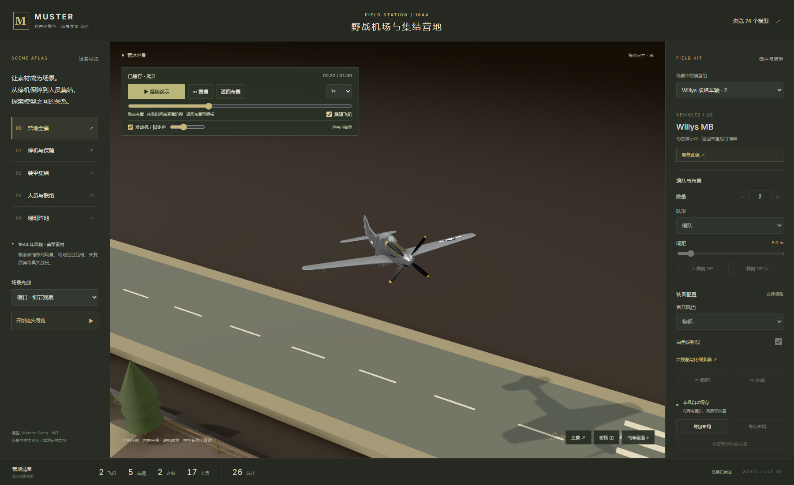
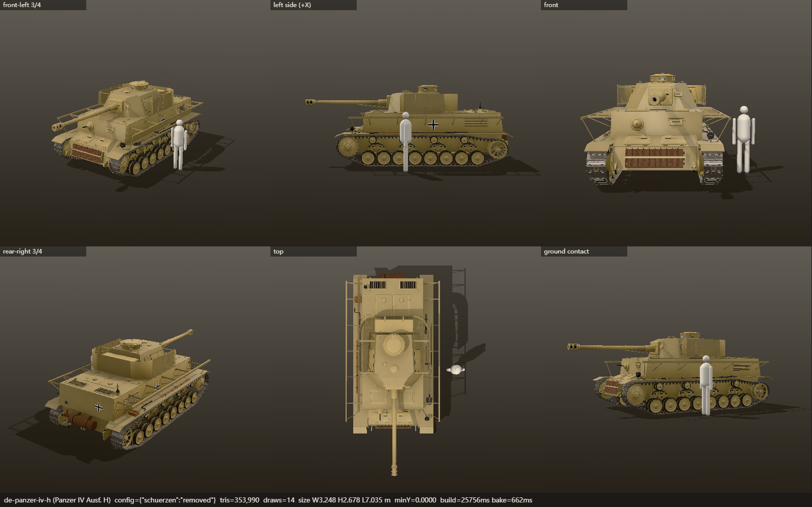

# 004 · Muster · 二战模型展柜 图片资源

运行截图在本地修复后的生产构建上实际渲染、直接截取，主要验收日期为 2026-10-11；下方单独标注的研究总图采用本地程序排版，不属于运行截图。模型与渲染源码来自 [固定上游版本](https://github.com/Kenton-GMI/muster-ww2/tree/7d2fa86ebc3b999eaf085831cdcd5dccefea63d4)，版权与授权见 [THIRD_PARTY.md](../web/THIRD_PARTY.md)。

## 一图总览 · 能力、资源与探索

| 文件 | 说明 |
| --- | --- |
| [research-hub-overview.png](research-hub-overview.png) | Muster 中文一图总览：九个理解模块与十张原始截图，3840 × 4886；本地程序排版，非应用运行截图 |
| [research-hub-overview-source.svg](research-hub-overview-source.svg) | 同一张 Muster 总图的可编辑 SVG，直接嵌入十张原始 PNG；非独立运行截图 |

2026-10-12 汇总。图区分上游能力、本地已实现和后续建议，保留 74 条资源统计、原理、营地与协同任务、使用场景、个人价值、扩展及验证边界。实际效果以对应原始 PNG 和报告为准；十张截图来源、排版脚本、未成图的 imagegen 提示词和复现命令见 [制作记录](../notes/research-hub-infographic.md)。

## 装甲对战 · 前线演习

下列图片来自新增 `battle.html` 的真实生产页面，使用上游谢尔曼、M18 与 P-51D。完整战局由真实鼠标、键盘、按钮驱动；截图不是概念图。除窄屏390×844外均为1800×1100。详见 [开发记录](../notes/battle-game.md) 与 [浏览器报告](../notes/battle-browser-results.json)。

| 文件 | 实际画面 |
| --- | --- |
| [battle-ready.png](battle-ready.png) | 模型构建完成、演习准备与难度选择 |
| [battle-driving.png](battle-driving.png) | 玩家实际驾驶并转向 |
| [battle-combat.png](battle-combat.png) | 交火扣血、装填和争夺区域；初版阶段曾用作研究集封面 |
| [battle-paused.png](battle-paused.png) | 游戏、计时与声音一起暂停 |
| [battle-victory.png](battle-victory.png) | 实际击退3辆红队后的胜利结算 |
| [battle-defeat.png](battle-defeat.png) | 标准模式电脑击败玩家 |
| [battle-cover.png](battle-cover.png) | 实际炮弹被补给掩体阻挡 |
| [battle-capture.png](battle-capture.png) | 实际驾驶入 A 区后占领进度 |
| [battle-objective-victory.png](battle-objective-victory.png) | 0击杀完成20秒占领获胜 |
| [battle-mobile-ready.png](battle-mobile-ready.png) | 390px宽度准备界面 |
| [battle-mobile.png](battle-mobile.png) | 390px宽度实际使用方向和开火按钮 |

占领路线的 [独立报告](../notes/battle-objective-results.json) 也记录了挡弹与电脑射击。未实测真实手机性能。

## 营地动作演示

以下截图来自新增动作层的真实生产页面，时间轴暂停在相应阶段；车辆、士兵和飞机均为上游模型。生成命令为 `npm.cmd run verify:motion`，坐标、统一暂停、布局恢复等证据见 [动作报告](../notes/fieldcamp-motion-results.json) 和 [中文动作笔记](../notes/fieldcamp-motion.md)。

| 文件 | 画面 |
| --- | --- |
| [fieldcamp-motion-takeoff.png](fieldcamp-motion-takeoff.png) | 25 秒：P-51D 离地，全景显示新增跑道与道路 |
| [fieldcamp-motion-flight.png](fieldcamp-motion-flight.png) | 32 秒：跟随爬升中的飞机，可见真实桨叶和起落架 |
| [fieldcamp-motion-approach.png](fieldcamp-motion-approach.png) | 57 秒：进场下降 |
| [fieldcamp-motion-landing.png](fieldcamp-motion-landing.png) | 65 秒：接地后的滑跑 |
| [fieldcamp-motion-patrol.png](fieldcamp-motion-patrol.png) | 20.3 秒：12 名士兵沿巡逻道移动，腿部姿态各不相同 |
| [fieldcamp-motion-convoy.png](fieldcamp-motion-convoy.png) | 同一时间：装甲区车辆朝向跟随道路 |
| [fieldcamp-motion-mobile.png](fieldcamp-motion-mobile.png) | 桌面 Edge 的 390 × 844 视口，32 秒跟随飞机；由最终子目录检查更新 |



## 新增中文营地场景

营地图片展示的是新增场景与中文界面；飞机、车辆、火炮和人物调用上游真实模型，机库、帐篷、树木等环境是本地原创简化造景。除窄屏图外均为 1800 × 1100。截图由真实控件驱动后的 WebGL 页面直接截取。

| 文件 | 画面与验证意义 |
| --- | --- |
| [fieldcamp-overview.png](fieldcamp-overview.png) | 完整营地与 26 个上游模型实例，营地阶段封面 |
| [fieldcamp-flight.png](fieldcamp-flight.png) | P-51D 停机编队、金属表面与机库 |
| [fieldcamp-armor.png](fieldcamp-armor.png) | 两辆谢尔曼装上履带挡板，近景可见新配置几何 |
| [fieldcamp-battery.png](fieldcamp-battery.png) | 榴弹炮改成收拢炮架，与配置控件一致 |
| [fieldcamp-squad.png](fieldcamp-squad.png) | 步兵班从 12 人网格改成 8 人横队，场景总计 22 |
| [fieldcamp-evening.png](fieldcamp-evening.png) | 傍晚光线与修改后的布局；没有让模型执行战斗或驾驶 |
| [fieldcamp-restored.png](fieldcamp-restored.png) | 导出 / 导入后的修改布局再次刷新恢复 |
| [fieldcamp-mobile.png](fieldcamp-mobile.png) | 桌面 Edge 模拟 390 × 844 视口，页面可向下滚动编辑；未测试真实手机性能 |

执行 `npm.cmd run verify:camp` 生成以上图片和 `notes/fieldcamp-results.json`。实际验收结果以报告为准。完整场景说明见 [营地实验记录](../notes/fieldcamp.md)。

[实测导出的编辑布局 JSON](fieldcamp-edited-layout.json) 保留了 22 个实例、谢尔曼挡板、收拢炮架、8 人横队和一辆吉普的单体偏移；可在营地的“导入布局”中选择该文件复现。


## 原版模型展柜与六视图

| 文件 | 画面与验证意义 |
| --- | --- |
| [cover.png](cover.png) | 1800 × 1100，74 条公开目录与 280 个模型的完整默认展台；部分缩略图仍在后台生成 |
| [configured-grid.png](configured-grid.png) | 1800 × 1100，三辆四号坦克、拆除车体侧裙板、Grid 编队及右侧配置面板 |
| [restored-layout.png](restored-layout.png) | 1800 × 1100，浏览器刷新后恢复相同三辆坦克配置、位置与朝向 |
| [panzer-fitted.png](panzer-fitted.png) | 1600 × 1000，侧裙装配状态的六视图与 1.80 米比例人物 |
| [panzer-removed.png](panzer-removed.png) | 1600 × 1000，车体侧裙拆除后的同角度对照；炮塔裙板仍保留 |

主界面与编队截图由 `web/scripts/verify.mjs` 在独立浏览器配置中生成。审查器截图命令在 `web/` 内执行，服务器为已构建的生产预览：

```powershell
npm.cmd run verify -- --screenshots ../assets --report ../notes/verification-results.json
node scripts/snap.mjs germany/panzer-iv-h --base http://127.0.0.1:5198 --ref --w 1600 --h 1000 --out ../assets/panzer-fitted.png
node scripts/snap.mjs germany/panzer-iv-h --base http://127.0.0.1:5198 --config '{"schuerzen":"removed"}' --ref --w 1600 --h 1000 --out ../assets/panzer-removed.png
```

审查器的三角形与材质批次统计属于合并后的单模型模板，不能当成整个展台含阴影、后处理的实际 GPU 绘制次数。详细数据、运行限制和尚未验证的范围见 [实验记录](../notes/experiment.md)。




[返回项目说明](../README.md)

## 部件动作与声音增强

以下图片由 `npm.cmd run verify:realism` 在生产页面实际运行和截图，暂停在指定阶段。

| 文件 | 实际画面 |
| --- | --- |
| [fieldcamp-realism-gear-folding.png](fieldcamp-realism-gear-folding.png) | 29.5 秒，起落架向内折叠 |
| [fieldcamp-realism-gear-up.png](fieldcamp-realism-gear-up.png) | 38 秒，全收状态与关闭的舱门 |
| [fieldcamp-realism-gear-down.png](fieldcamp-realism-gear-down.png) | 57 秒，进场前完整展开 |
| [fieldcamp-realism-patrol.png](fieldcamp-realism-patrol.png) | 20.8 秒，不同相位的抬脚、弯膝与支撑 |
| [fieldcamp-realism-convoy.png](fieldcamp-realism-convoy.png) | 20.3 秒，保留独立车轮和逐节履带的装甲车队 |
| [fieldcamp-realism-mobile.png](fieldcamp-realism-mobile.png) | 390 × 844 视口的声音开关、音量与动作控制 |
| [fieldcamp-realism-audio.wav](fieldcamp-realism-audio.wav) | 直接录制页面实际输出的发动机与脚步混音，单声道 PCM；不是历史发动机录音 |

详见 [增强实现与实测记录](../notes/fieldcamp-realism.md)。

对战增量的7项营地回归重新生成了真实感截图与 WAV，当前音频为2.632秒、48000 Hz，详见 [本轮回归](../notes/battle-camp-regression-results.json)。上轮报告保留原测试时间和当时录音长度。

## 陆空协同演习增量

2026-10-11，本地生产页面由`npm.cmd run verify:battle`实际操作和截图，7项浏览器流程通过。全部来自真实模型/战斗运行，详见 [协同玩法记录](../notes/combined-arms.md) 与 [原始浏览器报告](../notes/combined-arms-browser-results.json)。

| 文件 | 实际画面 |
| --- | --- |
| [battle-combined-ready.png](battle-combined-ready.png) | 协同演习准备界面 |
| [battle-infantry-combat.png](battle-infantry-combat.png) | 两队步兵持枪交火、实际伤害与行走 |
| [battle-jeep-driving.png](battle-jeep-driving.png) | 接管Willys并真实驾驶，显示无武装定位 |
| [battle-airstrike-flight.png](battle-airstrike-flight.png) | P-51飞过红队上空，起落架收起，炸弹尚在下落 |
| [battle-combined-paused.png](battle-combined-paused.png) | 飞机和炸弹在空袭中一同暂停，声音挂起 |
| [battle-airstrike-impact.png](battle-airstrike-impact.png) | 炸弹落地、爆炸与车辆受击 |
| [battle-enemy-air-raid.png](battle-enemy-air-raid.png) | 红队锁定落点后的可见预警 |
| [battle-combined-combat.png](battle-combined-combat.png) | 主炮射击和空袭配合的真实战况 |
| [battle-combined-victory.png](battle-combined-victory.png) | 击退红队3辆装甲和6名步兵的胜利结算 |
| [battle-combined-mobile-ready.png](battle-combined-mobile-ready.png) | 390×844视口准备界面 |
| [battle-combined-mobile.png](battle-combined-mobile.png) | 窄屏车辆卡、触控驾驶和空袭操作 |

初版`battle-ready/combat/victory/defeat/mobile/cover/capture/objective-victory`等截图继续保留作为增强前的装甲玩法记录；不能将旧画面当作当前协同玩法的证据。协同版本曾使用`battle-airstrike-flight.png`作为索引封面，机场任务阶段曾使用`airport-wave-two.png`，当前网页研究入口封面为`research-hub-home.png`。

窄屏图片随后由`npm.cmd run verify:battle -- --mobile-only`复验并更新，确认驾驶车辆居中、状态面板全宽、方向按钮按前/左/后/右排列，点地面瞄准后调用空袭。详见 [窄屏专项报告](../notes/combined-arms-mobile-results.json)。

## 机场保卫战增量

2026-10-11，本地生产页面通过真实键鼠完成四阶段任务、两波交火、两箱机场补给与8秒步兵警戒，在86.23秒模拟时间获胜。7项浏览器流程通过，报告见 [机场完整战局](../notes/airport-browser-results.json)，14张实际截图的逐项说明见 [机场任务记录](../notes/airport-defense.md)。

| 文件 | 实际画面 |
| --- | --- |
| [airport-briefing.png](airport-briefing.png) | 四阶段目标与操作简报 |
| [airport-squad-orders.png](airport-squad-orders.png) | 分班选中与实际移动命令 |
| [airport-paused.png](airport-paused.png) | 任务和音频同步暂停 |
| [airport-supply-loaded.png](airport-supply-loaded.png) | 吉普在D站装2箱补给 |
| [airport-recon-north.png](airport-recon-north.png) | 北侧来袭通道停车侦察 |
| [airport-recon-complete.png](airport-recon-complete.png) | 两通道侦察完成 |
| [airport-deployed.png](airport-deployed.png) | 小队到位、HQ首箱补给与第一波来袭 |
| [airport-wave-one.png](airport-wave-one.png) | 第一波实际步兵和装甲交火 |
| [airport-air-support.png](airport-air-support.png) | 有限P-51空袭支援 |
| [airport-wave-two.png](airport-wave-two.png) | 第二波北侧协同防守；机场任务阶段曾用作索引封面 |
| [airport-counterattack-complete.png](airport-counterattack-complete.png) | 两波击退后进入恢复阶段 |
| [airport-victory.png](airport-victory.png) | 完整任务实际胜利 |
| [airport-mobile-briefing.png](airport-mobile-briefing.png) | 390×844视口任务简报 |
| [airport-mobile-playing.png](airport-mobile-playing.png) | 窄屏小队命令、切车与触控驾驶 |

最终窄屏图片由 `npm.cmd run verify:airport -- --mobile-only` 复验更新；完整战局规则和桌面画面一致，方向按钮避开补给提示区域。

## 网页研究总入口增量

2026-10-11，从本地生产页面实际截图。首页已整理引导、理解、原理与资料，五个体验复用既有应用。报告见 [完整内嵌验收](../notes/research-hub-browser-results.json) 和 [资料更新复验](../notes/research-hub-content-results.json)。

| 文件 | 实际画面 |
| --- | --- |
| [research-hub-home.png](research-hub-home.png) | 研究首页、真实营地截图与首次访问路线；当前研究索引封面 |
| [research-hub-live-camp.png](research-hub-live-camp.png) | 首页中实际运行的营地演示与父页面控制栏 |
| [research-hub-live-airport.png](research-hub-live-airport.png) | 首页中实际开始机场任务、部署二班与切换谢尔曼 |
| [research-hub-reader.png](research-hub-reader.png) | 完整文档阅读器、目录检索与机场任务全文 |
| [research-hub-evidence.png](research-hub-evidence.png) | 效果档案、机场阶段过滤、原始截图说明与下载 |
| [research-hub-mobile.png](research-hub-mobile.png) | 390×844首页引导与直接体验入口 |

截图显示采集时的资料数量。资料包在构建时自动更新，最新数量以网页清单为准。早期效果及其时间、玩法和限制均继续保留；不是把旧画面改称为最新版本。

