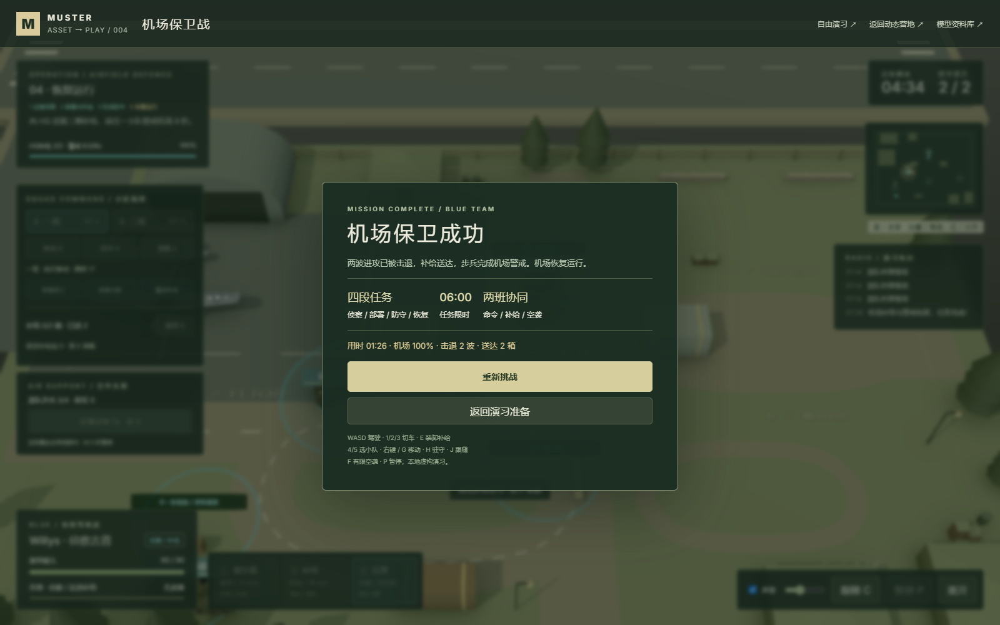

# 机场保卫战 · 本地小队协同任务

本地任务入口：`http://127.0.0.1:5198/airport.html`；开发入口端口5199。固定项目004，基于上游 [Kenton-GMI/muster-ww2](https://github.com/Kenton-GMI/muster-ww2) commit `7d2fa86ebc3b999eaf085831cdcd5dccefea63d4` 的MIT程序化资产；任务、命令、补给与界面为本地原创增量。当前未部署。

## 一局的完整目标

任务限时6分钟，开局接管Willys吉普。原来的3分钟协同自由演习继续放在 `/battle.html`，两套规则独立。

| 阶段 | 实际通过条件 | 单位分工 |
| --- | --- | --- |
| 1 吉普侦察 | 在N、E两个来袭通道内停车观察2秒，必须接管存活吉普，车速低于2m/s | 吉普探明两个来袭方向，可预先装货；步兵可接受命令 |
| 2 部署与补给 | 一班到路口、二班到北侧，各至少一名存活步兵；HQ收到至少1箱补给 | 下达两个班的独立命令，吉普运送首箱机场补给 |
| 3 机场防守 | 第一波2辆M18、4名步兵全部退出；10秒后第二波3辆M18、6名步兵；击退后进入恢复 | 两辆蓝队装甲车掩护、小队守阵地、吉普补弹维修、2次P-51空袭 |
| 4 恢复运行 | HQ累计收到至少2箱补给；存活友军步兵在HQ连续警戒8秒 | 吉普完成机场保障，选一班下令「警戒机场」 |

机场完整度初始100%，红队进入HQ周边后按4%/秒（轻松）或7%/秒（标准）下降。HQ每收1箱补给修复20%，上限100%。完整度归零、步兵全部失效、必要侦察/补给未完成时吉普失效、全部蓝车失效或6分钟超时会明确失败。任务结算使用新条件，全歼一波或旧A区占领不会直接赢下机场任务。

机场任务的蓝队步兵为75耐久（轻松）/55耐久（标准）。到蓝色沙袋阵地4米内且停止移动后，实际伤害乘0.6，即减伤40%；移动离开防护区会失去减伤。沙袋是防护区的视觉提示，减伤按区域规则计算，仍保留实体大掩体的射线遮挡。这给补给与支援留出反应时间。

## 操作与协同

| 操作 | 效果 |
| --- | --- |
| WASD / 方向按钮 | 驾驶车辆；松开前进会减速 |
| 鼠标 / 左键 / 空格 | 装甲炮塔瞄准与射击；吉普无武装 |
| 1 / 2 / 3 / 车辆卡 | 接管谢尔曼、M18、吉普，各自保留状态 |
| 4 / 5 / 小队卡 | 选择一班、二班，各2名步兵 |
| 右键 / G | 当前小队向鼠标地面目标移动 |
| 面板「移动」 | 先按按钮，再点地面下令，适用于触控 |
| H / J | 就地驻守 / 跟随当前驾驶车辆 |
| 部署路口 / 部署北侧 | 给对应班直接下达阵地移动命令 |
| 警戒机场 | 选中小队前往HQ，供恢复阶段使用 |
| E / 装卸按钮 | 吉普停车装货或卸货 |
| F / 空袭按钮 | 完成部署后，向友军当前视野内的地面坐标呼叫空袭 |
| P / Esc | 同时暂停任务、小队、侦察、弹药、车辆、飞机、炸弹、冷却和声音 |
| C / 滚轮 | 俯瞰 / 跟随、缩放 |

吉普必须进入D补给站4米内、车速不超过1.5m/s才能装满2箱。每次在HQ5米内或蓝色阵地4米内卸1箱，修复12米内存活友军：车辆+70耐久，步兵+22耐久（均不超过各自上限），主炮补满18发、步枪补满30发；失效单位不会复活。吉普车上可见的两箱货物随装卸同步显示。

弹药是实际射击资源，步兵与蓝队装甲都消耗；耗尽后停止开火。命令分别存入两班；移动时使用步兵半径0.35米的A*路线和连续掩体检测，点到实体掩体时将目标投到安全边缘。步兵按命令行走，到位驻守并自主交火；跟随目标随当前驾驶车辆变化。

友军共享当前视野：吉普32米、装甲28米、步兵24米，实体掩体阻断视线。敌方模型和小地图标记按同一规则显示，蓝队自动目标选择和空袭也使用共享视野。这是视距与射线规则，没有完整地表战争迷雾。N/E侦察点和阵地标签随任务阶段切换，避免重叠。

P-51限2次支援，24秒共享冷却。第一次部署完成前不能呼叫；未发现的落点不能呼叫。保留真实飞行、桨叶转动、收起起落架、3枚重力炸弹、范围伤害和掩体衰减；红队空袭仍提前预警。声音由Web Audio合成，暂停会将主增益归零、停止瞬态声音并挂起音频时钟。

## 实现边界与复用

`web/src/battle/airport.ts` 集中保存任务坐标、阶段、小队命令、货物、视野与通过条件，`game.ts` 继续运行米/秒固定步长战斗。新页面复用 `main.ts`、`world.ts`、机械关节、程序化步态和音频链路，不引入新依赖或外部网格。当前仍是一个紧凑的本地单人对规则电脑任务，没有联网或大模型决策。

演习使用虚构红蓝双方，地形和机场保障是抽象规则。空袭沿预设路径飞行，士兵采用程序化步态，补给为范围内即时维修补弹，均不代表真实军事流程或完整物理仿真。恢复机场以任务警戒结算表现，没有新增可驾驶飞机。

## 实测

2026-10-11在本地生产构建和Edge独立临时配置中实际运行。完整战局通过真实键鼠打通轻松模式：第70.20秒击退两波（5辆装甲、10名步兵），第86.23秒在两箱机场补给和步兵警戒完成后胜利，机场完整度100%。这些是单次本机任务结果，不是性能基准。

```powershell
cd projects/004-muster-ww2/web
npm.cmd run build
npm.cmd run test:battle
npm.cmd run test:airport
npm.cmd run verify:airport
npm.cmd run verify:airport -- --mobile-only
npm.cmd run verify:subpath -- --report ../notes/airport-subpath-results.json
```

- [任务规则报告](airport-unit-results.json)：14项通过，包含阵地减伤与补给事件分类回归。
- [完整键鼠战局与窄屏报告](airport-browser-results.json)：7项通过，仅真实按钮、键盘和鼠标；只读接口用于断言，不提供传送、改血或改阶段。运行错误和资源加载失败均为0。
- 原自由演习的18项规则检查重新通过。着色器仍有既有X4122精度与X3595循环梯度警告，原文保存在报告中。
- [子目录回归](airport-subpath-results.json)：实际挂载 `/1010_codex_project/004-muster-ww2/`，原版74条目录、营地26模型/19动作实例、自由演习与新机场入口全部通过；机场小队命令、暂停音频与相对资源正常。
- [窄屏专项复验](airport-mobile-results.json)：2项通过，390×844方向键、补给面板和驾驶席不重叠，触控下令、切车、实际驾驶和后台暂停正常。最后仅调整窄屏方向键位置，桌面任务规则与完整战局保持一致。
- 生产构建通过（630模块），研究集根 `npm.cmd run check` 通过（13项目），项目编号、目录、图片与生成索引一致。

完整战局验证轻松模式；标准模式已检查规则配置和失败条件，尚未完整试打一局。真实手机和低性能设备尚未实测。

## 实际截图

以下14张由真实应用生成。窄屏截图随最后布局复验更新。

| 文件 | 实际内容 |
| --- | --- |
| [任务简报](../assets/airport-briefing.png) | 四阶段目标、操作与本地开始按钮 |
| [小队命令](../assets/airport-squad-orders.png) | 分班选中、移动及程序化步态 |
| [暂停](../assets/airport-paused.png) | 任务与音频同时冻结 |
| [吉普装货](../assets/airport-supply-loaded.png) | D站装载2箱补给 |
| [北侧侦察](../assets/airport-recon-north.png) | 停车观察完成N点 |
| [侦察完成](../assets/airport-recon-complete.png) | N/E均完成，任务切到部署 |
| [阵地部署](../assets/airport-deployed.png) | 两班到位、首箱HQ补给、第一波出现 |
| [第一波战斗](../assets/airport-wave-one.png) | 装甲、步兵和命中反馈 |
| [空袭支援](../assets/airport-air-support.png) | P-51飞行与有限支援 |
| [第二波进攻](../assets/airport-wave-two.png) | 北侧阵地协同防守，弹药实际消耗 |
| [两波击退](../assets/airport-counterattack-complete.png) | 恢复阶段，需要第二箱补给与步兵警戒 |
| [完整胜利](../assets/airport-victory.png) | 01:26任务完成、机场100%、2箱送达 |
| [390px简报](../assets/airport-mobile-briefing.png) | 窄屏开始任务 |
| [390px实际游玩](../assets/airport-mobile-playing.png) | 小队命令、切车与触控驾驶 |



