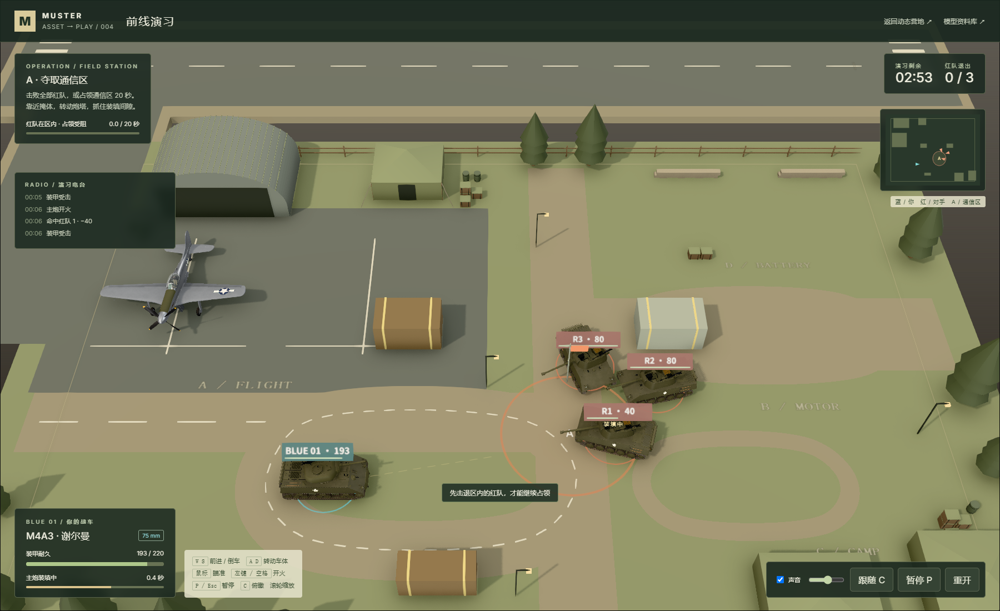

# 004 · 从模型营地到「前线演习」

> 本文为增强前的装甲玩法及当时实测记录。当前已加入步兵、空袭和三车接管；最新玩法、命令与验证见 [协同玩法记录](combined-arms.md)。

2026-10-11 在既有营地上新增本地装甲对战，入口为 web/battle.html。蓝队为1辆 M4A3 谢尔曼，红队为3辆 M18，停机区保留1架 P-51D，全部调用已有真实程序化模型。场地、掩体、规则、界面和声效由本地代码补充。

模型来自 [Kenton-GMI/muster-ww2](https://github.com/Kenton-GMI/muster-ww2)，固定 commit [7d2fa86ebc3b999eaf085831cdcd5dccefea63d4](https://github.com/Kenton-GMI/muster-ww2/tree/7d2fa86ebc3b999eaf085831cdcd5dccefea63d4)，MIT / Copyright 2026 Kenton Wang。双方使用已有美军素材，设定为虚构红蓝演习。授权见 [THIRD_PARTY.md](../web/THIRD_PARTY.md)。

## 可实际玩的内容

- 玩家驾驶、倒车、转动车体，鼠标瞄准，炮塔以有限速度独立转动，左键或空格连续开火。
- 车轮按实际路程旋转，两侧履带分别循环；炮口闪光、弹丸、命中烟尘与退出演习的爆破效果。
- 规则电脑接近通信区，用 A* 绕过掩体，视线清晰时瞄准玩家开火。没有接入远程大模型或多人服务器。
- 补给箱、混凝土块、机库、帐篷和停机区阻挡车辆及炮弹。小地图、血量、装填、占领、时间、战果和电台提示反映实际状态。
- 3分钟内击退全部3辆红队，或进入 A 区控制20秒获胜；耐久归零或时间耗尽失败。红队进入区域阻止占领，玩家离开会缓慢损失进度。
- 开始、暂停、继续、重开、结算后再战；后台或失去窗口焦点自动暂停。发动机、炮声、撞击与爆破统一停声，支持音量与静音。

## 操作与数值

生产预览地址 http://127.0.0.1:5198/battle.html，开发地址 http://127.0.0.1:5199/battle.html。营地首页右上角有「进入装甲对战」。首次进入须等待代码构建模型，点击「进入演习」启动战斗与声音。

| 操作 | 功能 |
| --- | --- |
| W / S | 前进 / 倒车，松开后减速 |
| A / D | 转动车体 |
| 鼠标 | 指向地面目标，炮塔逐步转向 |
| 左键 / 空格 | 开火，可按住；装填中不能再次发射 |
| P / Esc | 暂停 / 继续 |
| C / 滚轮 | 俯瞰与跟随 / 缩放 |
| 重开 | 清除战况，返回准备 |
| 再战一局 / 返回演习准备 | 立即重玩 / 返回并调整难度 |
| 窄屏方向 / 开火按钮 | 驾驶、转向、开火；点场地改变瞄准位置 |

玩家主炮伤害40、装填1.35秒；红队每辆耐久80，两次有效命中即可退出。玩家最高速度7.5米/秒，有加减速，转向上限1.65弧度/秒。轻松模式玩家耐久220，红队单发伤害9、装填4.8秒；标准模式玩家耐久140，红队伤害18、装填3.3秒。弹药不限；数值服务于游戏，不代表真实装备性能。

## 原型能力怎样成为游戏

| 层 | 实现 |
| --- | --- |
| 真实资产 | 原 AssetDef.build 和默认配置生成模型，保留几何与程序化材质，增加炮塔部件标记 |
| 机械动作 | 复用 [rig.ts](../web/src/showcase/rig.ts) 的部件提取、独立烘焙与逐节履带实例矩阵；新增炮塔转向及实际炮口世界坐标 |
| 渲染 | 复用 Studio 的 Three.js、灯光、阴影、N8AO、SMAA；增加红蓝环、耐久标记、准星、弹丸与烟尘 |
| 战斗 | [game.ts](../web/src/battle/game.ts) 独立于渲染，以固定1/60秒推进驾驶、装填、AI、炮弹和胜负 |
| 碰撞 / 导航 | 同一 COVERS 生成新增掩体和碰撞范围；车辆近似圆形足迹；炮弹以连续线段寻找最近矩形/圆形交点，避免穿墙；A* 检查对角边 |
| 声音 | 复用 [audio.ts](../web/src/showcase/audio.ts) 的空间发动机与暂停上下文；新增本地合成炮声、撞击、爆破，经过同一主音量节点 |
| 用户流程 | [main.ts](../web/src/battle/main.ts) 管理准备→战斗→暂停/继续→结算→重开；战况不写入原营地布局 |

暂停冻结 AI、弹丸、装填、占领与特效，清除按键；音频主节点静音，瞬态声源停止，随后暂停 AudioContext。继续从同一战况恢复发动机；静音只影响声音。

## 实际验收

桌面 Edge 使用独立浏览器配置，通过真实按钮、键盘、鼠标和窄屏控件操作。页面只提供只读状态与坐标投影，没有无敌、改血量或传送接口。规则测试可设置独立模拟对象，用于碰撞边界与计时测试；不把这种设置当成浏览器玩家胜利。

运行命令（从 web 目录；先构建并保持生产预览运行，浏览器验收依次执行）：

~~~powershell
npm.cmd run test:battle
npm.cmd run build
npm.cmd run preview
# 另一个终端，同一目录
npm.cmd run verify:battle
npm.cmd run verify:battle:objective
npm.cmd run verify:realism -- --report ../notes/battle-camp-regression-results.json
npm.cmd run verify:subpath -- --report ../notes/battle-subpath-results.json
~~~

原始数据：[9项规则测试](battle-unit-results.json)、[完整战局报告](battle-browser-results.json)、[挡弹与占领报告](battle-objective-results.json)、[营地动作回归](battle-camp-regression-results.json)、[子目录入口报告](battle-subpath-results.json)。实际通过9项规则测试、6项完整战局与2项挡弹/占领流程，以及7项原营地回归。完整战局验收于北京时间 2026/10/11 13:29:04 至 2026/10/11 13:30:09，击退路线用时13.3秒，剩余耐久175；标准模式不操作玩家在12.53秒后被电脑击败。占领验收于 2026/10/11 13:31:10 至 2026/10/11 13:32:01，用时22.27秒、0击杀、控制20秒，剩余耐久112。营地回归于 2026/10/11 13:32:36 至 2026/10/11 13:34:20。上述报告均无页面错误或失败请求；桌面图形驱动仍产生已有的精度/导数着色器警告，未将它们当成页面错误。子目录检查也已通过：资源实际挂载在 /1010_codex_project/004-muster-ww2/，展柜加载74条目录和1个测试模型，营地加载26个模型并播放19个动作实例，对战生成4辆机械战车并通过开始/暂停；无失败资源请求。图标已改为相对路径，避免访问站点根目录。根目录 npm run check 通过13个项目，生产构建通过，194个本地文档链接均存在。

| 实际截图 | 内容 |
| --- | --- |
| [battle-ready.png](../assets/battle-ready.png) | 已构建模型与难度选择 |
| [battle-driving.png](../assets/battle-driving.png) | 驾驶、转向后的车体与履带 |
| [battle-combat.png](../assets/battle-combat.png) | 实际交火、扣血与装填 |
| [battle-paused.png](../assets/battle-paused.png) | 游戏和声音同步暂停 |
| [battle-victory.png](../assets/battle-victory.png) | 真实鼠标与按键击退3辆红队后结算 |
| [battle-defeat.png](../assets/battle-defeat.png) | 标准模式电脑实际击败玩家 |
| [battle-cover.png](../assets/battle-cover.png) | 补给掩体挡住实际炮弹 |
| [battle-capture.png](../assets/battle-capture.png) | 实际驶入通信区后占领计时 |
| [battle-objective-victory.png](../assets/battle-objective-victory.png) | 0击杀、20秒占领获胜 |
| [battle-mobile.png](../assets/battle-mobile.png) | 390×844视口中实际方向/开火按钮操作 |

## 边界与扩展

这是本地单人对规则电脑的可玩原型。碰撞和瞄准在平面近似计算，尚无真实履带动力、炮弹重力、装甲厚度/入射角、炮管俯仰、建筑破坏、完整残骸碰撞或联网同步。被击退的战车停驻显示「退出演习」，不会继续攻击。窄屏实测使用桌面 Edge，未验证真实手机性能；未部署线上地址。

下一阶段可扩展车种、武器、地图和规则难度，再加入双人操作或服务器权威多人同步。若引入模型指挥，应把慢速战术决策与本地实时驾驶分开；当前电脑就是规则控制。

[返回项目说明](../README.md) · [营地动作和声音](fieldcamp-realism.md)
