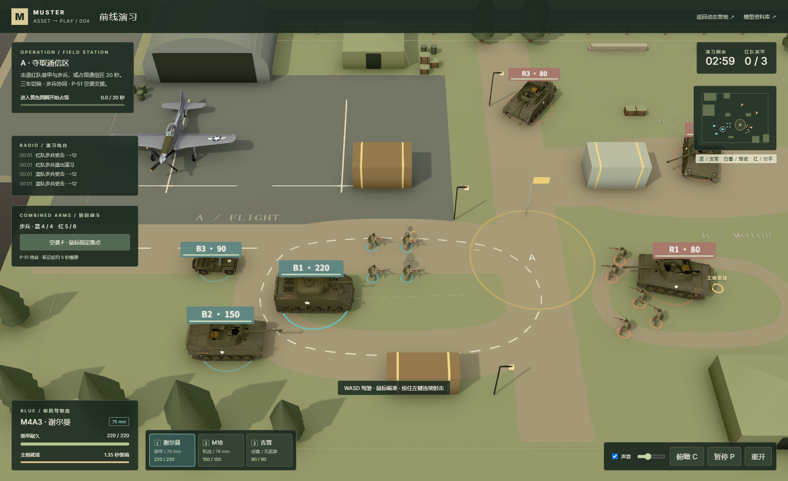
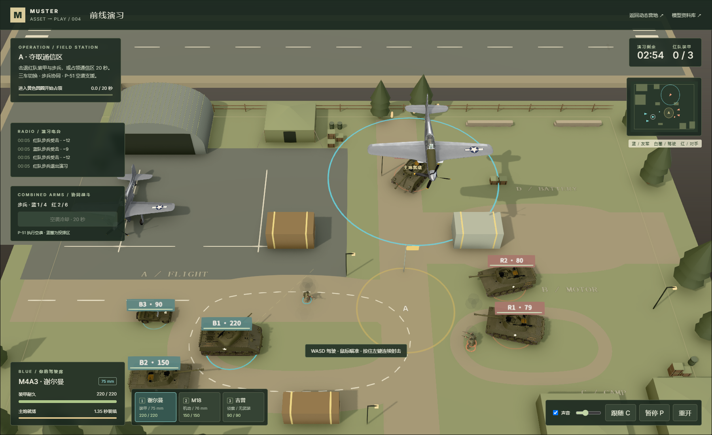
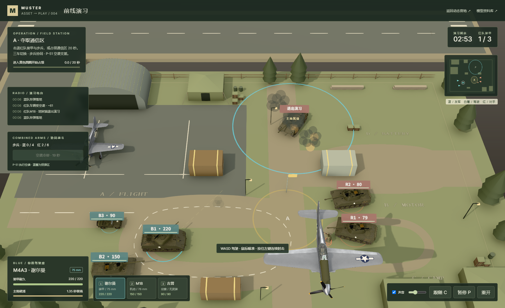
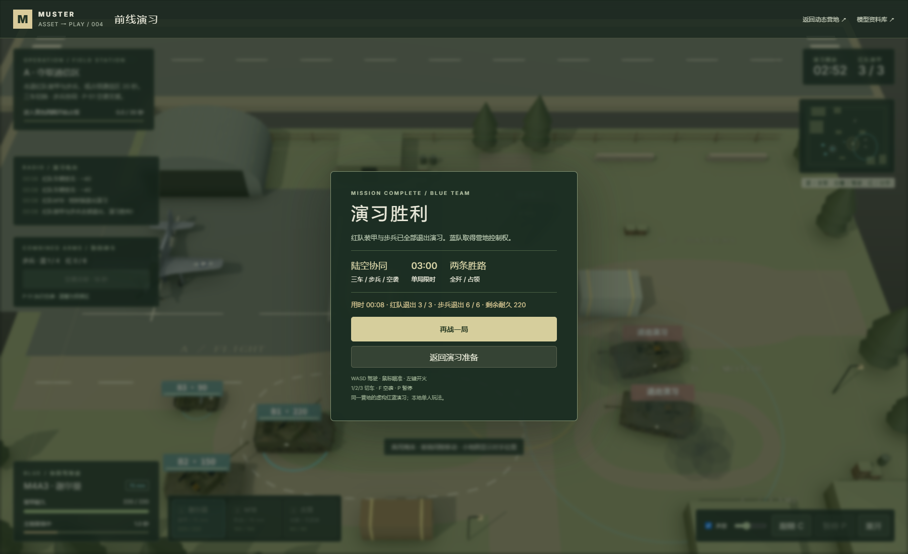
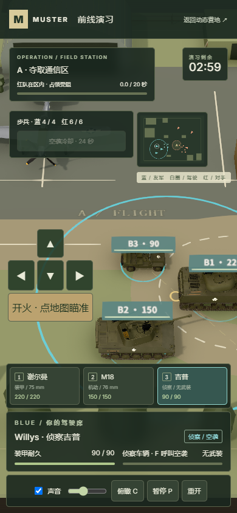

# 前线演习 · 步兵、空袭与三种驾驶席

2026-10-11，项目004的本地原创玩法增量。上游仍固定于 `7d2fa86ebc3b999eaf085831cdcd5dccefea63d4`，MIT版权保留。已有程序化军事模型提供外观、配置和关节；这里增加的是规则游戏逻辑、持枪姿态、交互与声音，没有引入外部模型，也没有网络或大模型控制。

## 实际玩法

蓝队拥有谢尔曼、M18、Willys和4名步兵；红队有3辆 M18、6名步兵。双方 P-51执行虚构红蓝演习空袭，另保留一架停机位模型。步兵、车辆和飞机实际参与同一场战斗，不只是循环背景动画。

| 控制 | 行为 |
| --- | --- |
| WASD | 驾驶当前车辆，前进/倒车、车体转向 |
| 鼠标 + 左键/空格 | 地面瞄准与主炮开火 |
| 1 / 2 / 3；底部车辆卡 | 接管谢尔曼、M18、Willys |
| F；空袭按钮 | 当前鼠标地面落点呼叫 P-51 |
| P / Esc | 暂停/继续，包括声音 |
| C；滚轮 | 俯瞰/跟随镜头、缩放 |

车辆切换是接管场上不同车辆：每辆车拥有独立位置、朝向、血量、装填与行驶路程；切换不会回血或取消装填。未驾驶的蓝队装甲车原地自主掩护，开火窗口间隔4.2秒；接管后使用正常装填速度。吉普没有武器。正在驾驶的车退出后自动接管幸存蓝车，切换会清除旧驾驶输入；三辆蓝车都退出才失败。暂停与结算中禁止换车、呼叫空袭。

| 蓝队车辆 | 轻松模式耐久 | 游戏最高速度 | 主炮/装填 | 用途 |
| --- | --- | --- | --- | --- |
| M4A3谢尔曼 | 220 | 7.5m/s | 40伤害 / 1.35秒 | 正面交战、护住步兵 |
| M18地狱猫 | 150 | 10m/s | 48伤害 / 1.65秒 | 机动绕行、侧面接敌 |
| Willys侦察吉普 | 90 | 13m/s | 无武装 | 快速转移、占领、呼叫支援 |

这些数值用于玩法平衡，不能作为史实性能。标准模式蓝队耐久为上述约65%，敌方炮弹伤害和频率提高，红队空袭更频繁。

步兵优先选择视线可达的敌方步兵，进入交战距离后驻足、转身、按独立射击冷却交火。没有目标时向通信区推进，进行小半径绕障并避让车辆。步枪弹有独立轨迹、最近碰撞和实际伤害，能被掩体挡住；对步兵基础12伤害，对装甲约1，对吉普6。主炮直接命中与2.5米步兵溅射适合清理密集目标，掩体挡住碎片。退出的步兵从场上撤离，不显示血腥效果。

空袭全队共享24秒冷却，切车不会刷新。呼叫时锁定落点并显示蓝色10米半径预警圈（覆盖3枚炸弹的整体伤害区）；飞机按约25m/s的航线接近，螺旋桨旋转、起落架收起，投下3枚有重力和前向速度的炸弹，约5秒后落地。炸弹造成5米范围伤害，穿过实体掩体的伤害降至25%。蓝队炸弹基础65伤害，红队轻松/标准30/48，均按距离衰减。演习关闭友军伤害。

红队在轻松模式第22秒、标准第16秒首次呼叫空袭，后续32/24秒一次；锁定当时驾驶车辆的位置。红色地面圈、支援区警告、电台记录和小地图会提前提示，玩家可驶离落点。飞机退出航线后消失；这里不是从营地跑道起飞的实时飞行模拟。

3分钟内击退3辆红队装甲与6名步兵，或驾驶当前车辆在无人争夺的通信区占领20秒获胜。敌方步兵在区内同样阻止占领。离区时进度缓慢衰减，三辆蓝车都失效或超时失败。

## 底层实现

`src/battle/game.ts`是无渲染依赖的米/秒规则模拟，固定1/60秒更新。统一红蓝阵营、车辆类型、独立步兵状态、步枪/炮弹、空袭和炸弹；使用连续线段/盒体/圆形最近碰撞防止高速弹穿透。战车使用已有A*路网绕掩体，步兵使用较小半径的局部方向候选。炸弹有高度、垂直速度和重力，落地才触发范围伤害。

`main.ts`把同一模拟状态映射到已有模型和机械关节。战场使用素材原有低细节等级，美军步兵增加本地`aim-rifle`姿态，复用上游人体、双臂IK和武器握点，枪口来自解算后的武器矩阵。营地材质变形通过独立uniforms复用到战斗步态与螺旋桨；原有姿态和营地动作仍保留。车轮和逐节履带按各车实际行驶路程与转向更新。

`world.ts`渲染可见步枪弹、炮弹、炸弹与爆炸；主炮闪光取机械炮口，步枪闪光使用人体构建的枪口数据。`CampAudio`提供8个稳定发动机声源（6车+2飞行实例），10名步兵的落脚事件，以及独立的步枪/炮声/撞击/爆破合成。暂停立即清空瞬态声源、静音并挂起音频时钟；游戏冻结全部战斗计时，包括空袭飞行与共享冷却。返回页面需要手动继续。

只读`window.__battle.getState()`用于核对真实模拟、模型关节、步态、飞机姿态和音频采样；`project()`只提供屏幕投影。浏览器验收通过真实按钮、键盘和鼠标，不通过改血量、传送或伪造胜负完成战局。

空袭验证期间发现车辆对象的`kind`曾覆盖命中事件类型，已改为只复制坐标，并增加车辆空袭命中事件断言；炸弹落点收拢到标记中心前后，10米预警圈覆盖整组爆炸范围。

完整战局实测后，把待命友军开火窗口从玩家装填频率调整为4.2秒，防止不操作也在敌方首次空袭前过快结束对局；驾驶接管不改变已经进行的真实装填。

## 本轮实际验证

2026-10-11，在本机生产构建与 Edge155.0.4283.45 独立浏览器上实际运行。主报告时间为17:24–17:26（北京时间）。截图来自页面的真实 WebGL 渲染，没有使用合成概念图。

| 检查 | 实际结果与证据 |
| --- | --- |
| TypeScript + Vite生产构建 | 通过，628个模块构建成功 |
| 独立规则测试 | 18项通过：不同车辆状态、枪弹碰撞、步兵伤害/行走、空袭投弹/掩体衰减/无友伤、暂停、争夺/占领、重开与标准模式自然失败；[原始报告](combined-arms-unit-results.json) |
| 真实浏览器流程 | 7项通过：6辆车/10名步兵/2架空袭飞机构建、步兵交火与声音、键鼠切车/行驶、蓝队投弹、敌方空袭、完整胜局、重开和窄屏；[原始报告](combined-arms-browser-results.json) |
| 运行/资源错误 | JavaScript错误0、HTTP或加载失败0；保留2类已有着色器精度/梯度警告，不能把它们写成零警告 |
| 完整胜局 | 真实鼠标主炮射击与F空袭配合，8.03秒击退3辆红队装甲和6名步兵；结果界面胜利，声音自动停止 |
| 标准模式失败 | 纯规则模拟中不操作的蓝队在23.35秒全部三车失效，包含自动接管和敌方空袭；这是规则测试结果，不是本轮浏览器失败截图 |
| 暂停与声音 | 实际暂停时步兵、飞机、炸弹、冷却和模型状态相同，AudioContext为suspended、gain/RMS为0，继续恢复实际声音输出 |
| 窄屏 | 390×844桌面视口无横向溢出，切换/触控驾驶/点场地瞄准/空袭通过；后续专项2项复验也通过，确认车辆居中、面板全宽与方向排列；[专项报告](combined-arms-mobile-results.json)。未验证真实手机GPU性能 |
| 子目录兼容与营地回归 | 已实际通过：资料库74条、营地26个模型/19个动作实例、对战6车/10步兵/2空袭飞机，资源失败0；[子目录报告](combined-arms-subpath-results.json) |
| 根仓库检查 | 已运行`npm.cmd run catalog:sync`与`npm.cmd run check`，13个项目编号/目录/图片/生成索引一致，通过 |

### 实际截图

11张图片的完整清单见 [图片说明](../assets/README.md)。浏览器状态中的步枪事件、实际步兵扣血、机械车轮四元数、空袭炸弹高度、起落架可见性、暂停前后对比和声音采样均保留在JSON报告，便于复查。

在`web/`执行`npm.cmd run test:battle`；先`npm.cmd run build`和`npm.cmd run preview`，再`npm.cmd run verify:battle`。子目录回归为`npm.cmd run verify:subpath -- --report ../notes/combined-arms-subpath-results.json`。脚本使用只读状态验收与真实UI输入；历史装甲版报告仍保留当时数据，不能把旧结果当作当前协同版验证。

## 边界和后续方向

这是本地单人对规则电脑的可玩原型，电脑采用规则和几何视线。装甲命中是二维圆形近似，没有装甲厚度、跳弹、穿深；步枪弹道高度用于展示，命中用地面投影。步兵使用程序化步态与局部绕障，不是完整骨骼状态机、寻路网格或掩体姿势系统。空袭按预设航线，没有飞机间格斗、被击落、防空或真实起降物理。游戏数值与红蓝编排不代表史实阵营。

适合继续扩展班组指令、掩体站位、弹药补给、修理/救援、空袭次数和防空、多人同步及地图任务；当前没有实现这些能力。真实手机性能、低端GPU和多人网络均未验证；没有部署在线演示。

[返回项目说明](../README.md)
