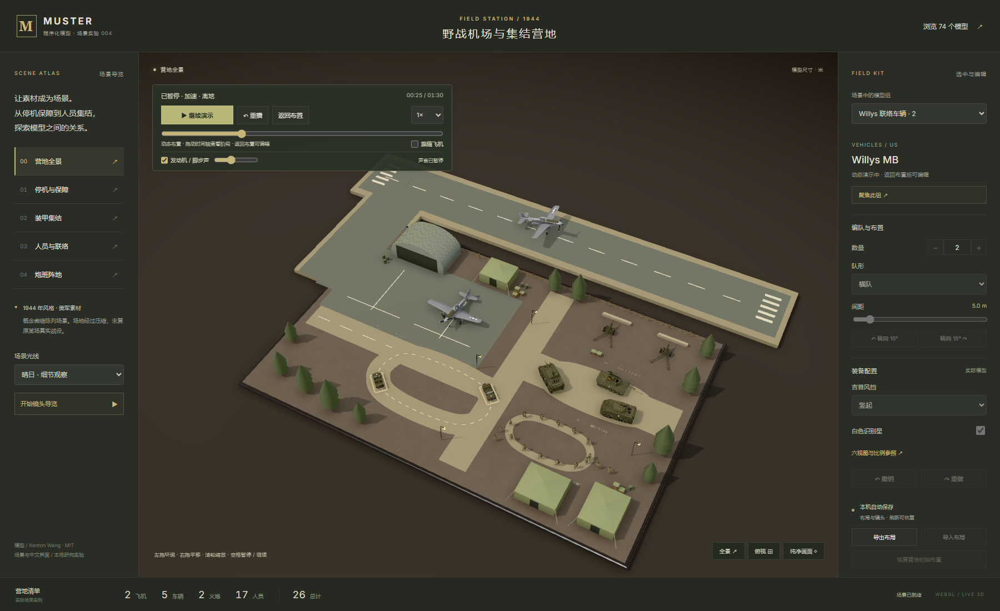
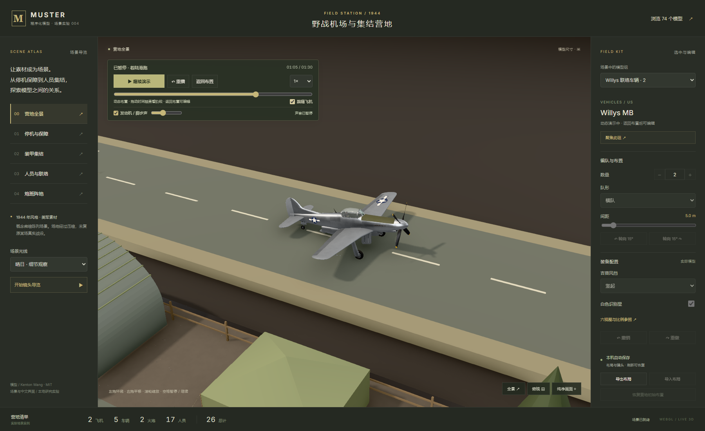

# 让营地动起来：本地动作实验

日期：2026-10-11。以固定版本 `7d2fa86ebc3b999eaf085831cdcd5dccefea63d4` 的既有模型为基础。本次新增的是演示动作层，不是发现上游已有运动能力。

## 可以看到什么

- 两辆 Willys 沿营地联络道路循环；两辆 Sherman 和一辆 M18 沿装甲区道路运行，朝向跟随路线切线。
- 12 名 Rifleman 沿营区巡逻道行走，有交替腿部摆动、脚步抬起和轻微身体起伏。班长和 BAR 组继续站岗。
- 一架 P-51D 从停机位滑出，经左侧滑行道进入新增跑道，完成加速、离地、爬升、巡航、进场、接地、减速和归位。另一架留在停机位；现有螺旋桨叶片随时间旋转。
- 90 秒循环；暂停 / 继续、重播、0.5× / 1× / 2×、拖动时间轴和跟随飞机镜头。页面转到后台自动暂停，重新可见时由用户继续。

动态演示暂时按固定路线安排模型，不承诺依据用户任意摆放的位置自动规划路线。点击“返回布置”恢复所有模型的保存位置和朝向，可继续装备和编队编辑。演示期间编辑锁定，镜头仍可查看。播放状态和动态位置不进入 Store、撤销栈或 localStorage；导出保存的是编辑布局。

## 底层实现

`CampMotion` 使用 `requestAnimationFrame` 的时间戳驱动统一时钟，所有车辆、士兵、飞机和桨叶由同一个时间值计算。暂停后时钟停止，继续时重建时间基准，因此不会补算暂停或后台隐藏的时长。地面循环周期为 30 / 45 秒，都整除 90 秒，避免总周期回绕时突然跳位。

道路和运动共用 Catmull–Rom 曲线：`environment.ts` 从曲线采样铺路，`motion.ts` 用按弧长采样的位置与切线控制真实渲染实例。飞机用十个阶段组成轨迹，高度约 0–25 米；起飞段加速、着陆滑跑减速，飞行时抵消原模型约 10° 的停机姿态，再依据轨迹设置俯仰和侧倾。相机目标范围只在营地扩大，支持跟随地台外的飞行轨迹。

上游 bake 按材质合并几何，原始零件不再独立。为保留这些真实网格，巡逻动作通过顶点着色器按腿部高度与左右侧做小幅变形，桨叶通过 P-51D 机体坐标筛选后旋转；同步改变法线并使用相同变形的阴影深度材质。每个实例拥有独立时间 uniform，几何仍共享。材质克隆保留原版的着色器和 defines，返回布置时恢复原材质并释放动作材质。

SceneController 的可选动画回调在动作播放时连续请求渲染；未安装回调时沿用原版按需渲染。SceneController 提供当前实际渲染实例，动作层不经过 Store 写入位置。原版展柜未安装这个动作控制器。

## 后续动作与声音增强

本页记录第一版路径动作的设计与实测；随后新增车轮、逐节履带、两段腿 IK、起落架 / 舱门收放以及同步空间声效，详见 [真实感增强记录](fieldcamp-realism.md)。首版数据已另存，下列日期指首版阶段；动作截图会随最新复测更新。

## 首版范围与限制

这是微缩场景演示，不是某个真实机场或战役。新增跑道长 92 米，距离与时长用于画面演示，不能当作 P-51D 的真实起降性能数据。模型仍保持原版米制大小。

首版阶段使用简单的程序化顶点步态，当时没有骨骼蒙皮、关节 IK 或地形足底接触，车轮与履带也尚未独立滚动，飞机起落架保持展开。上述部件动作与两段腿 IK 已在后续增强实现，见前面的增强记录链接。路线为预设，没有碰撞检测、避障、飞行空气动力学、车辆物理或作战 AI。地面为平坦场地，不能保证任意导入布局与路线完全不相交。真实手机与低性能设备尚未做性能实测。

## 复现与证据

在 `web/` 内先执行 `npm.cmd run build` 和 `npm.cmd run preview`，再运行 `npm.cmd run verify:motion`。脚本使用独立 Edge / Chrome 配置，通过真实按钮、键盘和时间轴操作；只读 `__camp` 读取当前实例、时间、相机与保存布局。遇到浏览器错误或失败资源立即失败。原始结果见 [首版动作验收报告](fieldcamp-motion-baseline-results.json)。

最终动作验收为 **7 项通过**，浏览器为 Edge 155.0.4283.45；报告时间 2026-10-11 11:04:22–11:05:47（北京时间）。运行错误和资源失败均为 0，保留两个已有的着色器警告类型 X4122、X3595。检查覆盖启动真实位移与转向、统一暂停 / 空格继续、各起降阶段与跟随相机、倍速与循环接缝、重播、保存布局恢复与刷新、窄屏控件。

首次渲染增量曾因着色器拼接缺少换行导致动作对象不可见，随后修复并实际检查飞机与士兵截图；材质克隆还需显式保留上游 defines。另一次验收在六项完成后遇到截图写入 ENOSPC，没有把这次运行计为全部成功。最终成功报告来自后续完整运行，截图改为获取实际像素后写入文件。刷新 restore 会重新分配模型组 ID，因此刷新比较检查规范化后的配置与布局，不把临时 ID 当作持久化身份。

报告的渲染耗时包含首次编译和浏览器调度，不是 GPU 帧率或硬件基准。页面后台自动暂停由可见性事件和帧回调共同处理；本轮七项报告没有单独计入真实系统休眠场景测试。

原有营地编辑流程在本次动作增量后重新执行，**10 项回归通过**，时间为 2026-10-11 11:06:32–11:08:06（北京时间），见 [首版动作后的编辑回归报告](fieldcamp-editor-baseline-results.json)。保留了装备生成、编队、拖动、撤销、文件往返、刷新和原展柜保存隔离。

最终构建还挂载到 `/1010_codex_project/004-muster-ww2/` 做实际子目录检查：原版 74 条目录与一个四号坦克正常渲染，营地 26 个模型和 19 个动作实例正常加载，失败请求与运行错误为 0；窄屏继续按钮可用，跟随飞机画面和收起静态说明已实际截图。见 [动作子目录报告](fieldcamp-motion-subpath-results.json)。本次没有重复运行完整 280 个模型的旧版大展台验收，其此前结果仍保留在原版回归报告中。

实际截图由生产页面生成，截图取指定时间并暂停，便于检查画面：

巡逻、车队、进场与窄屏截图见 [图片索引](../assets/README.md)。

窄屏图在最终子目录检查中更新为 32 秒的跟随飞机视角，其他动作截图来自上述七项动作验收。

## 后续可扩展方向

可把固定路线扩展成可编辑路网和任务计划；独立车轮、履带、起落架和程序化两段腿 IK 已在后续增强完成，下一步可为人物引入完整骨骼蒙皮与地形接触；使用 LOD、合批与材质实例预算支持更大场景。当前实现已经把资源库、环境、路径时间线和本机布局恢复接在一起，可以用于素材演示、镜头预演和教学展示。

[返回项目说明](../README.md)
