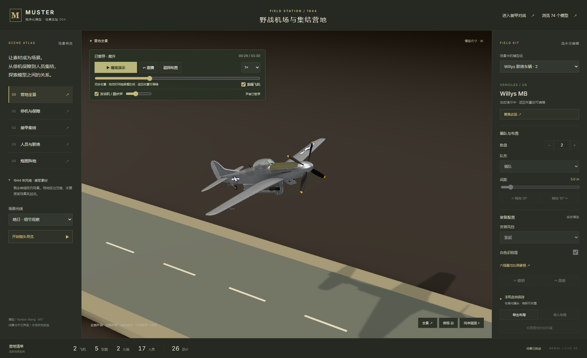
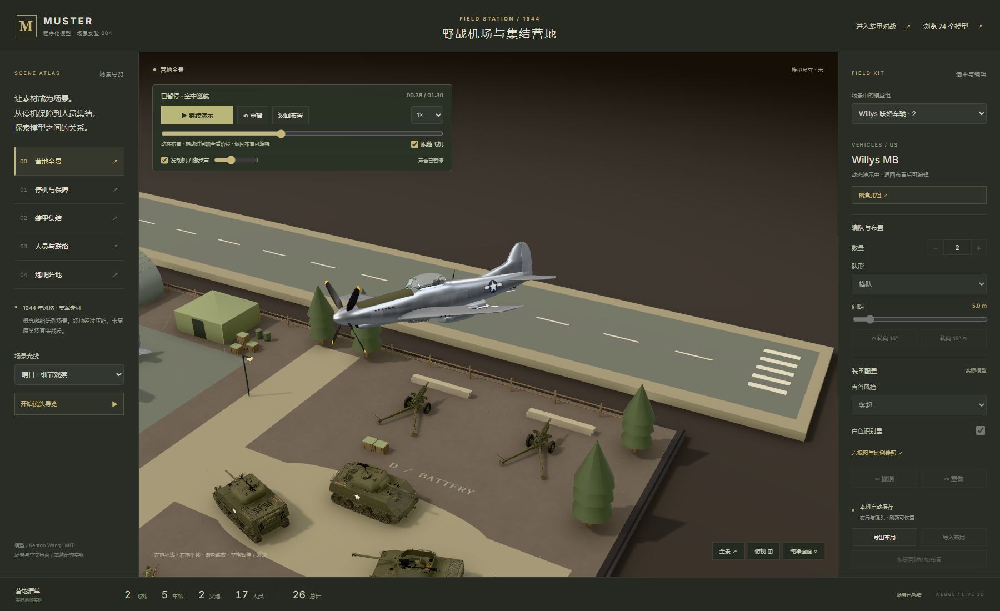
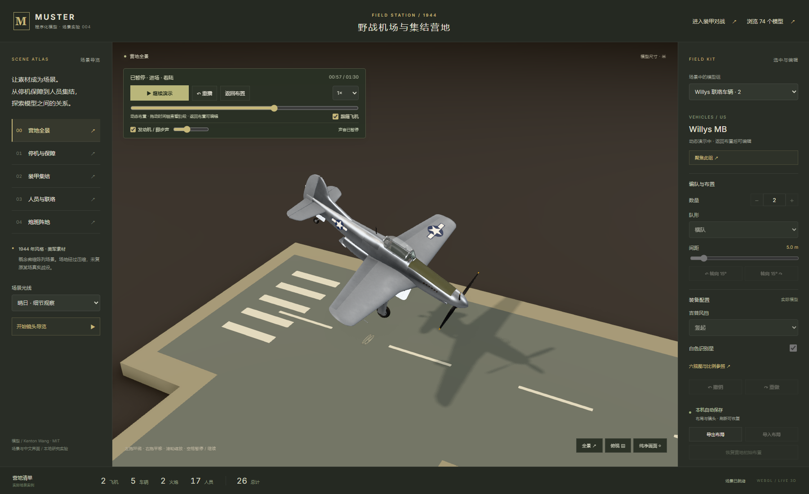
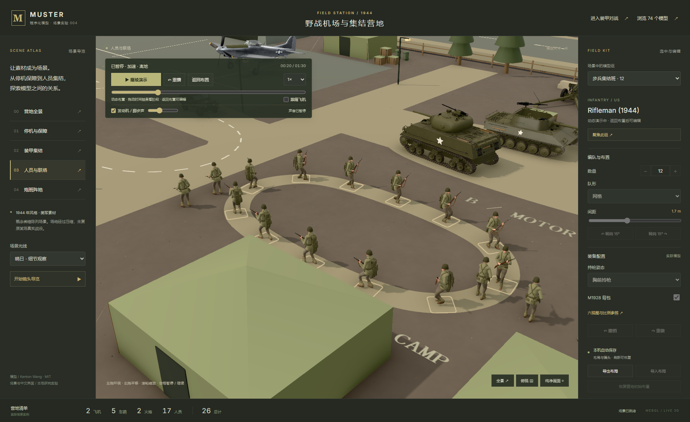
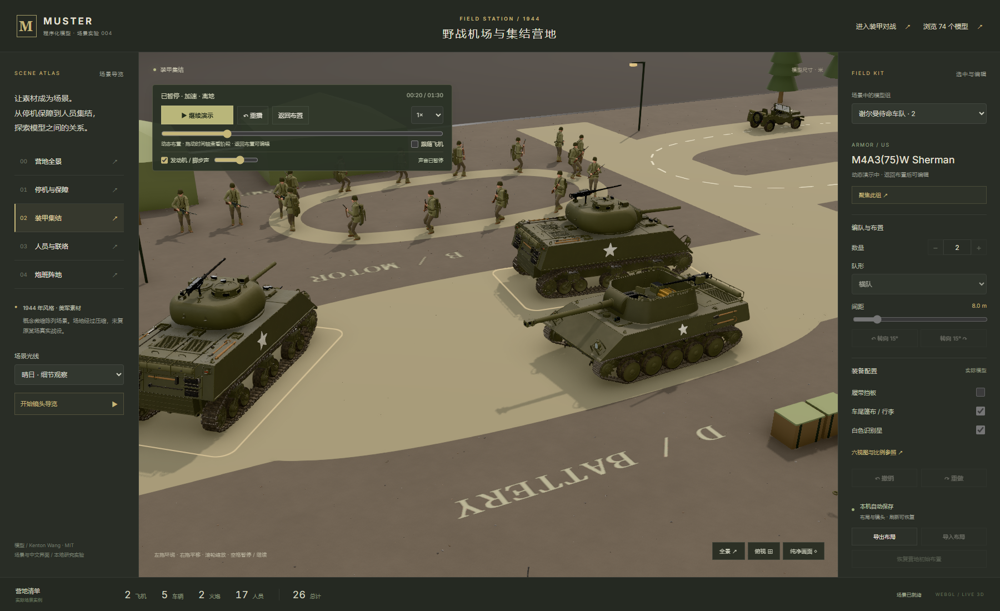

# 营地真实感增强：部件、步态与同步声音

本地增强继续使用上游 commit `7d2fa86ebc3b999eaf085831cdcd5dccefea63d4` 的实际美军模型，不增加外部网格或录音。上游 MIT 与版权保留在 [来源说明](../web/THIRD_PARTY.md)。默认入口仍为中文营地，原版资料库保留在 `archive.html`。

## 可以直接体验的变化

点击“开始动态演示”，5 辆车辆沿道路行驶，12 名士兵巡逻，一架飞机执行起降。Willys 的四个行驶轮滚动，备胎保持固定；Sherman 与 M18 的负重轮、主动轮和诱导轮转动，履带鞋与连接件沿上游履带闭环逐节循环。转弯时左右侧路程有所区别。

士兵增加脚掌支撑、抬脚摆动、弯膝和轻微上身转动，保留持枪与装备组合。支撑期脚掌向后运动的速度与角色向前速度匹配，减少平地滑步。步态不是导入的动作文件或完整骨骼蒙皮。

飞行飞机在 27–31 秒折叠主起落架与尾轮，随后合拢舱门；51–55 秒反向展开，在进场接地前完成。停机飞机保持起落架展开。折叠阶段仍能看见支柱移动，全收后隐藏进入机体的支柱，并关闭机翼下表面的轮舱开孔。

发动机与碎石脚步由 Web Audio 在本机合成。七个发动机声源随车辆 / 飞机移动，按观察相机的位置计算左右声像与距离衰减；飞行阶段提高发动机音调和滤波亮度，巡逻脚步在左右脚支撑开始时触发。点击启动后启用声音，面板提供声音开关与音量。声音不是历史机型录音。

暂停时立即把主音量设为零、停止短脚步声源，再冻结 AudioContext 时钟。继续从当前动作时间恢复；拖动时间轴清掉旧脚步，避免恢复时积压发声。进入后台自动暂停，返回后手动继续。“返回布置”恢复原模型、编辑布局，移除演示关节并释放其几何和音频节点。

## 实现与复用价值

| 层 | 实现 | 可复用经验 |
| --- | --- | --- |
| 机械部件 | [rig.ts](../web/src/showcase/rig.ts) 在资产构建之后、合并之前提取 `campMotion` 标记；车体与轮组分别 bake，履带保留 InstancedMesh | 把静态资产转成可动资产，保留原配置与材质 |
| 运动时间 | [motion.ts](../web/src/showcase/motion.ts) 统一驱动路线、关节和程序化步态；车轮角度约等于路程 / 半径 | 暂停、时间轴、倍速和循环共用状态；循环保留累计滚动路程 |
| 人物步态 | 支撑期占一个步态周期的 62%，摆动期抬脚；用两段腿解析 IK 求膝盖位置，鞋保持水平；法线随变形更新 | 无骨骼资产也可先做有限的步态演示，完整人物动画应继续引入骨骼 |
| 起落架 | 真实支柱、轮与舱门作为独立关节旋转；舱门晚于支柱关闭，展开时先开门 | 支柱与遮盖件要按顺序联动，不能只隐藏整套起落架 |
| 声音 | [audio.ts](../web/src/showcase/audio.ts) 用振荡器、滤波器、短噪声缓冲与 PannerNode 合成 | 声源绑定对象、听者绑定相机；暂停需要管理音频上下文和待播事件 |
| 状态恢复 | 演示模型暂时替换渲染实例，原始 Store 中的配置和布局始终保留 | 展示、编辑、导出可以共用资产，但分开管理瞬时动作状态 |

`campMotion` 只是原机械构建函数上的本地元数据，普通资料库仍使用原有整体合并。演示启用时才创建独立部件模板，同配置共享模板几何，各实例保留自己的关节和履带矩阵。退出后释放演示资源，再进入时重新建立。

## 实际验证

在 `web/` 中运行生产构建与预览，然后执行：

```powershell
npm.cmd run verify:realism
npm.cmd run verify:motion
npm.cmd run verify:camp
npm.cmd run verify:subpath -- --report ../notes/fieldcamp-realism-subpath-results.json
```

验收脚本通过真实按钮、时间轴、声音开关、音量和镜头操作，读取当前渲染实例的车轮四元数、履带实例矩阵和关节姿态。声音证据来自实际 AudioContext 的时钟与 AnalyserNode 采样，不以面板文字替代发声验证。支撑脚速度检查对应程序化步态计算，截图用于检查最终 GPU 画面；没有进行外部运动捕捉或地形足底测量。

最终增强验收运行于北京时间 2026/10/11 11:45:34 至 2026/10/11 11:46:45，7 项通过。录下的实际混音为 2.71 秒、48000 Hz 单声道 PCM。暂停采样 RMS 为 0，音频上下文为 suspended，期间音频时钟不增加。

本轮已实际执行增强验收、动作回归、编辑回归和双入口子目录检查；增强与动作各 7 项、编辑 10 项，运行错误与失败请求均为 0。报告保留 Edge 已有的 X4122 / X3595 着色器警告，未把警告写成错误消失。最终修正履带坐标方向后再次执行增强与子目录检查。

最新结果保留于 [增强验收报告](fieldcamp-realism-results.json)、[动作回归报告](fieldcamp-motion-results.json)、[编辑回归报告](fieldcamp-results.json) 与 [双入口子目录报告](fieldcamp-realism-subpath-results.json)。验证日期、通过数量、运行错误和浏览器警告以这些实际报告为准。首版路径演示的数据另存为 [首版动作报告](fieldcamp-motion-baseline-results.json) 与 [首版编辑报告](fieldcamp-editor-baseline-results.json)。

第一次增强验收完成前三项后，因为把 Float32 音量 `0.6000000238418579` 与 `0.6` 作严格相等比较而失败；随后改为合理精度容差并重新完整执行，没有将该中断运行当作通过。复核还修正了履带局部 +Z 应与闭环切线反向的问题，避免生成负行列式的实例矩阵；验收增加实际履带矩阵的正行列式检查。

## 实际画面与声音

以下是生产页面的实际截图，均在时间轴指定阶段暂停。截图与原始报告由 [验收脚本](../web/scripts/verify-realism.mjs) 同次生成。











[实际页面混音 WAV](../assets/fieldcamp-realism-audio.wav) 由验收页直接读取应用主音量之后的音频流并保存成单声道 PCM，音量为该次验收设定值。对战增量的营地回归已重新生成当前截图和该 WAV：当前文件为2.632秒、48000 Hz，峰值约0.328，见 [本轮回归报告](battle-camp-regression-results.json)；上面的11:45报告仍保留当时的2.71秒历史记录。详细采样率、时长和峰值写在对应报告中；没有额外制作一段与演示不相干的示例声音。

## 当前边界

这是平坦地面的微缩演示。起落架机构采用近似铰接，不模拟液压或精确机械干涉；履带沿离散闭环插值，不模拟张紧、履带打滑、悬挂载荷或履带与地形碰撞。步态仍由顶点着色器驱动，持枪上身变化较轻，没有完整骨骼、手臂摆动、足底地形 IK 或动作混合系统。Willys 原轮胎的静态接触压扁仍保留，演示车身抬高 16 毫米避免滚动时穿地。

92 米示意跑道与 90 秒循环仍是压缩的概念场景，不代表真实起降性能。空间合成音效可表达远近和动作，音色不保证对应历史发动机。桌面 Edge 窄屏检查不等于真实手机的声音、续航或 GPU 性能验证；未部署在线演示。

[返回项目说明](../README.md)
