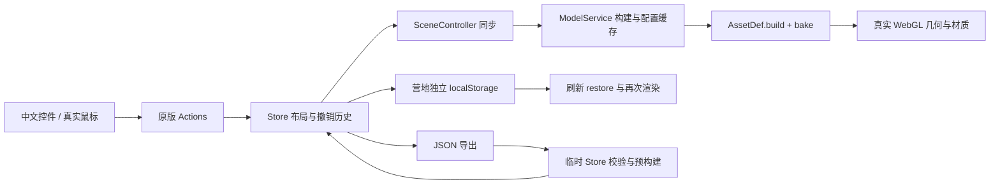
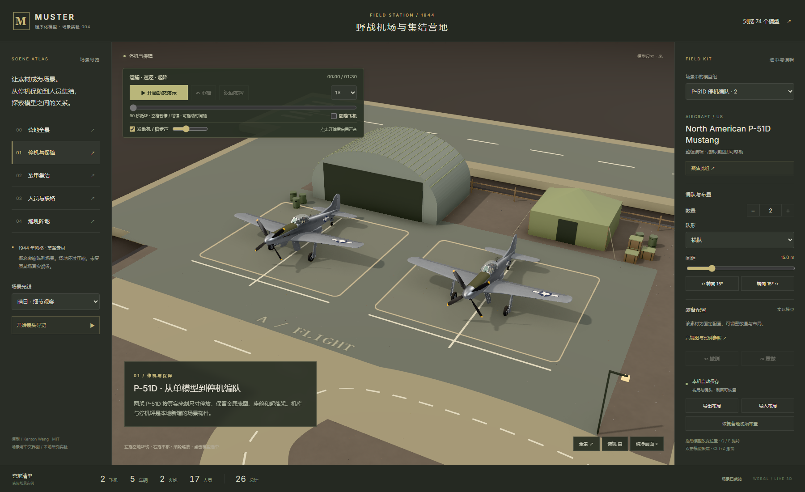
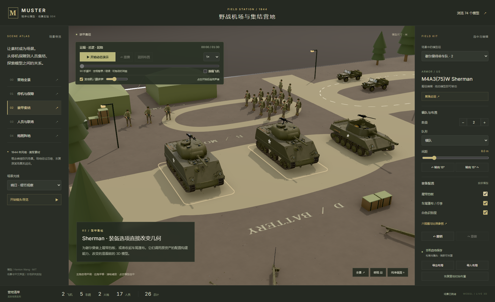

# 野战营地场景实验

研究日期：2026-10-11。以固定上游 commit `7d2fa86ebc3b999eaf085831cdcd5dccefea63d4` 的真实程序化模型为基础，把“模型收录”推进到“素材组织成可操作场景”。默认首页为中文营地，原版展柜保留在 `archive.html`，六视图仍在 `harness.html`。

本文保留首次静态营地阶段的设计与验收记录。后续已增加车辆运输、士兵巡逻与飞机起降，扩展了示意跑道；当前动作实现和证据见 [动作实验记录](fieldcamp-motion.md)。

## 场景为什么这样选

上游已有同属美军、年代大致符合 1944 年风格的飞机、装甲车辆、吉普、火炮和步兵。采用单一阵营，避免把各国装备简单混摆；用停机保障、联络车辆、人员集结、装甲待命、炮班阵地建立空间关系。

这是概念微缩陈列，**没有对应某个真实机场或战役**。72 × 48 米的原版地台仅放停机坪与联络道路，不用这段道路冒充足长的飞机跑道。不同兵种聚在同一地台是场景展示的压缩安排，未核验真实作战编制与机场组织。模型不缩放，米制尺寸、人物比例和原版配置继续生效。

| 场景组 | 上游资产 ID | 预设实例 | 展示能力 |
| --- | --- | ---: | --- |
| 停机编队 | `us-p51d` | 2 | 米制间距、金属表面、编队与镜头 |
| 装甲待命 | `us-m4a3-sherman` | 2 | 履带挡板、篷布、标识切换 |
| 机动支援 | `us-m18-hellcat` | 1 | 主炮型号、车尾装备 |
| 联络车组 | `us-willys-mb` | 2 | 风挡竖起 / 放倒、成组与单体编辑 |
| 炮班阵地 | `us-m2a1-howitzer` | 2 | 炮架展开 / 收拢 |
| 步兵集结 | `us-rifleman` | 12 | 横队 / 网格、人数、间距、持枪姿态 |
| 指挥组 | `us-squad-leader` | 2 | 装备、位置、比例参照 |
| BAR 支援 | `us-bar-gunner` | 3 | 持枪姿态、装备与布局 |
| **合计** | **8 类素材** | **26** | **17 人、5 辆车辆、2 门炮、2 架飞机** |

机库、帐篷、树木、篱笆、路灯、油桶、箱子、沙袋、道路和地面文字由 `src/showcase/environment.ts` 本地原创代码生成。这些是简化的造景构件，没有添加到 74 条历史模型目录，没有引入外部模型、纹理图或生成式效果图。

## 能力如何接入



直接复用 Catalog、Store、Actions、ModelService、SceneController、Interaction、CameraRig、摄影棚灯光和模型配置约束。没有重写一套只改变文字计数的假交互。状态修改进入原版编队、位置与配置流程，再驱动真实场景同步。

本地新增文件分工：

- `src/showcase/preset.ts`：八个预设模型组、坐标、数量、朝向、队形、导览镜头、中文配置标签。
- `src/showcase/environment.ts`：固定地面与营地构件、简化树木、傍晚灯罩发光。
- `src/showcase/main.ts`：中文界面、导览、模型编辑、保存与文件往返。
- `src/showcase/style.css`：营地界面与响应式布局。
- `scripts/verify-camp.mjs`：UI 到模型、编辑、文件、刷新恢复的实际浏览器验收。

Store 新增可选保存键参数；原版默认键不变，营地使用 `muster.fieldcamp.v1`。历史记录只在本轮页面内保留；刷新恢复布局与相机，光线、导览播放状态与撤销栈不保存。

为了维持紧凑场景，普通组的中文数量控件限制为 4、飞机为 2、步兵集结班为 20。JSON 导入限制为 60 个模型；完整资产上限和任意资产添加继续在原展柜使用。导入先用临时 Store 和原版 restore 规范化，再预构建模型，成功后才替换当前布局；环境构件不包含在布局 JSON 中。

## 运行与实际验证

在 `web/` 执行：

```powershell
npm.cmd run build
npm.cmd run preview
npm.cmd run verify:camp
```

打开 `http://127.0.0.1:5198/` 进入营地，`http://127.0.0.1:5198/archive.html` 进入原版展柜。报告与截图来自独立的临时浏览器配置，不改变日常浏览器的布局。当前仅本地运行，没有部署地址。

实际验收状态、几何变化与浏览器诊断保存在 [原始报告](fieldcamp-results.json)。报告只读接口 `window.__camp` 提供状态与真实模型命中坐标；测试修改均通过控件、鼠标、键盘或文件上传执行。

最终营地验收在北京时间 **2026-10-11 10:13–10:14** 执行，Node.js 22.15.0、Edge 155.0.4283.45、1800 × 1100 桌面视口，10 项通过：

| 实际检查 | 结果与证据 |
| --- | --- |
| 完整目录与场景 | 74 条公开目录；8 类素材、26 个实际实例；来源加载问题为 0 |
| 分区导览 | 停机坪镜头与 P-51D 组同步，目标坐标与视角可读 |
| 谢尔曼挡板 | 三角形从 315,532 变为 316,756，配置与新模型缓存键一致 |
| 炮架配置 | 真实生成 `trails=closed` 模型，截图可见收拢炮架；拓扑数量相同，不以三角形增减代替姿态验证 |
| 编队与人数 | 步兵班由 12 人网格改为 8 人横队，实际场景总计从 26 变为 22；间距与撤销重做一致 |
| 鼠标与键盘 | 通过真实命中点拖动一辆吉普，单体相对偏移变化；Q 旋转单体 15° |
| 观察工具 | 傍晚光线、俯视、纯净画面、导览开始与暂停 |
| 文件往返 | 下载真实 JSON；恢复预设可撤销；导入后配置、队形、数量、位置、单体偏移与原导出一致 |
| 刷新与隔离 | 修改后 22 个实例再次刷新恢复，镜头恢复；旧展柜保存键的测试标记未改变 |
| 窄屏 | 390 × 844 视口没有水平溢出，实际画布可见并渲染 |

最终报告运行错误与资源请求失败均为 0。仍记录 X4122 精度和 X3595 梯度着色器警告，没有称为“无警告”。最终运行约 93 秒，包括冷启动、多个配置、截图和再次刷新，不是帧率或硬件性能基准。

本轮首先验证完整渲染与分区、谢尔曼挡板和炮架配置。一次编队测试因为数值输入没有全选原数字，将输入追加到原值；改为真实 Ctrl+A 后输入再继续验收。没有把失败运行标成最终通过。

同时运行原版大展台与营地测试时曾出现原版等待超时，营地文件往返已完成后，为切换到串行验证主动关闭了该次验收窗口，因此那次刷新等待没有完成。最终营地成功报告来自新的独立运行。测试脚本另外显式恢复验收页前台，并对准备状态用定时轮询，减少浏览器焦点与 rAF 轮询带来的不确定性；没有据此归因于某个已证实的 GPU 故障。

随后串行执行的原版 `/archive.html` 回归 **7 项通过**，含 280 个默认模型、目录筛选、四号坦克侧裙、数量与网格、鼠标编辑、复制删除、保存与刷新，见 [原版回归报告](archive-regression-results.json)。首轮并行超时没有写成成功记录，最终报告来自完成的串行运行。

双入口子目录检查也已通过：把实际 `dist/` 临时挂载到本机的 `/1010_codex_project/004-muster-ww2/`，验证原版 74 条目录与 1 个真实模型，再验证营地 26 个模型、CSS、字体、图标和动态资源；失败请求为 0，服务器随后关闭。见 [子目录报告](fieldcamp-subpath-results.json)，这不代表已经部署线上。

交付前根目录 `npm.cmd run check` 校验项目编号、目录、图片与生成索引；文档本地链接另外核对，当前入口材料中 73 个本地引用均存在。

窄屏截图来自桌面 Edge 的 390 × 844 CSS 像素视口，不是实际手机或低性能 GPU 的性能实测。模型三角形统计属于各配置合并后的单模板，不等于整个场景含阴影与后处理的实际 GPU 绘制次数。

## 实际截图






其余分区、傍晚光线、刷新恢复和窄屏证据见 [图片索引](../assets/README.md)。

[实测导出布局](../assets/fieldcamp-edited-layout.json) 可在营地中通过“导入布局”复现报告里的 22 个模型编辑状态。

## 下一步价值

这个实验验证了“资产协议 → 配置构建 → 成组布局 → 场景保存”的组合方式，可以继续迁移到小镇搭建器、博物馆展陈、装备教学或创意场景工具。首次阶段人物、飞机和车辆静止；后续新增了车辆路径、巡逻步态与起降演示，见 [动作实验](fieldcamp-motion.md)。碰撞、真实运动物理、完整骨骼动画和资源预算仍需另行实现。

[返回项目说明](../README.md)
