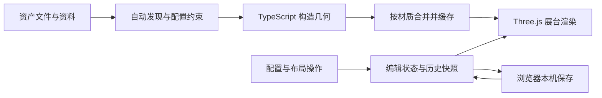

# Muster 中文研究

研究对象：[Kenton-GMI/muster-ww2](https://github.com/Kenton-GMI/muster-ww2)，固定 commit `7d2fa86ebc3b999eaf085831cdcd5dccefea63d4`。初次分析于 2026-10-10；本地引入与修复于 2026-10-11。

## 能力：把程序化模型变成可操作的资产库

成品是桌面浏览器里的二战模型展柜。用户按国家、类别与关键词寻找资产，查看资料与来源，然后把模型放到展台，调整配置、数量、编队、位置与朝向。已有布局和镜头保存到当前浏览器，编辑可撤销、重做。

该版本有 74 个公开条目：步兵 12、武器 14、装备 16、车辆 7、装甲 15、火炮 5、飞机 5。德国 20、苏联 18、美国 16、英国 16、日本 3、意大利 1，覆盖明显不均。另有隐藏审查资产；不能把这些内部条目计入公开目录。默认陈列 280 个模型，代码总上限 300，各资产另设组数量上限。

配置选项由每个模型预先定义。例如四号坦克可拆除车体侧裙板，德军步兵可切换背包、面包袋和工兵铲。模型、装备和姿势需要开发者实现；这个接口不提供任意文字生成新模型的能力。

## 效果：摄影棚里的微缩模型陈列

模型由多层几何表达轮组、履带、车体、炮塔、铆钉、舱盖和附件；表面有金属、橡胶、木材、织物等差异。统一灯光、阴影、环境反射与接触暗部让模型与地面形成稳定关系。六视图和比例人物帮助检查轮廓与尺寸。

展示质量依具体资产而变。部分内部结构、配件、纹理和人体细节是有意简化的，各资产通过 `provenance.notes` 记录。模型使用米制 1:1 约定，但外形来自公开尺寸和照片，不是生产 CAD 或精确测绘数据。当前没有战斗、驾驶、模型动作和物理模拟；镜头运动属于界面交互。

本轮实际效果见 [截图索引](../assets/README.md)；功能实测范围见 [实验记录](experiment.md)。

## 原理与数据流

### 几何与程序化人体

`src/core/geo/shapes.ts` 提供圆角盒、旋转体、挤出板、放样、杆件、管线、带状结构和重复零件工具。机械模型按真实部件层级构造，然后进行左右对称、阵列与组装。

`src/core/geo/sdf.ts` 用距离函数描述球、胶囊、圆角盒等体积，支持平滑联合与相减；Surface Nets 将零等值面转换成网格。共享人体系统组织骨架、静态姿势、头部、手、制服和装备贴合，供不同国家步兵复用。其静态骨架约定不等于完整动画系统。

### 材质与灯光

`src/core/materials/surface.ts` 在 Three.js 标准/物理材质上加入对象空间噪声、三向投影细节、木纹、迷彩、灰尘、凸边磨损和凹缝暗部。部分细节纹理由代码生成，不依赖外部贴图图片；三向投影减少任意程序化网格对手工 UV 的依赖。

`src/core/studio.ts` 统一摄影棚渲染：主光、补光、轮廓光和环境照明，N8AO 提供接触遮蔽，SMAA 处理边缘抗锯齿，再输出颜色。展台、卡片缩略图和单模型审查共用同一套灯光。

### 资产协议与扩展入口

`AssetDef` 包括名称、国家、类别、计数类型、事实、占地尺寸、间距、组数量上限、配置选项、构建函数与来源。`import.meta.glob` 自动发现 `*.asset.ts`，单个模块失败会被记录，不应悄悄把失败模型当成可用。

`options` 驱动配置控件，`constrain` 统一兼容规则；资产编号加上归一化配置形成缓存键。新条目接入同一套清单、检查器、布局与审查工具，降低重复界面开发。

### 状态与编队

`src/app/store.ts` 保存分组、选择、筛选和 UI 状态，布局修改通过快照记录历史；自动保存布局及镜头，历史栈不持久化。`src/app/layout.ts` 从数量、列数和间距计算槽位，个体微调作为相对槽位偏移保存，编队调整时可以继续保留。

底部数量取自实际呈现的场景；士兵携带武器不会再次计入独立装备。相机交互、状态变化和模型准备会触发渲染，静止场景按需更新。

### 性能取舍

`bake.ts` 把大量小零件按材质合并，并根据凸边、凹缝生成表面效果所需的属性。注册器按资产配置缓存模板，场景实例共享几何和材质。建模过程中使用的部分 `InstancedMesh` 会在合并阶段展开，因此不能据此宣称展台已经实现完整的 GPU 实例化。

程序化建模、合并与首次着色器编译会消耗时间；合并减少绘制次数，也会使运动部件不再天然独立。大型动态场景需要另行设计动画层级、LOD、实例化和生成调度。300 的数量约束不能替代性能预算。

## 使用场景与扩展方向

以下是基于架构的产品判断，尚未验证商业效果。

| 方向 | 已有基础 | 还需补充 |
| --- | --- | --- |
| 数字博物馆或教学 | 3D 观察、资料卡、比例关系 | 中文内容、讲解、课程流程、史料核对 |
| 收藏品陈列规划 | 数量、编队、手工微调 | 实际展柜尺寸、布局导出、打印清单 |
| 展示型产品配置器 | 配置协议、兼容约束、材质 | 新产品模型、价格与规则、订单流程 |
| 通用场景搭建器 | 自动注册资产、编辑状态、分组 | 抽象国家字段、组合模板、JSON 导入导出 |
| 动态探索或游戏 | 静态场景与模型基础 | 动作、物理、碰撞、玩法、网络同步 |

推进顺序建议为资产协议泛化、作品导入导出和分享、主题模板、目标设备性能优化，再根据真实需求加入动态系统。模型 GLB 导出属于后续能力；工程 CAD、可打印网格和生产精度需要独立验证。

## 对现有研究集的价值

Sakura Crossing 已提供三渲二风格、房屋/树木/道路编辑、撤销和本机保存；重复这些功能的增量价值有限。Muster 更值得提取的是：

1. 统一的资产接口和来源记录，使更多可配置组件接入同一套界面。
2. 配置选项及兼容约束，让屋顶、颜色、店铺附件等组合可维护。
3. 数量、编队、组内偏移和稳定槽位，使一排树、一组摊位等可以成组编辑。
4. 多角度审查、比例参照、最低点与几何统计，形成持续添加资产时的质量流程。

结合方向是保留樱花街的美术风格，抽取 Muster 的资产协议和布局方法。需要重新设计低复杂度的几何预算与材质适配，不能把高细节军事模型直接当成小镇在手机上的性能依据。

## 版本边界

本地衍生演示现已把既有素材组成中文营地，并新增车辆沿路移动、士兵程序化步态、飞机起降与统一暂停。它们是本地扩展，不改变本文对上游静态模型系统的分析；详见 [动作实验与实测证据](fieldcamp-motion.md)。后续还实现了车轮 / 逐节履带、程序化两段腿 IK、起落架与舱门关节，以及同步空间音效，详见 [真实感增强实测](fieldcamp-realism.md)。随后在独立的 `battle.html` 新增可玩装甲演习：本地驾驶、炮塔瞄准、平面车辆与炮弹碰撞、规则电脑、掩体寻路、占领与胜负流程；这是本地游戏层，详见 [对战开发记录](battle-game.md)。当前又扩展到步兵交火、预警空袭和谢尔曼 / M18 / Willys 三车接管，详见 [协同玩法记录](combined-arms.md)。完整骨骼蒙皮、真实车辆 / 飞行物理和联网仍未实现。

上游 README 的展台上限仍写 200，旧 `PROVENANCE.md` 记录 41 个条目，路线图目标是 100；本地按代码与浏览器确认 74 个公开条目、上限 300，并重新生成来源记录。路线图目标与隐藏资产均不算已交付能力。首次研究发现的构建错误已在本地修复，见 [修复说明](build-fix.md)。
