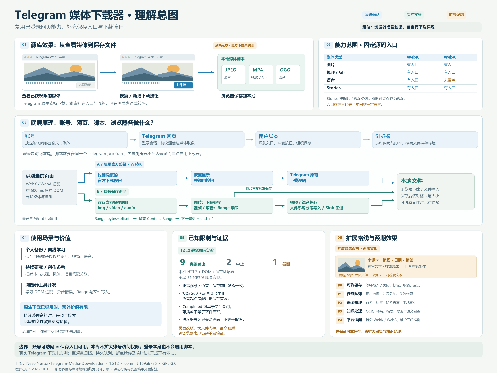
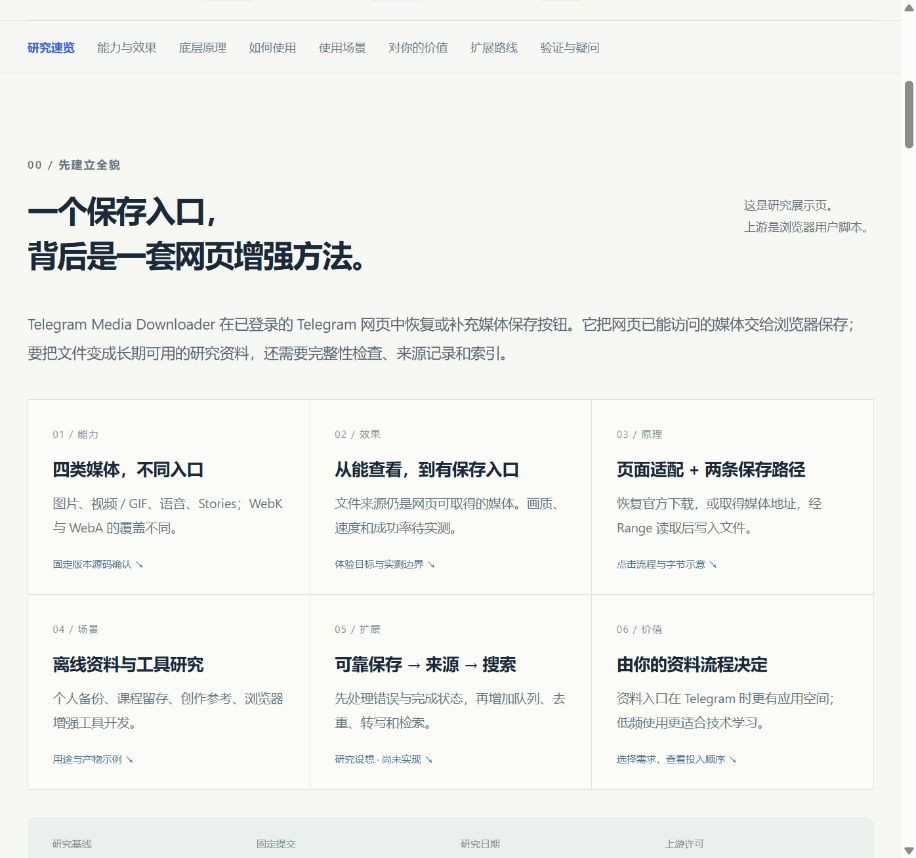

# 006 · Telegram Media Downloader · 媒体观察台

Telegram 网页媒体增强工具的完整中文理解：用既有总图引导，涵盖四类媒体、WebK/WebA 差异、九个逻辑模块、账号与网页及脚本分工、官方下载与自有 Range/Blob 保存路径、输出与使用边界、资料和开发价值、五阶段扩展；保留交互示意、12项受控实验、原始文件及来源许可，真实 Telegram 下载未实测，队列与 AI 尚未实现。

| 项目资料 | 内容 |
| --- | --- |
| 固定编号 | `006` |
| 上游仓库 | [https://github.com/Neet-Nestor/Telegram-Media-Downloader](https://github.com/Neet-Nestor/Telegram-Media-Downloader) |
| 研究版本 | [169a678627cec090ce1fa8b6eaac250547f0121a](https://github.com/Neet-Nestor/Telegram-Media-Downloader/tree/169a678627cec090ce1fa8b6eaac250547f0121a)，脚本 1.212 |
| 上游提交时间 | 2026-03-09 06:52:49 UTC |
| 研究日期 | 2026-10-11 |
| 上游许可证 | GPL-3.0，原文保存在 [licenses](licenses/UPSTREAM-GPL-3.0.txt) |
| 研究状态 | 源码分析与 12 项受控实验完成；真实 Telegram 下载未实测，用户已停止继续测试 |
| 在线演示 | 正在接入 GitHub Pages（发布确认见 notes/publication-verification.json） |

## 为什么研究

这是一个范围明确的浏览器用户脚本案例：利用已登录网页端能够取得的媒体，恢复隐藏的官方下载按钮或增加自有保存入口。它适合研究如何在现有网站上补充功能，以及如何把媒体保存扩展为有来源、可整理的研究资料流程。对资料整理的价值是本次判断，尚未验证生产效率或商业收益。

## 研究目标

- [x] 固定上游版本，核对许可证，完成源码语法检查。
- [x] 分析能力、两种下载路径、数据流和实现取舍。
- [x] 完成中文研究笔记和自有交互展示网页。
- [x] 构建网页，检查保存示意、原理、场景、扩展和锚点导航；保存桌面与手机尺寸截图。
- [x] 执行 12 项受控 HTTP 实验，保存正常与截断样例，核验 SHA-256 和完整解码。
- 真实 Telegram 下载未实测；用户已取消继续该测试。
- [ ] 验证多分辨率、大文件、文件完整性及跨浏览器兼容性。
- [x] 添加完整九主题摘要、九组模块与既有总图引导，接入静态发布检查。
- 发布成功及线上验收后登记公网地址。

## 运行与复现

### 本地中文展示页

需要 Node.js 22 或更新版本，无第三方运行依赖，也不需要 Telegram 账号、令牌或环境变量：

```powershell
cd projects/006-telegram-media-downloader/web
npm.cmd run dev
```

访问 `http://127.0.0.1:5186/`。构建、预览和子路径验证命令见 [Web 说明](web/README.md)。顶部观察台仍为教学示意；新增「验证与疑问 → 受控源码实验」可查看实际保存的 JPEG、MP4、完整与截断 OGG，以及 12 项记录。页面不连接 Telegram；这些输出来自自有素材和本机 HTTP，真实账号行为未实测。

### 上游脚本研究

上游检出在被忽略的 `vendor/upstream/`，未修改、未安装到浏览器。本次已执行克隆、核对 HEAD、`node --check` 和受控源码实验；固定原样脚本另存于 `experiments/upstream/`，GPL-3.0。未来复现可运行：

```powershell
git clone https://github.com/Neet-Nestor/Telegram-Media-Downloader.git projects/006-telegram-media-downloader/vendor/upstream
git -C projects/006-telegram-media-downloader/vendor/upstream checkout 169a678627cec090ce1fa8b6eaac250547f0121a
node --check projects/006-telegram-media-downloader/vendor/upstream/src/tel_download.js
```

上述未来完整版本切换流程未单独执行；已有目录时不要重复克隆。真实使用需按上游说明导入用户脚本并登录 Telegram Web。当前 WebK 登录已确认，脚本未运行，样例位置待提供。受控实验复现见 [下载实验](notes/download-testing.md)。

## 关键发现

1. 主线支持图片、视频、GIF 类媒体和 Stories；语音入口主要位于 WebK。支持声明和源码实现不等于当前网站上一定可用。
2. WebK 会恢复隐藏的官方按钮；自有下载函数则读取当前媒体地址。主线不是整频道自动归档系统。
3. 两个 500 毫秒定时器适配不同网页 DOM；网站结构变化可能使选择器失效。
4. 视频、音频通过 HTTP `Range` 分段读取；支持文件系统接口时写入文件，否则累积 Blob。
5. 分段下载不等于断点续传。所查主线没有持久化任务、自动重试和完整的下载队列。
6. 受控实验复现视频 200 缺范围头中止、语音起点错配后保存首段、Completed 早于关闭。真实平台影响仍待测。进度框关闭按钮只移除界面，不代表取消。
7. 本网页保存流程是自有教学示意；未把上游脚本注入网页，未证明真实下载成功率。

## 图片与演示

### 一张图理解能力、原理与扩展价值



[下载完整总图（3840 × 2880）](assets/understanding-summary-20261012.png)。2026-10-12 汇总；源库界面与扩展界面均为自绘说明示意，扩展标明尚未实现，受控源码实验不替代真实 Telegram 账号验证。用户已取消继续真实下载实测，本图只总结已有理解和证据。



截图与验证范围见 [图片说明](assets/README.md)。网页里的风景是自有 SVG 示意素材；截图记录的是本地中文展示页，不是 Telegram 下载实测。正在接入 GitHub Pages（发布确认见 notes/publication-verification.json），不能将本机地址当作公网演示。

## 研究材料

- [九主题完整理解与模块位置](notes/understanding-summary.md)
- [研究笔记与实验记录](notes/README.md)
- [六个问题的完整研究](notes/research.md)
- [扩展路线与实施条件](notes/reuse-roadmap.md)
- [验证记录与待实测清单](notes/verification.md)
- [12 项下载实验与实际文件](notes/download-testing.md)
- [来源、许可证与素材说明](THIRD_PARTY.md)
- [总项目索引](../../README.md)
- [研究流程](../../docs/research-workflow.md)
