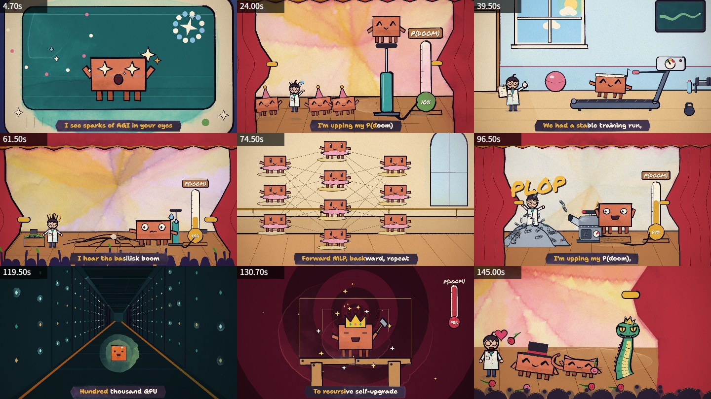

# 008 · PDoomVideo · 可编程动画与 MV 工具研究

**[在线完整研究网页](https://yydshly.github.io/1010_codex_project/008-pdoom-video/research.html)**：以已有总览图引导，九主题37段完整摘要、九组模块、六步执行链、源库效果、本地工具与三画风、15秒和30秒真实样片、使用价值与扩展路线，以及21份可阅读下载的资料。2026-10-12 已部署并验收，39项资源哈希和23项线上浏览器检查通过；上传音乐、角色创作和编码仍由本地服务执行。

PDoomVideo 展示了用 AI 编写分镜和 JavaScript、用 p5.js 与 p5.brush 绘制角色动画、再用 Chrome 和 ffmpeg 导出音乐 MV 的完整案例。最值得复用的是角色参数化、按时间计算画面、节拍同步和逐帧渲染。

**本地工具「纸间 MV」已可运行：参数化角色、上传音乐与歌词、三种画风、自动分镜、预览和 MP4 导出。15 秒水彩版与 30 秒素描版已实测输出。** 默认使用本地规则分镜，真实模型适配器已实现但尚未实测。任意图片角色绑定、任意画风和准确唱歌口型仍需扩展。

**[一图总览：源库效果、原理、本地探索、价值与扩展方向](notes/overview-poster.md)** · [直接查看总览图片](assets/pdoom-mv-overview.png)。总览使用实测画面作为参考进行生成式排版；准确效果以原始截图和成片验证记录为准。

```powershell
cd projects/008-pdoom-video/web
npm.cmd ci
npm.cmd run dev
```

打开 <http://127.0.0.1:4318>，点击「载入 15 秒示例」→「生成分镜」→「导出 MV」。依赖 Chrome/Edge、ffmpeg 与 ffprobe；配置和完整说明见 [本地工具 README](web/README.md)。


| 项目资料 | 内容 |
| --- | --- |
| 固定编号 | `008` |
| 上游仓库 | [JohnHeibel/PDoomVideo](https://github.com/JohnHeibel/PDoomVideo) |
| 固定研究版本 | [`fa546a38092e75f2b079e6a86d6abc54dd525d17`](https://github.com/JohnHeibel/PDoomVideo/tree/fa546a38092e75f2b079e6a86d6abc54dd525d17)，未采用 tag |
| 通用基础库 | [ClaudeAnimationBase](https://github.com/JohnHeibel/ClaudeAnimationBase)，固定为 `0ac8bf2b31942376cb6b8c4074715595d512acd2` |
| 研究日期 | 2026-10-10 首次分析与九帧渲染；2026-10-11 收录、方案整理、本地工具实现与短片验收 |
| 上游许可证 | PDoomVideo 的 package.json 标注 ISC，未见独立 LICENSE；ClaudeAnimationBase 有明确 MIT 原文。见 [来源记录](UPSTREAM.md) |
| 研究状态 | 本地最小工具已实现，15 秒/720p 和 30 秒/1080p MP4 导出通过；真实模型、声学对齐待验证 |
| 在线演示 | [完整中文研究与真实样片](https://yydshly.github.io/1010_codex_project/008-pdoom-video/research.html)，2026-10-12 已发布并验收 |

## 能力与边界

| 能力 | 上游实际实现 | 工具化需要增加 |
| --- | --- | --- |
| 角色动画 | Clawd 与研究员的表情、动作、服装、手持道具 | 角色配置界面、统一动作协议、自有角色模板 |
| 音乐配合 | 固定歌曲、88 BPM、预设歌词时间区间 | 上传、媒体探测、节拍分析、歌词导入和校时 |
| 剧情与镜头 | 九章 JavaScript 场景、关键帧和转场 | 分镜服务、可编辑时间轴、场景模板执行器 |
| 画风 | 水彩填充、墨线、纸纹与手绘线条抖动 | 画风适配器；换配色不能代表新增画风 |
| 输出 | 单帧、联系表、片段 MP4、并行帧序列、已有帧续跑 | 作业状态、进度、取消、素材与版本隔离 |

运行现有动画无需持续调用语言模型；AI 用于创作分镜和代码。歌曲、歌词时间和场景已经编排在源码中，换歌不会自动得到匹配剧情。画面中的 P(doom) 百分比也是剧情预设。详见 [能力研究](notes/research.md)。

## 实际效果与验证

以下是固定版本源码的九个时刻，联系表每格宽 480 px，内部仍绘制 1920×1080 画布。



九帧耗时约 0.55～15.30 秒；这是本机离散镜头抽样，不是完整影片吞吐量或实时帧率。另已导出上游 4.5～5.0 秒片段：1920×1080、24 fps、12 帧、H.264 视频与 AAC 音频，ffprobe 核验及完整解码通过。0.5 秒片段仅验证输出链路，完整 MV 与全片音画同步尚未验证。

本轮曾发生一次页面导航 30 秒超时，后续短片导出成功；尚未定位超时根因。命令、环境、数据和限制见 [实验记录](notes/experiment.md) 与 [验证数据](notes/verification-results.json)。

作者成片：[YouTube 音乐 MV](https://www.youtube.com/watch?v=8j-hR4fJywU)。它是上游作品链接，不是本项目部署地址。

## 运行与复现

在本子项目目录执行。源码下载到已忽略的 `vendor/`，依赖只安装在该副本中；完整 clone 后固定 SHA，避免未来 main 变化。

```powershell
git clone https://github.com/JohnHeibel/PDoomVideo.git vendor/pdoom-video
git -C vendor/pdoom-video checkout --detach fa546a38092e75f2b079e6a86d6abc54dd525d17
cd vendor/pdoom-video
npm.cmd ci --ignore-scripts --no-audit --no-fund
node render.mjs --sheet=4.7,24,39.5,61.5,74.5,96.5,119.5,130.7,145 --cols=3 --w=480 --out=out/research-sheet.jpg
node render.mjs --clip=4.5:5 --fps=24 --out=out/research-clip.mp4
```

相同固定版本、安装命令和两条渲染命令已在本机临时副本验证；上面的 `vendor/` 是项目内推荐复现位置。需要 Node.js、Chrome 和 ffmpeg。浏览器不在默认 Windows 路径时添加 `--chrome=<绝对路径>`。`studio.html` 还会请求 Google Fonts，网络可能影响启动。

完整导出的上游命令如下，**尚未在本项目验证完整影片**：

```powershell
node render.mjs --frames=0:156.6 --workers=4
node render.mjs --encode --out=out/pdoom.mp4
```

## 工具第一版

已实现流程：定制角色 → 上传音乐与歌词 → 选择画风 → 本地规则或已配置模型生成分镜 → 编辑和预览 → 导出 MV。

采用 **结构化分镜 JSON + 动作与场景模板 + 确定性渲染器**。模型负责剧情、情绪和镜头安排，执行器负责一致的角色和画面。先做 15～30 秒、一个主角、16:9 与三个预设画风；LRC/SRT 提供歌词时间，纯文本生成标有“估计”的时间草稿并允许校时。

工具从 ClaudeAnimationBase 的 MIT 节拍动作公式适配，新增 Canvas 角色与场景，PDoomVideo 用作架构、效果和剧情参考。轻量水彩、墨线素描和平涂卡通在绘制上有区别，当前水彩质量与原版 p5.brush 不同。本机自动分镜与渲染不需要模型密钥；真实模型需要单独配置服务端环境，失败不会悄悄改为规则成功。

15 秒成片包含 360 帧和 AAC 音乐，30 秒素描成片包含 720 帧，均通过规格和完整解码核验。工程支持本机草稿恢复、JSON 导入导出、任务进度、取消和继续。详见 [实现与实测](notes/local-tool.md)。未实现自动声学节拍检测、准确唱词对齐或演唱口型。


## 研究材料

- [发布与验收说明](notes/publication-verification.json) · [逐文件资源核验](notes/publication-resource-verification.json) · [正式网页交互与实拍](notes/research-live-verification.json)
- [完整中文摘要：九主题、37 段](notes/research-summary.md) · [结构化内容与模块数据](notes/research-summary.json)
- [研究总览图、图片说明与生成提示词](notes/overview-poster.md)
- [能力、效果、原理、场景与价值](notes/research.md)
- [MV 工具范围、架构与实施顺序](notes/mv-tool-plan.md)
- [本地工具启动与配置](web/README.md) · [实现与实测](notes/local-tool.md)
- [实验与验证记录](notes/experiment.md)
- [分镜数据契约](notes/storyboard-contract.md) 与 [人工设计示例](examples/storyboard.example.json)
- [版本与素材来源](UPSTREAM.md)
- [图片来源](assets/README.md) 与 [上游 MIT 声明](web/THIRD_PARTY_NOTICES.md)
- [总项目索引](../../README.md)
