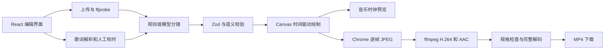

# 纸间 MV 本地工具实现与验证

纸间 MV 已在 `web/` 实现角色编辑、音乐与歌词导入、三种画风、自动分镜、动画预览和 MP4 导出。15 秒水彩版与 30 秒素描版已完成实际输出。当前可独立使用的自动分镜是本地规则模式；真实模型适配器已实现，但本机没有模型配置，尚未进行真实服务调用。

## 使用流程

在 `web/` 运行 `npm.cmd ci`、`npm.cmd run dev`，打开 <http://127.0.0.1:4318>。点击「载入 15 秒示例」，再点击「生成分镜」，即可预览和导出。示例音乐由本项目代码合成，无人声；字幕是原创示范歌词，不能用它证明唱词声学对齐。

角色可编辑名字、身体和点缀颜色、身体比例、眼睛大小、头饰与初始心情。音乐接受 MP3/WAV，可选择起点及 15～30 秒长度，手动设置 BPM 和首拍偏移。歌词接受 TXT/LRC/SRT，带时间格式按原音乐时间裁切，纯文本按长度估计。导入后可以逐句调整开始、结束和内容。

生成分镜后可以改变每镜头的场景、动作、表情、镜头、转场、叙事目的和结束边界；结束边界同时调整下一镜头的开始时间。预览以音乐播放器时钟驱动画面。工程草稿自动保存在浏览器，并支持工程 JSON 保存和打开。音乐文件保存在本机 `web/data/assets/`；工程 JSON 不内嵌音频，跨机器使用时需要重新上传。

## 实现结构

| 层 | 实际代码 | 作用 |
| --- | --- | --- |
| 工程与时间约束 | `web/shared/project.ts` | 格式 `1.0.0`，镜头连续覆盖、ID 引用、歌词不重叠、音乐选段不越界 |
| 歌词导入 | `web/shared/lyrics.ts` | TXT 估计时间，LRC 多标签和 offset，SRT 裁切 |
| 本地分镜 | `web/shared/planner.ts` | 开端与谢幕固定、歌词关键词选择场景和情绪、镜头边界靠近节拍 |
| 模型分镜 | `web/server/planning.ts` | OpenAI Chat Completions 兼容接口，JSON 校验及一次修复；仅允许改变故事和镜头 |
| 节拍动作 | `web/shared/motion.ts` | 复用并适配 MIT 基础库的动作公式，显式 BPM/offset，无 p5 全局变量 |
| 画面执行 | `web/src/engine.ts` | 六个场景、六个动作、五种情绪、三种镜头和三种画风 |
| 媒体与作业 | `web/server/media.ts`、`jobs.ts` | Chrome、ffmpeg、ffprobe、单任务队列、快照、进度、取消与继续 |
| 本机接口 | `web/server/index.ts` | 上传、歌词解析、自动分镜、导出、历史任务、文件下载 |

三种画风实际采用不同笔触：水彩版是透明填色、局部纹理与纸粒；素描版是浅色填充、排线和重复轮廓；卡通版是实心色块与清晰粗线。当前水彩没有使用 p5.brush，视觉质量与原片不同。新增画面和自有角色由 Canvas 绘制，上游直接复用部分是节拍动作公式，来源与完整 MIT 原文在 [第三方声明](../web/THIRD_PARTY_NOTICES.md)。

真实模型请求依据 [官方 Chat Completions 参考](https://developers.openai.com/api/reference/resources/chat)，通过服务端环境变量指定兼容地址、密钥和实际可用模型。输入包含歌词、角色、画风、长度和模板规则，不上传音乐。模型返回 `{story, shots}`；角色、素材、时长、分辨率、种子由程序固定。失败不会自动转成规则成功。协议修复测试使用本地模拟服务，不等于真实模型验证。

## 作业与缓存

状态为 `queued → rendering → encoding → verifying → complete`，另有 `failed` 和 `cancelled`。每个作业包含工程快照、独立帧目录、原子写入的 `job.json` 和 MP4。缓存包含工程 JSON、音乐内容哈希、核心源文件、系统标识、浏览器及字体文件元数据和 ffmpeg 版本。相同快照可复用完成作业；改变角色或画风会得到新作业。

继续任务时检查已有 JPEG 的文件长度、起止标记，缺失帧重绘；ffmpeg 在编码时负责实际解码帧。编码前检查序号和文件大小，编码后检查分辨率、24 fps、总帧数、音视频时长误差不超过一帧，再对 MP4 进行完整解码。中断作业在服务重启后标为失败，可从历史任务继续。相同渲染版本保留帧；版本改变重新建任务。

本轮实测了取消、继续、缺帧重绘和配置缓存失效。强制杀进程后的恢复、磁盘损坏与并发压力尚未实测。当前一次只渲染一个作业，文件需自行管理；未实现局部 AI 重写、并行 worker、按镜头增量缓存或服务端多用户项目版本冲突处理。

## 实测结果

本机：Windows、Node.js 22.15.0、Chrome、ffmpeg n6.1.3。本地开发服务与构建后的服务均已运行。无头渲染使用 `--disable-gpu` 软件绘制；默认模式和 D3D11 尝试曾卡在页面或截图等待，软件模式下完整链路通过。此结果不能据此推断上游导航超时也有相同原因。

| 验证 | 结果与证据 |
| --- | --- |
| 15 秒完整 UI 流程 | WAV/LRC 上传、角色改名和帽子修改、分镜编辑、带音频预览、导出与下载；720p、360 帧、H.264/AAC，时长 15 秒 |
| 30 秒接口与媒体流程 | MP3/SRT，88 BPM、0.21 秒首拍偏移，1080p 素描、720 帧、H.264/AAC，时长 30 秒 |
| 音视频核验 | 两支成片的音视频各与目标长度一致，ffprobe 和完整解码通过 |
| 三种画风 | 实际画布哈希不同，水彩、墨线、平涂截图已检查；完整视频导出验证了水彩和素描 |
| 确定性 | 在 4.2 秒绘制，跳回 1 秒，再绘制 4.2 秒，JPEG 完全一致 |
| 草稿恢复 | 浏览器刷新后角色与分镜保留 |
| 缓存 | 相同快照返回相同已完成任务；修改角色和画风新建任务 |
| 取消与继续 | 第 13 帧后取消；继续时保留原帧，并重绘被删除的第 3 帧 |
| 浏览器 | 1440 px 桌面与 390 px 手机布局检查，未出现横向溢出或运行错误 |
| 核心测试 | 10 项通过，覆盖解析、边界、约束、纯函数及模型模拟修复 |
| 真实模型 | 未配置、未实测；没有用规则结果冒充模型生成 |

完整数据保存在 [界面验证 JSON](local-tool-verification.json) 和 [30 秒集成验证 JSON](local-tool-integration.json)。这些记录中的耗时只描述本机、指定样片与当次环境；30 秒记录计时是取消后继续任务的耗时，不含首次取消之前与等待的时间。

成片保存在本机忽略目录：`out/local-demo-15s.mp4` 和 `out/local-demo-30s-ink.mp4`。截图、示例工程和验证 JSON 纳入项目资料。工程的 `assetId` 引用本机上传素材，并非随 JSON 分发的音频。新机器可使用内置示例重新生成。

## 后续优先方向

先配置真实模型并建立多组歌词样本，验证剧情连贯性与模板执行率；再加入自动节拍检测和唱词对齐。当前模型基于文字理解，节拍来自手动参数，画面不具备演唱口型。图片角色绑定、多角色剧情、高质量 p5.brush 水彩、竖屏构图和生成式镜头仍属于扩展方向。
