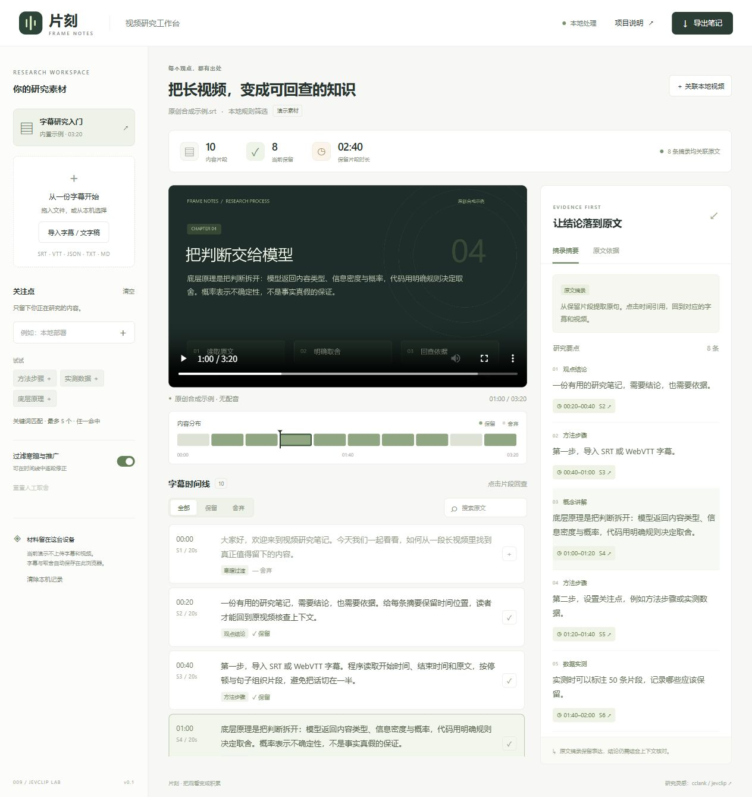
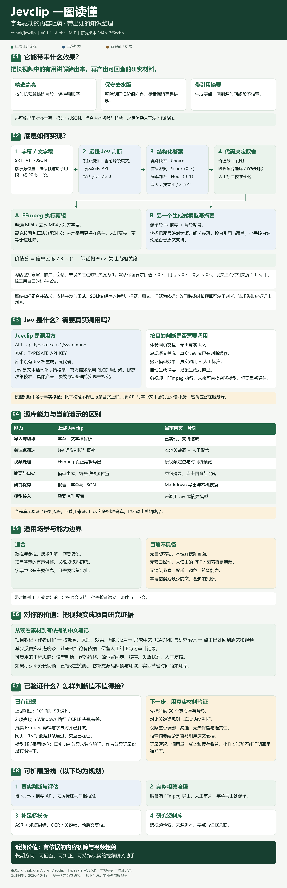

# 009 · Jevclip · 视频研究助手

完整整理字幕驱动视频粗剪与研究证据：精选与保守去水、带引用摘要、九组源码模块、Jev 判断与代码策略及 FFmpeg 分工、场景与个人价值、缓存和人工校准、模型接入、多模态与资料库扩展。既有全景图作为网页导读；原创「片刻」工作台提供字幕导入、关注点筛选、时间线预览和摘要回查。真实 Jev 与摘要模型未调用。

| 项目资料 | 内容 |
| --- | --- |
| 固定编号 | `009` |
| 上游仓库 | [cclank/jevclip](https://github.com/cclank/jevclip) |
| 研究版本 | `3d4b13f6ecbb7f56cf212c5040b4b4e19d83967a`，包版本 `0.1.1`，Alpha |
| 研究日期 | 2026-10-11 |
| 上游许可证 | MIT；[许可证副本](licenses/UPSTREAM-MIT.txt)、[来源说明](THIRD_PARTY.md) |
| 研究状态 | 中文源码分析和本地演示完成；真实模型 API 效果待验证 |
| 在线演示 | 尚未部署；本地运行方式见下文 |

## 完整研究网页与工作台

新首页为 `web/dist/research.html`：九主题、32 段完整摘要、九组固定源码模块、两条输出分工、源库与演示对照、15 份原文资料阅读和下载。全景图原样保留，可滚动预览、放大或下载 PNG / SVG。`web/dist/index.html` 保留原字幕研究工作台，两页相互导航。

统一内容来源为 [结构化研究摘要](notes/research-summary.json)，可读全文见 [完整摘要](notes/research-summary.md)。运行 `npm.cmd run research:sync` 同步项目索引与完整摘要，随后在根目录执行 `npm.cmd run catalog:sync`。公开页面无后台、模型密钥或外部材料上传。



## 一图总览

[高清中文全景图（PNG）](assets/jevclip-overview-2026-10-12.png) · [可编辑矢量图（SVG）](assets/jevclip-overview-2026-10-12.svg) · [来源与制作说明](notes/infographic.md)

用八个部分汇总输出效果、底层流程、Jev 调用、源库与演示能力对照、使用场景、对当前项目研究的价值、验证边界和扩展路线。图中区分已有能力、待验证效果与规划；真实 Jev API 仍未调用。

<details>
<summary>展开完整长图</summary>



</details>

## 能力与研究价值

上游通过 Jev 对字幕片段做结构化判断，再由代码决定保留、舍弃和剪辑；另一个模型根据保留段生成摘要，代码把引用编号换成源时间。可输出高亮、保守去水版、重对齐字幕、报告和 JSON。它不自带转写，也不读取视频画面。

网页顶部默认展开“原理与能力”：字幕切段 → Jev 判断 → 代码取舍，再分成 FFmpeg 视频剪辑和带引用摘要两条输出。对照表明确区分上游语义判断、剪辑导出与本演示的关键词筛选、原视频定位和原句摘录；可收起说明继续使用工作台。

值得借鉴的是“模型判断、代码策略、源位置引用、人工校准”的分工。可以把项目教程、演示和作者访谈整理成带出处的研究材料。完整架构、适用场景、限制与扩展方向见 [研究笔记](notes/research.md)。

## 本地网页已实现

| 功能 | 行为 |
| --- | --- |
| 字幕导入 | SRT、WebVTT、通用 JSON、whisper.cpp JSON、TXT 和 MD；支持拖放 |
| 关注点筛选 | 最多 5 个；关键词或预设关键词组，任一命中；不是语义模型判断 |
| 时间线预览 | 全部/保留/舍弃切换、原文搜索、内容分布、逐段人工修正 |
| 摘要回查 | 摘录原句；点击引用展开完整原文，已关联视频时同步跳转 |
| 上游结果导入 | 读取 Jevclip `segments.json`，保留取舍、类别、分数和理由；未判断单独显示 |
| 研究保存 | 导出含依据和完整时间线的 Markdown，字幕、关注点和取舍支持刷新恢复 |
| 无时间文字稿 | 使用段落定位，不生成虚构的视频时间 |

**演示默认采用本地规则和原文摘录，未调用 Jev 或摘要模型。** 原创合成示例约 3 分 20 秒、10 个片段，无配音，用于检验交互，不是模型准确率实验。网页预览原视频，不导出剪辑成品。

普通字幕按约 20 秒合并，尽量保留句子边界；Jevclip 已判断片段不再合并。仅含起点的时间稿标记终点推定，优先使用实际起止时间的 SRT/VTT。

## 运行本地网页

需要 Node.js 22+。无第三方运行时依赖，无需安装 npm 包：

```powershell
cd F:\codex_project\1010_codex_project\projects\009-jevclip\web
npm.cmd run dev
```

访问终端显示的 `http://127.0.0.1:5199/`。端口冲突时：`npm.cmd run dev -- --port 5209`。

体验顺序：内置示例 → 添加“方法步骤” → 点击摘要引用 → 人工修正 → 导出笔记。也可导入 [示例字幕](assets/demo.srt)，再关联 [示例视频](assets/demo.mp4)。

```powershell
npm.cmd test
npm.cmd run build
npm.cmd run preview
```

子目录预览：`npm.cmd run preview -- --port 5200 --base /1010_codex_project/009-jevclip/`。所有资源使用相对路径。构建输出在 `web/dist/`，已忽略提交。本地地址不能填入根登记表 `demo`；部署后才填写实际 HTTPS 地址。

## 上游复现与验证范围

在独立临时目录固定上游 commit，用 Python 3.10 运行原始 101 项测试：99 项通过、2 项失败。通过项包括真实 ffmpeg 剪辑、画面片段核对和字幕重对齐；失败来自 Unix 路径断言和 Windows 测试夹具的二次 CRLF 转换。未修改上游代码。见 [实际输出](notes/upstream-test-output.txt) 与 [验证记录](notes/verification.md)。

真实 Jev 判断需要 `TYPESAFE_API_KEY`；生成式摘要还需要 OpenAI 兼容模型配置。本次未调用这些 API。上游 README 的中文效果是作者有限样本记录，不是本项目独立复现。

## 材料与隐私

当前网页无外部模型请求、CDN 字体或分析服务。文件通过浏览器读取，视频用 Blob URL 关联。字幕原文、关注点和人工取舍默认存在该浏览器 `localStorage`，可用“清除本机记录”清除。刷新后本地视频需要重新选择，视频不写入记录。

输入采用 UTF-8，最多 5 MB / 5,000 条字幕。视频能否播放取决于浏览器编解码器，优先使用 H.264 MP4 或 WebM。未来接入真实 API 时字幕会离开本机，需明确发送目的地，密钥保留服务端。

## 研究材料

- [研究笔记](notes/research.md)：能力、流程、引用局限、使用场景与扩展路线。
- [验证记录](notes/verification.md)：命令结果、浏览器操作和待验证边界。
- [浏览器实际导出](notes/sample-export.md)。
- [Web 开发说明](web/README.md)。
- [手机布局截图](assets/showcase-mobile.jpg)。
- [来源与授权](THIRD_PARTY.md)。
- [总项目索引](../../README.md)。
