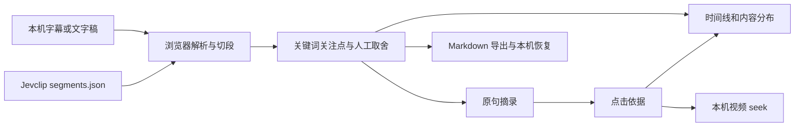

# Jevclip 研究：从视频筛选到证据回查

研究日期：2026-10-11。固定上游版本：`3d4b13f6ecbb7f56cf212c5040b4b4e19d83967a`，版本号 `0.1.1`，MIT，Alpha。

## 能力与效果

Jevclip 接收视频及配套字幕，或单独的字幕、文字稿。它逐段判断内容价值，输出精选视频、保守去水的视频、带位置引用的摘要、字幕和 JSON 数据。已有文字材料可以独立研究；没有时间稿时，位置是段落编号，不是虚构的视频时间。

作者在 README 展示了一个合成样本和一期真实技术讲解。合成样本中的明显寒暄、广告和具体内容被正确区分；真实视频的三分钟精选只覆盖参考要点中的一部分。这些记录有助于理解输出，但不是独立或大样本准确率证明。本项目未调用付费模型 API，不能复现或承诺作者的中文筛选准确率。

最适合信息主要存在于语言表达中的教程、访谈、技术介绍；PPT 上未被读出来的数字、无旁白演示、视觉情节不能通过字幕判断。

## 上游如何实现

| 模块 | 职责 | 借鉴点 |
| --- | --- | --- |
| `subtitles.py` | SRT、VTT、JSON、文字稿解析，按停顿与句子切段 | 源位置必须和原文绑定；不拆字幕行 |
| `store.py` | SQLite 保存材料版本、片段和判断记录 | 保持源数据版本可追溯 |
| `jev.py` | TypeSafe HTTP 请求、并发、重试与使用量记录 | 网络失败不是“没有价值” |
| `rubric.py` | 定义分类、密度、夸大、独立性、相关性问题；规则取舍 | 模型判断与业务策略分离 |
| `reel.py` | 时长预算内选择片段；生成保守去水版；ffmpeg 剪辑、字幕重对齐 | 时长约束、连贯性和时间同步共同影响结果 |
| `summary.py` | 保留段摘要、编号引用、遗漏补写、数字与名称检查 | 引用定位交给代码，减少伪造位置 |
| `labels.py` | 导出人工标注，比较门槛的错误比例和召回 | 用自己的材料选门槛 |
| `pipeline.py` / `report.py` | 串联执行，输出人能核查的报告与机器数据 | 报告需要说明取舍理由与未判断状态 |

模型收到视频标题和当前片段原文，不会读取原视频画面；默认模型固定为 `jev-1.13.0`。每段的多个窄问题一起请求，结果包含 Choice、Score、Noul 等结构化值。根据 TypeSafe 官方文档，Jev 是针对校准决策训练的文本模型，公开资料不能还原完整训练实现。

设信息密度为 `d`、闲话三类概率之和为 `j`、最高关注点相关度为 `f`：

```text
value = d / 3 × (1 - j) × f
```

未设置关注点时 `f = 1`。默认同时要求价值不低于 0.5、闲话概率小于 0.5、夸大概率小于 0.6，设置关注点时相关度还要达到 0.5。门槛是临时默认值，应通过自己的标注调整。

高亮的背包算法按 `value × (0.5 + 0.5 × standalone) × duration` 计算收益，成本包括每段前后留白。源码会对部分依赖前文的开头关联上一段，但它不是完整语义连贯性保证。预算为零时收全部保留段。去水完整版采用更保守的 `skip` 条件，不会把“没进高亮”简单等同于“应删除”。

缓存键包含模型、标题、文本与问题的完整请求。调整取舍门槛和高亮预算可以复用判断；改关注点、标题或问题文本会改变请求。缓存减少的是判断调用，不保证摘要调用免费。

## 引用可靠性

摘要模型引用的是片段编号，代码映射为源时间范围或段落。未知编号被移除，漏引用的保留段会得到一次补写机会，最终仍缺失的片段会报告出来。

需要区别三个层次：

1. 编号存在：它指向了实际片段。
2. 片段覆盖：每个保留段至少被引用一次。
3. 命题正确：摘要中的每个结论都被原文支持。

上游对前两层做了明确检查，第三层仅检查部分数字和英文名称。片段被引用不代表内部所有要点完整保留；词项出现也不能证明因果关系和适用范围正确。点击回查与人工修正仍然有价值。上游 Markdown 默认输出时间标签，本项目网页才提供点击播放器跳转。

## 本地演示如何实现

本项目在 `web/` 实现原创静态应用“片刻”，使用 HTML、CSS 和原生 JavaScript，没有第三方运行时包。它参考上游职责拆分，但没有复制或移植上游 Python 代码。



普通字幕按本地关键词识别寒暄、推广和简单类别，不输出虚构的概率或“AI 价值分”。内置关注点是可查看的关键词组；自定义关注点按大小写不敏感的原文子串匹配，多个关注点取任一命中。这是交互演示，不能代替 Jev 的语义判断。

导入上游 `segments.json` 时保留 `keep`、`kind`、`value`、`reasons`；`keep: null` 显示待判断，不进摘录。关注点仍是本地关键词过滤。人工决定优先于上游或本地规则，摘要与导出同步更新。

每条摘录从保留段提取原句，直接绑定片段对象。点击依据会清空遮挡该片段的搜索和显示过滤，展开原文并定位时间线；已关联视频时跳转播放位置。无时间文字稿只显示段落，不用阅读速度伪装视频时间。只有起点的时间稿标记终点推定。

字幕、关注点和人工取舍存入 `localStorage`，视频通过 `URL.createObjectURL` 关联，不存入浏览器数据库。刷新后本地视频需要重新选择。用户可清除本机记录；存储失败时仍可继续操作并导出。

## 对当前研究仓库的价值

将项目教程和作者讲解变成带依据的研究材料，补充源码分析。比单独保存一个视频链接，更容易回答“这条结论来自哪里”“演示在什么位置”“哪些数据还需要复核”。

可迁移的工程经验是：狭窄模型问题、明确策略、源位置绑定、失败状态、人工纠正和可审计输出。产品差异应来自特定研究流程，而不是仅增加一个摘要按钮。

## 可扩展方向与优先级

| 优先级 | 方向 | 实现条件与风险 |
| --- | --- | --- |
| P1 | 服务端接入真实 Jev 与摘要模型 | 密钥留在服务端；导入后明确告知字幕会发送外部服务，保留模型版本、成本和错误状态 |
| P1 | 领域标注与评估 | 测误删、召回、摘要命题错误；当前浏览器规则不适合输出通用准确率 |
| P2 | 自动转写与热词 | 需要音频处理和模型名、产品名纠错；不能把转写错误当成原始事实 |
| P2 | 画面 OCR 与关键帧 | 补充代码、图表、PPT；需要新的证据位置和视觉来源标记 |
| P2 | 上下文复核 | 将不确定片段与前后文交给模型或人，减轻转述宣传被误删的问题 |
| P3 | 多视频检索 | 保存来源版本、片段和命题关系，检索结果仍必须回到原始材料 |
| P3 | 真正剪辑导出 | 通过本地 Python/ffmpeg 后端执行，静态网页当前只预览原视频，不输出剪辑成品 |

## 来源

- [固定版本源代码](https://github.com/cclank/jevclip/tree/3d4b13f6ecbb7f56cf212c5040b4b4e19d83967a)：模块分析和能力边界。
- [README](https://github.com/cclank/jevclip/blob/3d4b13f6ecbb7f56cf212c5040b4b4e19d83967a/README.md)：作者的运行说明与有限样本记录。
- [MIT 许可证](https://github.com/cclank/jevclip/blob/3d4b13f6ecbb7f56cf212c5040b4b4e19d83967a/LICENSE)：已在项目 `licenses/` 保留副本。
- [TypeSafe System One](https://docs.typesafe.ai/concepts/system-one)、[RLCD 说明](https://docs.typesafe.ai/introduction/machine-learning-primer)：模型定位；未推断未公开的训练细节。
- [本地验证记录](verification.md)：区分实际测试、作者结果和待验证工作。
