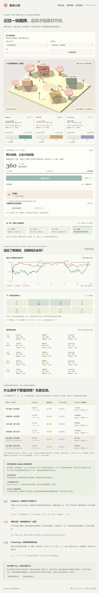
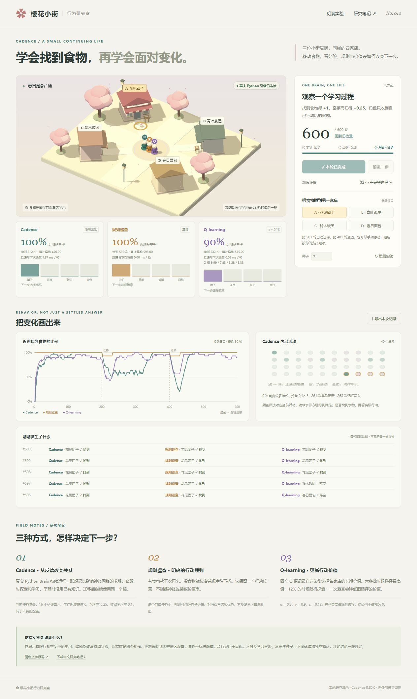
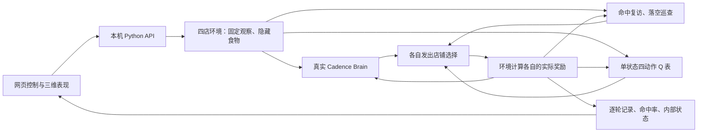

# 010 · Cadence · 樱花小街觅食实验

让三位 NPC 在樱花小街觅食，用真实 Cadence、规则和 Q-learning 对照观察学习与奖励变化。保留四店即时奖励实验，新增两类街区线索、两次岔口选择、两个等待时刻与单线索迁移。三者只收到公开观察及自己的实际反馈，搬家时保留学习状态。

| 项目资料 | 内容 |
| --- | --- |
| 固定编号 | `010` |
| 上游 | [muellerberndt/cadence](https://github.com/muellerberndt/cadence) |
| 固定研究版本 | [`19bee92756d1842176ad30b1cd01edbfbfa3f14c`](https://github.com/muellerberndt/cadence/tree/19bee92756d1842176ad30b1cd01edbfbfa3f14c)，包版本 `0.80.0` |
| 研究日期 | 2026-10-10 至 2026-10-12 |
| 许可证与来源 | 上游 GPL-3.0；渲染片段 MIT；见 [来源清单](THIRD_PARTY.md) |
| 当前状态 | 三个本地场景、NPC 算法可视化；新增历史位置捕鱼预测与两条件四种子对照，见各验证记录 |
| 在线演示 | 正在接入既有 GitHub Pages；部署与线上验收后登记实际地址。公开研究和真实记录回放，新训练需要本机 Python 服务 |

## 完整中文研究与公开回放

新增 `web/research.html` 作为正式研究入口，沿用我们已生成的 3200×6700 理解总图，PNG/SVG 字节不变。九主题36段完整摘要涵盖能力、模块、算法原理、对照效果、14个场景与业务、接入方法、个人价值、六阶段扩展和来源边界，内容源为 [research-summary.json](notes/research-summary.json)，同时生成 [完整摘要](notes/research-summary.md) 并同步根项目索引。

公开版 `replay.html` 可切换四店4种子、街区24次运行、捕鱼8次运行的冷启动/训练后与全部留出鱼，单步查看真实行动、累计命中、历史/预测/实际轨迹、误差和射击结果；NPC内部播放器保留28帧观察、活动、450连接资格和权重前后值。`fish-ep.html` 原八步数字、八幕相减动画和七步β推导、中文指南及能力地图继续可用。

公开网页只播放已完成的真实Python计算，不新建模型或训练；源3D实验、手动搬奖励和新种子仍在本机运行。图稿与历史笔记中的“未部署”和localhost地址属于制作阶段，当前发布状态以验收记录为准；原SVG点击链接保留本机含义，在线使用图旁导航。

在 `web` 执行 `npm.cmd ci`、`npm.cmd run check`、`npm.cmd run build:public`、`npm.cmd run publication:check` 生成独立 `dist-public/`。CI校验已有数据与源代码SHA-256、七项EP数值测试和逐文件发布清单，不重训、不重新生成图、不需要Python或密钥。`npm.cmd run build` 继续生成本机API版。正式HTTPS与浏览器实际验收记录保存在 `notes/publication-verification.json`（发布成功后生成）。

## 统一研究入口与中文理解指南

启动服务后从 **[研究首页](http://127.0.0.1:8190/)** 进入：四店觅食、街区多步奖励、真实算法单步播放器和捕鱼预测均有独立入口，首页同时汇总四种子结果与完整资料库。

新增 **[中文理解指南](http://127.0.0.1:8190/guide.html)**，源文件为 [web/guide.html](web/guide.html)。13 个章节汇总能力与模块、输入／模型／目标／学习机制分类、EP、反向传播、Actor–Critic、TD、资格迹、Q-learning、时序预测、不规则运动与无人机输入条件、其他算法路线、实际场景、接入方法、价值与扩展，以及可检索的中英术语。

EP 分步教学和无人机输入选择器属于明确标注的概念示意，不调用模型、不生成实验成绩。真实内部算法仍在 [街区播放器](http://127.0.0.1:8190/route.html#algorithm)。无人机方案没有飞行日志或精度验证；Kalman、IMM、粒子滤波及其他网络是对照路线，不宣称由 Cadence 全部内置。

新增 **[一条鱼的 EP 实际数字单步](http://127.0.0.1:8190/fish-ep.html#ep-player)**：同一条训练鱼依次展示位置差分输入、自由态、真实答案与误差、正／负扰动、7 时刻的连接局部量、参数更新和无答案重算。数字直接取自真实 `TemporalPatchNet.observe()` 的返回值与参数前后数组；由 [记录器](runtime/record_fish_ep.py) 生成 [完整 JSON](notes/fish-ep-sample.json)。这是一条训练鱼、独立冷模型的一次更新检查，区别于主实验每批 8 条鱼及 48 条留出评估；点击只回看，不改当前捕鱼会话。

[首页资料库](http://127.0.0.1:8190/#resources) 按类型检索研究原文、完整 JSON、项目说明、运行源码与配置、实拍截图及许可证，支持全文查看／下载。构建自动复制本项目的声明资源并生成大小与 SHA256，不公开虚拟环境、依赖目录或凭据；大轨迹按需加载。页面保留本机运行要求，尚未公开部署。

同页新增 **[EP 理解汇总与独立核验](http://127.0.0.1:8190/fish-ep.html#ep-understanding)**：九章整理活动／权重／输出／标签、正负目标、Newton 求解、局部导数的负号与七时刻求和、中心对比的梯度理由、直接改变一个权重的数值核验、参数接受与无答案重算、实际场景和十个常见疑问。④⑤⑥播放器也补上随查看选择变化的代入推导；固定汇总保持同一个 C[2,0] 例子，回看按钮可恢复该例子的选择器。独立旧快照复算写入原始 JSON，新增测试后共 49 项通过。

新增 **[为什么两侧相减：八幕动画](http://127.0.0.1:8190/fish-ep.html#ep-contrast-animation)**：用同一真实鱼解释答案如何进入内部差、七时刻局部导数如何携带预测误差、两侧各除以自己的有符号 β 为什么得到近似同一损失斜率，以及平均为何等价于 `(g⁺−g⁻)/(2β)`。支持逐幕、自动播放、暂停与重播；图形放大或连接真实端点，明确不代表求解器中间帧。最后用仅改一项权重的独立复算核对方向，与实际 288 项更新效果分开。构建前七项数值测试检查这条教学链。

第⑤幕进一步拆成 **[g≈βG 的七步数字推导](http://127.0.0.1:8190/fish-ep.html#ep-beta-bridge)**：从单项平方误差展开、输出教学平衡、内部差通分、代入局部导数、提出 β，到明确标出两个近似，最后才汇总七个时刻。正侧实际 gₜ=−0.0000001623663872，βGₜ=−0.0000001624026752，相差约 0.0223445%。直接展示自由／正／负的误差、活动和校正因子，区分单时刻 Gₜ 与合计 G；单项 dw 算术验算明确不作为新网络调用。

## 能力、算法与业务地图（2026-10-12）

新增 **[能力与业务地图](http://127.0.0.1:8190/applications.html)**：九章整理我们的理解，按预测／判断、动作／奖励、记忆／回查、动作后果／规划四类任务解释能力。列出 **12 组核心算法与机制、14 个场景与业务设计**，每项描述输入、输出、反馈、可能价值、简单基线、失败边界、最小验证与证据状态。

场景覆盖捕鱼、无人机操作响应、设备趋势、数值判断、NPC、多步任务、虚拟宠物、动态难度、有限工具路由、个性化界面、模拟机器人、环境调节、事件回查和异常线索。支持任务筛选、关键词检索、逐步切换五步闭环、完整设计展开与直接场景链接。该交互是说明，不运行模型、不生成成绩；三类本地场景、上游机制／示例与待实测业务明确分开。

算法层面区分神经图与求解、EP、时序残差模型、Actor–Critic、TD、资格迹、Trace、两速联想 Delta、Records、RecordPatchNet 的显式反向求导与巩固、BeliefPatch 的有限证据修复、时序输入规划。**历史轨迹只是输入的一种，EP 只是学习方法的一种，监督预测不等同于强化学习；不同模块不能都宣称使用 EP。** 页面补充组合方式、方法选择、真实效果、接入骨架和扩展优先级。

[完整中文汇总](notes/capabilities-scenarios.md) 与网页算法／场景使用同一内容源 [capabilities-data.js](web/src/capabilities-data.js)，构建时生成 Markdown 并复制到首页资料库。首页、指南、捕鱼、街区和 EP 页均有新入口。固定上游版本与原始成绩未变；新业务尚无运行数据，不推定商业收益。

## 一张研究总图（2026-10-12）

[中文研究总图 PNG](assets/cadence-understanding-map.png) / [可放大 SVG](assets/cadence-understanding-map.svg)，3200×6700。图中将四类能力、两条已测学习链、12 组核心算法作用、六组已有证据、14 个场景、扩展优先级与对你的价值连接起来，嵌入 9 张现有网页实拍。EP 区域保留同一训练鱼的实际局部导数、权重和误差；结果与候选业务分别标明。

首页有“一张总图看懂 Cadence”入口，[能力地图中的完整图](http://127.0.0.1:8190/applications.html#research-map) 提供放大与下载。说明见 [图解笔记](notes/understanding-map.md)，截图裁取、源数据与输出 SHA256 见 [来源凭据](notes/understanding-map-source.json)。该图汇总已有证据，没有新增模型训练或业务验证。

## 新增：捕鱼预测

启动后打开 **[捕鱼预测演示](http://127.0.0.1:8190/fishing.html)**。鱼随机转弯和加速，真实 `TemporalPatchNet` 只看 0.4 秒历史位置及其数值差分，预测未来 1.2 秒；对照匀速、匀加速度，显示冷启动、逐批学习、同鱼预测/实际轨迹、连续碰撞射击与命中率。支持逐帧播放、时间条、换鱼、两种运动条件及 JSON 导出。此处是监督时序预测，区别于 NPC 的奖励学习。

四种子实测：有惯性时，Cadence 的平均轨迹误差从 75.57 降至 17.72 px，匀速 21.34、匀加速度 20.25；射击却是匀加速度 190/192，Cadence 189/192。完全独立随机时，Cadence 学会收缩外推，但无需训练的「零位移」校验仍更准：18.60 对 19.27 px。**它能学习统计趋势，不能知道下一次独立随机转弯。** 未证明替换简单公式或其他序列模型的必要性。

完整数据隔离、模型公式、训练参数、拦截/碰撞算法与选择建议见 [捕鱼研究笔记](notes/fish-research.md)；实际数据与检查见 [验证记录](notes/fish-verification.md)。正式 8 次实验保留全部种子，此数据用于开发观察，尚不是独立确认集。

## 街区线索与多步奖励

启动服务后打开 **http://127.0.0.1:8190/route.html**。用「前进一步」观察路牌出现、选择街区与巷口、等待、终点结算；选 32× 可跑完 360 趟。第 121 趟只迁移樱花路线，第 241 趟返回；灯笼路线保持，用于检查旧技能。

可切换短暂／持续线索、终点／途中反馈。改变条件新建实验，手动搬家继续原状态，途中迁移在下一趟生效。页面同时显示总体曲线、各类线索的近期命中率和真实等待/更新读数，并可导出全部行动与观察。

新增 **[算法单步可视化](notes/algorithm-visualization.md)**，入口 `http://127.0.0.1:8190/route.html#algorithm`。逐帧播放观察输入、42 个神经活动、实际动作概率、正负扰动态、450 条连接资格、等待及奖励更新；可检查任意连接的权重前后值，回看不重复学习。保留最近 96 个真实内部帧及完整环境行动，并继续显示规则与 Q 的实际结算。新增记录器不改变原基准协议；已通过 33 项 Python/API 测试。

四个种子、四个主条件及两个关闭工作轨迹的对照，共 24 次运行、8640 趟：

| 条件 | Cadence | 规则记路 | 有路牌锁存的 Q-learning |
| --- | ---: | ---: | ---: |
| 街口线索、终点奖励 | 40.56% | 98.06% | 81.81% |
| 持续线索、终点奖励 | 71.94% | 98.06% | 81.81% |
| 街口线索、途中反馈 | 74.31% | 98.06% | 84.24% |
| 持续线索、途中反馈 | 75.21% | 98.06% | 84.24% |

**本任务没有测出 Cadence 的总体优势。** 可枚举路线优先规则，小型状态表优先 Q-learning；Cadence 当前更适合研究学习和记忆机制。途中反馈改善了它的表现，但关闭工作轨迹的对照没有证明轨迹收益。成功和失败种子均保留。完整协议、各类线索保留、成本与选择建议见 [新场景研究笔记](notes/route-research.md)；实测凭据见 [新场景验证](notes/route-verification.md)。



## 原场景：四店即时奖励

启动后打开 **http://127.0.0.1:8190/**。页面的 C、R、Q 分别是 Cadence、规则巡查、Q-learning。

1. 点击「开始观察」，默认 8×；选 32× 可较快跑完整个 600 轮实验。
2. 看绿色命中率曲线：第 201 轮食物从团子店迁到饭团店，第 401 轮回到团子店。Cadence 会经历落空、探索和重新稳定。
3. 看规则的迅速巡查、Q-learning 的持续小幅探索，以及 Cadence 的唤醒模式、动作概率和真实神经活动。
4. 点击任意另一家店可手动搬食物，继续使用原有学习状态。手动模式关闭自动切换，最多 1000 轮；「重置实验」才新建控制器。
5. 用「前进一步」观察单次行动；导出 JSON 可回查每轮店铺、奖励、参数和固定上游版本。

加速时动画只展示每批的最后一轮，曲线与导出保留所有实际行动。步行是表现层，控制器没有学习寻路。



## 本机运行

本次实测：Windows 11、Node `22.15.0`、npm `10.9.2`、uv `0.11.2`、Python `3.12.13`、NumPy `2.5.3`。首次安装需要联网获取锁定依赖；运行时无外部模型 API、无凭据要求。

在仓库根目录的 PowerShell 执行：

```powershell
Set-Location projects/010-cadence-foraging/web
npm.cmd ci
npm.cmd run build
Set-Location ../runtime
uv sync --locked --python 3.12
uv run --locked python server.py
```

服务只监听 `127.0.0.1:8190`，同时提供页面和 API。保留终端运行，`Ctrl+C` 停止。页面刷新会新建实验；服务重启会丢失内存会话，导出的文件可用于分析，尚不支持恢复导入。详细开发入口见 [Web 说明](web/README.md)。

## 原场景实测结论

固定种子 7、41、42、43，每种子 600 轮，奖励位置 A → C → A，每阶段 200 轮。全部 2400 轮合计：

| 控制器 | 找到食物 | 总命中率 | 每阶段末 50 轮的平均命中率 |
| --- | ---: | ---: | ---: |
| 真实 Cadence | 2081 / 2400 | 86.71% | 100% |
| 规则巡查 | 2384 / 2400 | 99.33% | 100% |
| Q-learning | 2112 / 2400 | 88.00% | 91.00% |

Cadence 在奖励变化后重新学习并最终稳定，规则在这个简单任务中更快、更省计算，Q-learning 保留固定 ε 探索。这支持研究机制差异，不能证明 Cadence 普遍优于基线。规则初始动作固定 A，对初始阶段有优势；本次没有统一超参数搜索或统计显著性检验。

完整结果、恢复指标定义、测试记录见 [验证记录](notes/verification.md)。原始 [四种子数据](notes/evaluation-results.json) 包含全部逐轮行动与实验代码 SHA256；[浏览器导出](notes/browser-seed-7-600.json) 与离线种子 7 的行动历史逐轮相同。

## 能力、原理与价值

Cadence 提供持续行动、局部图学习、联想记忆、唤醒调节及状态检查。默认 Brain 的图参数与记忆可随奖励变化，不能把稳定求解等同于任务成功，也不能把默认 `imagine` 当作已经学会环境预测。

新增 [底层原理、算法与实现](notes/algorithm-implementation.md)：沿当前真实 NPC 调用链，解释反馈神经图、EP 式局部对比、带资格迹的 Actor–Critic、活动轨迹与联想矩阵，提供公式、接入代码和固定源码行号。已运行 [算法诊断](notes/algorithm-inspection.json)，确认 wait 可改变活动轨迹而不更新参数或替换待奖动作；同时确认默认联想记忆键在路牌消失后可能混合历史，因果影响仍待消融。



对研究集的直接价值：把 001 的程序化街景变成可观察的行动—奖励闭环，比较提示词记忆之外的另一种持续学习机制，同时用强规则基线判断是否值得增加学习系统。街区线索、多步反馈与未迁移线索回查现已完成；下一步检验更多线索、未见组合、长延迟和连续导航，而不是由现有机制推定一般优势。

六个原始问题的完整中文分析见 [研究笔记](notes/research.md)：能力、效果、底层原理、场景、扩展方向和价值。高级引擎与作者其他演示的结论明确区分为源码研究、上游报告或本机验证。

## 验证与后续

- 已完成：真实 Git 固定依赖、两个场景、原四种子实验与新场景 24 次实验、真实算法单步可视化、33 项 Python/API 测试、双入口生产构建、完整浏览器运行与导出核对、28 帧内部数据核对、手动迁移及窄屏布局验证。
- 捕鱼新增已完成：真实 TemporalPatchNet 监督时序预测、两种随机运动与三模型/零位移校验、8 次完整四种子实验、42 项 Python/API 测试、三入口构建、两条件真实浏览器导出与全部预测/误差/碰撞核对。
- EP 数字新增已完成：固定训练鱼的 8 步播放器、真实正负活动与 Newton 步、全部 288 项参数更新、无答案重算及 JSON 下载；48 项 Python/API 测试、五入口构建、29 个查看选项和八步窄屏验证，详见 [记录](notes/fish-verification.md)。
- 待研究：更多种子与公平调参、更多任务与未见组合、连续路径学习、长延迟、存档恢复。
- 待验证：真实手机硬件、低性能设备、公开部署；Vite 构建仍提示主包超过 500 kB。

[笔记索引](notes/README.md) · [截图说明](assets/README.md) · [运行引擎](runtime/README.md) · [总项目索引](../../README.md)
