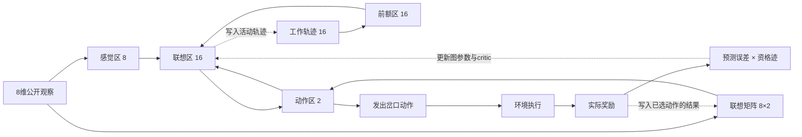

# Cadence 底层原理、算法与实现

研究日期：2026-10-11。对象为当前樱花小街演示实际调用的 `cadence.Brain`，固定上游 [19bee92756d1842176ad30b1cd01edbfbfa3f14c][upstream]，包版本 `0.80.0`，GPL-3.0。源码位置和文件 SHA256 来自已安装的固定依赖；实际配置与一趟诊断记录见 [algorithm-inspection.json](algorithm-inspection.json)。

**当前 Brain 是一组配合工作的算法：反馈神经图负责形成动作，EP 式局部对比负责记录连接对动作的影响，带资格迹的 Actor–Critic 用奖励调整这些连接，工作轨迹和联想矩阵提供两类记忆，唤醒机制决定何时探索和学习。** 网页里的走路动画由场景代码执行；Brain 学的是岔口选择。

## 1. 先看一次完整决策

路牌和所处位置编码成 8 维观察。Brain 叠加工作轨迹与联想记忆的输入，让神经图迭代到合格的稳定状态，读取两个动作神经元。平静时选最强动作；唤醒时按概率抽样，并为该动作保存两次教学扰动的状态。环境执行动作，实际奖励回来后，Brain 根据奖励预测误差增强或减弱连接，再开始下一次选择。



这里的 `cadence.Brain` 是 `generic.py` 的组合控制器。它里面的 `brain.brain` 才是 `brain.py` 的数值神经图。两者都叫 Brain，阅读源码时要区分。

当前图有 **42 个神经元、450 条有向连接**：感觉→联想 128 条，联想↔动作 64 条，前额→联想 256 条，两个动作之间抑制连接 2 条。图的连接位置固定，学习修改连接效力和神经元偏置。`motor/actions` 是动作区的别名，不能再加两个神经元。工作轨迹与 8×2 联想矩阵是额外状态／参数，不属于这 450 条连接。

来源：[Brain.compose][compose]、[输入与记忆叠加][stimulus]；实际入口：[RouteCadence](../runtime/route_experiment.py)。本配置没有启用额外 observer、动作副本 efference 或预测环境的高级引擎。

## 2. 底层神经图如何运转

每个神经元有电位 `v` 与输出活动 `s`。用当前配置的简化记号，一次数值迭代为：

```text
I_i = 外部输入_i + 偏置_i + Σ_j W_ji · s_j
v_i ← v_i + dt · (I_i − v_i)
s_i ← activation(v_i)
```

`W` 表示有效连接权重；源码还通过结构权重、连接效力、gain 等量组合它。当前 `dt=1`、threshold=0、slope=1，未启用 adaptation。激活函数等价于：正电位 `tanh(v/2)`，负电位 `0.1·tanh(v/2)`。负方向保留较弱响应。

联想区与动作区有反馈，因此动作区的变化又会影响联想区，需要多次迭代。公共 Brain 会检查完整方程的残差，必要时减小步长重试；当前自由态预算为 1024 步、容差为 0.003。若自由态不合格，会拒绝发出动作。

**稳定求解只表示“这次内部活动已符合方程”，不表示“路线选对了”。** 稳定状态既可能产生正确动作，也可能产生稳定的错误偏好。源码底层某些有限迭代接口还使用活动变化量停止，不能把所有接口都解释为同一种严格资格检查。

来源：[CPU 图迭代][settle]、[上游学习说明][learning-doc]。

## 3. 算法如何把奖励变成连接更新

### 3.1 先保存“这次选择涉及了哪些连接”

唤醒时，动作概率为：

```text
π(a | 内部状态) = softmax(动作活动 / T)
```

基础温度 `T=0.2`，唤醒机制可提高温度。抽样得到动作后，Brain 把**刚刚选中的动作**当作临时教学目标，从同一个自由态开始，分别运行 `+β` 和 `−β` 两个扰动阶段。这里的目标没有泄漏正确路线：选择错了，保存的也是错误动作的参与记录。

当前 `β=0.1`，每个扰动阶段最多 12 步。对连接 `e=(前神经元, 后神经元)`，两个阶段的活动差构成局部对比：

```text
C_e = (s⁺_前 · s⁺_后 − s⁻_前 · s⁻_后) / (2β)
C_bias_i = (s⁺_i − s⁻_i) / (2β)
```

只用连接两端的活动，就能获得该连接对这次选择的响应。反馈通路让动作端的扰动影响内部神经元。源码把两个扰动状态保存到待奖动作，反馈到达时再计算／使用对比。

这是 **Equilibrium Propagation 风格的局部对比学习**。它使用网络扰动与活动差获取学习方向。与精确梯度等价需要权重对称、稳定可微分支、小扰动和充分收敛等条件；当前只有有限的 12 步扰动，不能宣称其每次更新都等于精确反向传播梯度，或必然收敛到最优策略。

来源：[ActorCritic.act][act]、[上游学习说明][learning-doc]。

### 3.2 奖励到达后，通过 TD 误差调制资格迹

Critic 使用 16 维联想区活动 `h` 做线性价值估计：`V(h)=h·w_critic+b_critic`。实际反馈到达时：

```text
δ_t = r_t + γ·(1−done_t)·V(下一状态) − V(发出动作时的状态)
m_t = clip(δ_t, −1, 1)

E_t = γλ·E_(t−1) + C_t
Δ效力_e = actor_eta · m_t · E_t,e
Δ偏置_i = actor_eta_bias · m_t · E_bias_t,i
```

`E` 是资格迹，即此前选择留下的连接参与记录；`δ` 是这次结果比原先预计好或坏多少。**正奖励也可能低于预期而产生负 TD 误差，不能简单等同于“有奖励就加权”。** 资格迹让后来的奖励能影响之前的选择，而不只影响最后一步。

当前 `γ=0.9`、`λ=0.8`，旧资格每次实际反馈乘 `0.72`。第二个动作的终点反馈同时使用 `0.72·第一步对比 + 第二步对比`。`wait` 不额外衰减资格；无论中间等待几个观察时刻，一个结果仍算一个 TD 步。若希望时间越长价值越低，需要在环境／协议中另行定义时间成本。

Actor 学习率是 `0.1`，偏置学习率是 `0.01`。`Learner.apply` 最后处理可学习掩码、绑定连接的平均更新及效力上限 8。它修改效力和偏置，不新增连接。公式省略了这些约束和批处理；本场景只有一条流。

Critic 有自己的资格迹：对联想活动与常数 1 做相同的 `γλ` 累积，并用 `1+资格迹平方和` 归一化，学习率 `0.3`。需要特别区分：当前 `critic_signal="auto"` 解析为 **`modulated`**，Critic 使用截断后的 `m`，而不是原始 `δ`。这种实现可能改变价值估计的固定点，不能直接视为已校准的标准 TD 期望回报。

来源：[ActorCritic._learn][reward-update]、[Critic 更新][critic]、[参数应用][apply]。

### 3.3 工作记忆和奖励信用是不同的状态

| 状态 | 保存什么 | 何时改变 | 用在哪里 |
| --- | --- | --- | --- |
| 工作轨迹 | 最近的联想区活动 | 发出动作与 `wait` 后 | 下一次神经图输入 |
| Actor 资格迹 | 连接对已选动作的局部响应 | 收到实际反馈时累积／衰减 | 奖励如何改连接 |
| 待奖动作 | 原观察、动作、原价值及正负扰动状态 | 发出动作时建立；反馈时消费 | 让晚到结果归属正确动作 |
| Critic 资格迹 | 发出动作时的联想活动及常数项 | 实际反馈时 | 价值估计更新 |

这解释了“记住路牌”与“终点奖励能回传到街口”为什么不是同一个问题。奖励信用保留正确，并不保证工作轨迹能充分区分两种路牌历史。

## 4. 两种记忆具体怎样实现

### 4.1 工作轨迹：神经活动的指数滑动平均

当前 `working_memory_decay=0.2`、amplitude=0.3、focus=0：

```text
c_next = 0.2·c + 0.8·h_current
前额区输入 = 0.3·c
```

`c` 有 16 个数，是联想活动的残留，不是一个明确存储“樱花／灯笼”的离散变量。它通过前额→联想连接影响下一次活动。旧轨迹的直接项只有 0.2，但新的 `h` 自身也受到旧轨迹与反馈图影响，所以不能把完整系统的历史影响简单写成 `0.2^n`。

`done=True` 清理上一趟的工作轨迹；下一趟观察随后会形成新轨迹。图权重和 Critic 参数保留。

来源：[Trace.update][trace]、[Brain.learn][learn]。

### 4.2 联想记忆：观察到动作结果的两速矩阵

默认记忆不是保存逐条经历的回放缓冲区。它有持久矩阵 `C` 与每条流的快速残差 `F`，形状都是输入宽度×动作宽度。当前为 8×2，持久部分有 16 个参数。

读取时，把当前原始观察归一化成单位方向 `q`：

```text
动作区额外输入 = q·(C + F)
```

写入时，`value` 是已选动作收到的实际奖励，`mask` 只覆盖已选动作。对未执行动作的结果保持未知，不用零奖励充当其教学目标。单条流的慢更新为：

```text
error = (value − q·C) · mask
slow_rate = min(1, 0.25 + min(1, 0.25·salience))
C ← C + slow_rate·outer(q, error)
```

快速残差每次写入衰减 0.9，再用 rate=1 的纠偏响应当前结果。当前默认 salience 为实际奖励的绝对值。读记忆不会修改矩阵；这条记忆学习路径独立于 Actor 的 EP 对比和 TD 更新。

**默认记忆键取原始外部观察，不取工作轨迹。** 在街口线索条件中，樱花与灯笼到达同一个西侧岔口时，输入都为：

```text
[0, 0, 0, 1, 1, 0, 0, 0]
```

因而键本身没有把此前路牌区分开。持久矩阵的同一读取位置可能混合两类历史的结果，这是源码与输入编码确定的表示限制。快速残差可随此前经历变化，工作轨迹与 Actor 也可能区分历史，所以这**不是**“整个 Brain 必然无法区分”的证明。

“共享键可能造成记忆干扰，从而影响短暂线索表现”是机制推断，尚未做单独消融来证明它是低命中率的主要原因。源头与图学习的影响要分开测。

来源：[输入叠加][stimulus]、[实际动作记录][record]、[SynapticMemory.observe][memory]；同键检查已在诊断脚本断言。

## 5. 唤醒、等待和终点的真实含义

### 唤醒机制

`live` 不在每次调用中都运行同样的学习流程。平静时只做合格的自由求解与贪心选择，省去正负扰动和 Actor/Critic 学习；已有资格迹随实际 transition 衰减。唤醒时抽样、保存扰动状态，并学习其随后收到的结果。

唤醒由相对平常的预测误差、近期与长期收入差、可配置的需求以及青春期共同控制。当前 threshold=0.2、level decay=0.9、近期速率=0.05、长期速率=0.005、youth=100。默认 value_surprise=1，**record_surprise=0、need=0**；虽然记录误差也会被测量，本配置没有直接赋予它唤醒权重。只有符合自身最佳判断的结果进入 surprise，探索所得的所有实际结果仍进入收入统计。

使平静 Brain 醒来的那一次反馈可先写入联想记忆，但没有保存采样资格的平静动作不进行 Actor/Critic 学习；之后的唤醒动作才保存资格并学习。因而“更新次数”“记忆写入次数”和“环境步数”不能当成同一个计数。

来源：[Brain.live][live]、[Arousal.outcome][arousal]。

### 延迟反馈协议

当前场景实际调用顺序为：

```text
live(街口观察)                         → 发出西／东动作
live(岔口观察, 街区实际奖励, done=False) → 结算街区动作，发出北／南动作
环境执行巷口动作                       → 结果尚未到达，不调用 live
wait(途中观察)                        → 看新观察，保留待奖动作
wait(抵达观察)                        → 看新观察，保留待奖动作
live(下一趟街口观察, 终点奖励, done=True) → 结算巷口动作，发出下一趟动作
```

`live` 的奖励归属于**上一次动作**，不属于当前新观察下即将发出的动作。首次调用没有待奖动作。之后省略 reward 等价于已观察到零结果，不能用它表达“结果未知”。结果未知时用 `wait`。

`wait` 不发新动作、不学习、不写联想记忆、不替换原价值与资格，也不推进唤醒年龄。它更新活动与工作轨迹，供未来求解使用。等待由调用方决定，Brain 没有自动选择等待或学习截止时间。

`done=True` 表示上一个动作结束一趟，终点价值不自举；Actor/Critic 资格与工作轨迹被清理，学到的参数与联想记录保留。公共 `live` 随即处理下一趟观察并发新动作。不要在搬家时重新 compose 一个 Brain，否则展示的是重新训练，无法研究原控制器的适应。

库支持 `decision_id=brain.decision_id` 检查结果归属，错 ID 在修改状态前拒绝。本项目包装器采用严格串行结算，HTTP 立即重试还通过 request_id 去重。

来源：[live][live]、[wait][wait]、[learn][learn]。

## 6. 本机检查：状态变化与参数变化分开看

2026-10-11 实际运行 [inspect_algorithm.py](../runtime/inspect_algorithm.py)，读取固定依赖源码、工厂解析后的配置，并运行种子 7 的一趟真实终点奖励协议。

| 环境时刻结束后 | 待奖 ID | Actor 更新数 | wait 数 | 工作轨迹范数 | 资格迹范数 |
| --- | ---: | ---: | ---: | ---: | ---: |
| 初始街口发动作 | 1 | 0 | 0 | 0.109131 | 0 |
| 街区反馈并发巷口动作 | 2 | 1 | 0 | 0.205259 | 0.012259 |
| 执行巷口动作，途中 | 2 | 1 | 0 | 0.205259 | 0.012259 |
| 途中 wait | 2 | 1 | 1 | 0.317740 | 0.012259 |
| 抵达 wait、终点反馈、下一趟动作 | 3 | 2 | 2 | 0.109124 | 0 |

三行等待区间的图参数、Critic 参数、联想记忆 SHA256 均相同，待奖 ID 与资格范数相同；工作轨迹则确实变化。终点只额外消费一次反馈。该趟实际奖励为 +1，原价值为 0，因此终点 `δ=1`、dopamine=1；图与 Critic 参数随后改变。第一步零反馈仍计一次 Actor 更新，但 `δ=0` 导致参数步长为零，不能由更新计数推定权重变了。

这是源码诊断与单趟见证，**不是新增性能评估**。原有 24 次实验的结果和运行代码没有被修改。诊断读了库的内部字段，只用于观察，不参与动作或奖励。

当前解析参数见 JSON，不能套用孤立类的默认值：`ActorCriticConfig` 的裸默认 λ 与组合工厂的值可能不同；本场景实际为 0.8。`LearnerConfig.eta=0.5`、momentum=0.9 属于其一般学习设置，本奖励路径由 Actor 自己计算步长，实际 actor_eta=0.1、actor momentum=0，再交给 `Learner.apply`，不能多乘一次 0.5 或加入 0.9 动量。

复现：

```powershell
# 在 projects/010-cadence-foraging/runtime
uv run --locked python inspect_algorithm.py
```

## 7. 与规则、Q-learning 的算法差异

| 控制器 | 状态表示 | 动作与学习 | 本场景的作用 |
| --- | --- | --- | --- |
| 规则记路 | 明确锁存路牌；每类路牌一个候选路线编号 | 成功复访；终点失败就轮换下一条路线 | 四条路线可穷举，给出强而便宜的基线 |
| Q-learning | 明确锁存路牌；路牌×位置共 6 个状态、每状态 2 动作 | ε-greedy 与表格 TD 更新 | 精确区分路牌历史，学习多步价值 |
| 当前 Cadence | 8 维观察、16 维活动轨迹、反馈图及联想矩阵 | 唤醒抽样、局部对比、Actor–Critic 资格迹及记忆写入 | 学习表征与策略的机制更丰富，也有更多相互作用与计算 |

Q-learning 的更新为：

```text
Q(s,a) ← Q(s,a) + 0.3·[r + 0.9·(1−done)·max_a' Q(s',a') − Q(s,a)]
```

`ε=0.12`，持续小幅探索；wait 不更新表。这里的 Q 已经通过锁存路牌得到 `(路牌,位置)` 状态，不是一个失去历史的普通观察表。Cadence 的默认记忆则要从活动轨迹中间接保留历史。因此三者原始信息来源相同，但表示方式、记忆先验与容量不同；对照评估的是这三种具体实现，不能将结果外推为所有神经算法与所有表格算法的胜负。

现有四种子均值：短暂线索＋终点奖励时 Cadence 40.56%、规则 98.06%、Q 81.81%；加入途中反馈后分别为 74.31%、98.06%、84.24%。关闭工作轨迹的对照没有证明它的收益。由算法机制可知途中反馈缩短了信用分配链，但它究竟通过 Actor 更新、Critic 或联想矩阵贡献多少，当前数据没有分解。

对你当前 NPC 的实际意义：路线和线索数量小且能明确编码时，规则／Q 更省事。Cadence 值得继续研究的条件是需要从连续或组合特征学习响应、研究长期与短期适应，以及观察内部学习机制；这些方向仍需专门任务证明收益。它目前不能因“有反馈、有记忆”就被视为已经具备地图规划或未见路线推理能力。

完整成绩与边界：[街区实验研究](route-research.md)。

## 8. 如何实现与接入

### 用当前库实现 NPC

环境负责观察编码、执行动作、计算奖励和终点；控制器只接收公开观察及自己的实际结果。每个 NPC 保留同一个 Brain 实例。当前包装器仅几十行，主要价值是保证结果归属和生命周期，而不是重新写学习公式。

下面例子在本项目 `runtime` 中运行，使用相同配置。隐藏目标只用于环境计算评分，不传给 Brain；动作 0／1 在街口解释为西／东，在巷口解释为北／南。

```python
import cadence as cd
from route_experiment import ROUTE_CONFIG, observation

brain = cd.Brain.compose(8, 2, seed=7, **ROUTE_CONFIG)
street = int(brain.live(observation(0, 0))[0])
street_id = brain.decision_id

# 环境执行街区动作，已确认这一段实际奖励为零。
alley = int(brain.live(
    observation(0, 1, street), reward=[0.0], done=[False],
    decision_id=street_id,
)[0])
alley_id = brain.decision_id

# 环境执行巷口动作；途中与抵达观察没有新的决策或结果。
brain.wait(observation(0, 2, street))
brain.wait(observation(0, 3, street))
hidden_target_route = 0  # 仅由环境持有
actual_reward = 1.0 if street * 2 + alley == hidden_target_route else -0.25

# 下一趟出现灯笼路牌；结算的仍是上趟巷口动作。
next_street = int(brain.live(
    observation(1, 0), reward=[actual_reward], done=[True],
    decision_id=alley_id,
)[0])
```

依赖通过本项目 `uv.lock` 锁定，无外部模型 API。当前 Python 服务执行数值求解，Web 页面经本机 API 驱动，不把三维坐标、隐藏目标或阶段切换传给 Brain。服务结构与生命周期见 [运行引擎说明](../runtime/README.md)。引入或分发上游代码需保留 GPL-3.0 来源，当前来源登记见 [THIRD_PARTY](../THIRD_PARTY.md)。

本次已从笔记中提取上面的完整 Python 代码，在锁定虚拟环境执行通过：42 个神经元，两个反馈更新，下一待奖 ID 为 3；示例实际收到 −0.25，没有将随机选择写成成功。仓库根 `npm.cmd run check` 同样通过，确认 12 个项目的编号、目录、图片与索引一致。本次新增机制笔记和诊断，不修改场景、控制器参数或 Web 行为。

### 如果要从零理解并实现同类机制

建议按模块实现并分别验证：

1. **图与求解器**：固定有向连接、有效权重、激活函数、自由求解、完整残差与拒绝失败的行为。
2. **局部学习器**：从同一自由态启动正负扰动，计算连接端点活动对比，应用学习掩码、绑定与上限。
3. **Actor–Critic**：softmax 抽样、保存原价值及动作对比、真实反馈时做 TD 和资格迹更新，终点禁止自举。
4. **两种记忆**：活动指数轨迹与观察→动作结果矩阵分别实现，明确慢参数与临时状态。
5. **持续控制器**：实现 routine／aroused 模式、待奖 ID、`live/wait/done` 协议和失败重试语义。
6. **环境与观察台**：隔离隐藏状态，保留观察、动作、奖励、参数变化和固定种子，接入规则／Q 基线。

仅实现“反馈网络＋奖励乘活动”会丢失当前库的扰动对比、资格、价值估计、记忆与反馈归属语义，不能称为完整 Cadence 复现。本项目目前接入真实库，没有另造简化算法冒充它。

最有区分力的检查是：wait 前后参数和待奖 ID 不变；终点不跨趟自举；错误决策 ID 不消费结果；没有奖励时不伪造结果；奖励换位置继续同一参数；各控制器都只能读取公开观察。这些行为在既有测试及本次诊断中有对应检查。

## 9. 从源码继续研究的路径

| 问题 | 固定版本入口 |
| --- | --- |
| 图如何装配 | [generic.py:746 · Brain.compose][compose] |
| 输入如何读记忆 | [generic.py:1055 · Brain.stimulus][stimulus] |
| 神经元如何迭代 | [brain.py:1084 · Brain._run_numpy][settle] |
| 抽样与资格如何准备 | [plasticity.py:442 · ActorCritic.act][act] |
| TD、资格和 Actor 更新 | [plasticity.py:648 · ActorCritic._learn][reward-update] |
| Critic 如何更新 | [plasticity.py:816 · _critic_candidate][critic] |
| 更新如何应用到图 | [learning.py:589 · Learner.apply][apply] |
| 工作轨迹 | [stream.py:166 · Trace.update][trace] |
| 联想矩阵 | [memory.py:72 · SynapticMemory.observe][memory] |
| 唤醒反馈 | [arousal.py:264 · Arousal.outcome][arousal] |
| 持续运行与等待 | [generic.py:1305 · live][live]、[1483 · wait][wait] |
| 反馈分发与结果记录 | [generic.py:1744 · learn][learn]、[1824 · _record][record] |

下一轮因果实验可沿下列方向进行，**本次尚未执行**：

- 给 Cadence 与 Q 使用一致的显式路牌状态，另设都无显式锁存的条件，分开研究“状态表示”与“学习算法”。
- 在相同图与种子下关闭默认联想记忆，判断共享键与奖励记录的贡献；确认构造前后图和初始参数一致。
- 分别改变轨迹 decay／amplitude 与奖励延迟，分析路牌历史保留；保留关闭轨迹条件，不能只挑较好参数。
- 对照 `critic_signal="td"` 与当前 modulated 模式，检查价值预测的校准及实际行为。

这是从实现推出的可检验问题。现有成绩足以判断当前小环境优先规则／Q，但尚不能回答 Cadence 在连续观测、未见组合或长延迟中是否更有收益。

[upstream]: https://github.com/muellerberndt/cadence/tree/19bee92756d1842176ad30b1cd01edbfbfa3f14c
[learning-doc]: https://github.com/muellerberndt/cadence/blob/19bee92756d1842176ad30b1cd01edbfbfa3f14c/docs/learning.md
[compose]: https://github.com/muellerberndt/cadence/blob/19bee92756d1842176ad30b1cd01edbfbfa3f14c/src/cadence/generic.py#L746
[stimulus]: https://github.com/muellerberndt/cadence/blob/19bee92756d1842176ad30b1cd01edbfbfa3f14c/src/cadence/generic.py#L1055
[live]: https://github.com/muellerberndt/cadence/blob/19bee92756d1842176ad30b1cd01edbfbfa3f14c/src/cadence/generic.py#L1305
[wait]: https://github.com/muellerberndt/cadence/blob/19bee92756d1842176ad30b1cd01edbfbfa3f14c/src/cadence/generic.py#L1483
[learn]: https://github.com/muellerberndt/cadence/blob/19bee92756d1842176ad30b1cd01edbfbfa3f14c/src/cadence/generic.py#L1744
[record]: https://github.com/muellerberndt/cadence/blob/19bee92756d1842176ad30b1cd01edbfbfa3f14c/src/cadence/generic.py#L1824
[settle]: https://github.com/muellerberndt/cadence/blob/19bee92756d1842176ad30b1cd01edbfbfa3f14c/src/cadence/brain.py#L1084
[act]: https://github.com/muellerberndt/cadence/blob/19bee92756d1842176ad30b1cd01edbfbfa3f14c/src/cadence/plasticity.py#L442
[reward-update]: https://github.com/muellerberndt/cadence/blob/19bee92756d1842176ad30b1cd01edbfbfa3f14c/src/cadence/plasticity.py#L648
[critic]: https://github.com/muellerberndt/cadence/blob/19bee92756d1842176ad30b1cd01edbfbfa3f14c/src/cadence/plasticity.py#L816
[apply]: https://github.com/muellerberndt/cadence/blob/19bee92756d1842176ad30b1cd01edbfbfa3f14c/src/cadence/learning.py#L589
[trace]: https://github.com/muellerberndt/cadence/blob/19bee92756d1842176ad30b1cd01edbfbfa3f14c/src/cadence/stream.py#L166
[memory]: https://github.com/muellerberndt/cadence/blob/19bee92756d1842176ad30b1cd01edbfbfa3f14c/src/cadence/memory.py#L72
[arousal]: https://github.com/muellerberndt/cadence/blob/19bee92756d1842176ad30b1cd01edbfbfa3f14c/src/cadence/arousal.py#L264
