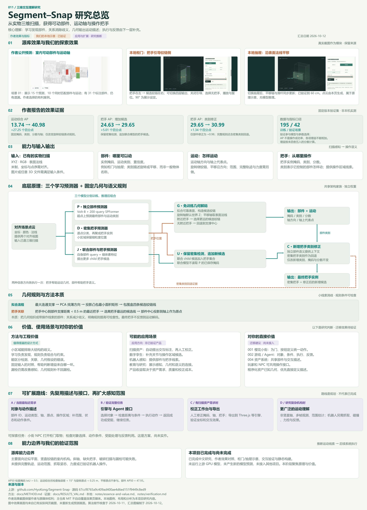
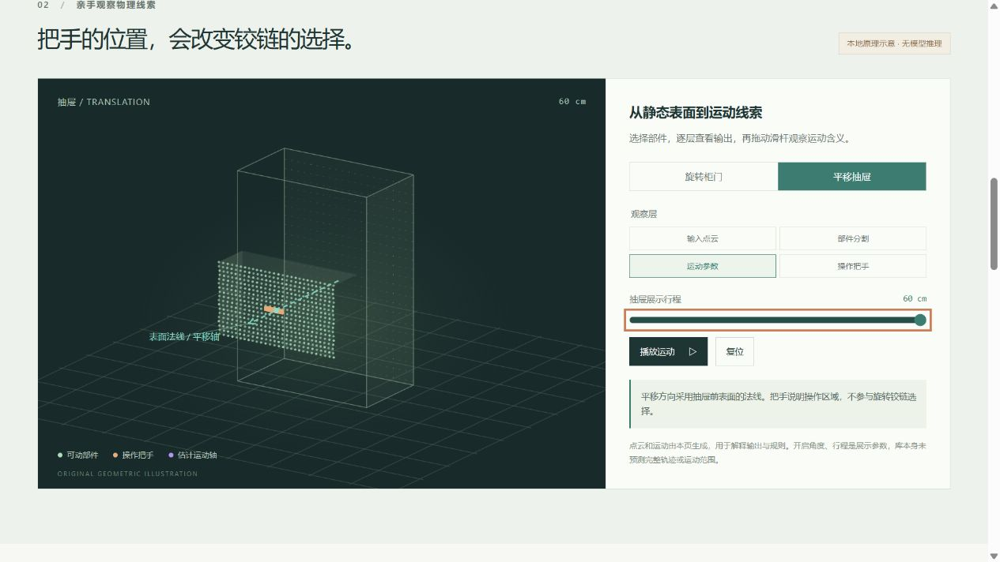

# 011 · Segment–Snap · 三维交互理解观察台

从静态室内三维扫描中找出“哪些部件能动、怎样运动、把手在哪里”。当前聚焦原理、本质与复用价值：如何给几何增加操作语义，如何用把手消除铰链歧义，以及这些思路如何用于已有三维场景与 Agent。

核心判断见 [原理本质与复用价值](notes/essence-and-value.md)。作者效果与本地交互示意用于解释方法；模型安装与完整复现不在当前研究范围。

## 完整网页理解

新增 `web/research.html`，以我们已有的总图作为引导，提供九主题36段完整摘要、11组模块职责、训练与推理分工、几何和语义信息流、作者 AP 与本地截图对照、现有项目价值、五阶段扩展及13份原文阅读和下载。原观察台继续提供作者场景切换和柜门、抽屉操作，两页互相导航。

正文统一由 [research-summary.json](notes/research-summary.json) 生成，网页、[完整摘要](notes/research-summary.md) 和登记表详细摘要保持一致。原引导 PNG/SVG 字节不变，网页提供缩放、滚动和原图下载。固定公开路径为 `011-segment-snap/research.html`；实际发布状态以 [发布记录](notes/publication.md) 为准，验收后再登记演示地址。



[下载高清总图 PNG](assets/research-overview.png) · [查看可缩放 SVG](assets/research-overview.svg) · [原观察台截图](assets/showcase-desktop.png)

总图编制于 2026-10-12，分八部分汇总效果证据、能力、算法流程、几何规则、应用及个人项目价值、扩展路线和验证边界。绿色表示作者结果与方法，橙色表示已验证的本地原理示意，紫色表示尚未接入的应用与规划。三个效果模块使用已有实际网页截图，未生成新的模型预测。图中两种信息方向各执行一次，最终把手不反馈到运动解码；引擎执行与机器人操作属于后续系统。

| 项目资料 | 内容 |
| --- | --- |
| 固定编号 | `011` |
| 上游仓库 | [HyoKong/Segment-Snap](https://github.com/HyoKong/Segment-Snap) |
| 固定研究版本 | [`67ccf8765a9c409ad400ae4d6ed151f9449c8ed9`](https://github.com/HyoKong/Segment-Snap/tree/67ccf8765a9c409ad400ae4d6ed151f9449c8ed9) |
| 研究日期 | 2026-10-11 |
| 论文 | [arXiv:2609.25247 v2](https://arxiv.org/html/2609.25247v2) |
| 上游许可证 | 主仓库 MIT；第三方实现与数据另按各自条款 |
| 当前状态 | 原理与价值研究；中文说明与本地示意已完成，模型推理未执行 |
| 在线演示 | 尚未部署；登记表 `demo` 为 `null` |

## 这个库能做什么

输入是一份带坐标、RGB 与表面法线的点云，核心输出有三类：

| 能力 | 输出 | 直观例子 |
| --- | --- | --- |
| 找到可动部件 | 部件实例掩码、运动类别、置信度 | 从整个房间中分离柜门和抽屉 |
| 推断运动方式 | 旋转或平移、运动轴方向、轴上位置 | 柜门绕一侧铰链旋转；抽屉沿表面法线抽拉 |
| 找到操作把手 | 把手实例掩码、所属运动类别、置信度 | 定位小把手，解释它控制旋转部件还是平移部件 |

把手类别描述它控制的部件怎样动，不表示把手的独立运动。库未提供完整轨迹、开启范围、抓取姿态或已验证的机器人操作。

## 当前如何展示能力

本地网页提供：

1. **作者公开效果**：两个室内场景，可切换 RGB 输入、模型预测和真实标注；保留样例选择条件与遗漏说明。
2. **三类输出说明**：部件、运动和把手的含义与对应输出。
3. **本地交互示意**：柜门和抽屉，四种观察层；移动把手、关闭引导或选择无把手，观察铰链规则；支持滑杆、播放与复位。
4. **效果对照**：作者铰链误差案例、公开 AP 指标及定义；可展开原始方法图、观看作者 73 秒视频。
5. **原理拆解**：三个模型的分工、点云与掩码的直观含义、拟合支撑与选择铰链的三步规则，区分学习模型与免训练几何。
6. **能力边界与应用价值**：假设、运行成本，以及场景标注、空间 Agent 和复杂运动研究的扩展路径；应用仍为推断。
7. **资料入口**：原始来源、方法图和来源指标记录下载。
8. **完整研究总图**：可展开八部分总览，下载高清 PNG 或 SVG；同时保留作者预测、本地示意与规划的区分。

推荐观看顺序：先在首页切换“RGB 输入 / 模型预测 / 真实标注”，再播放柜门运动并改变把手位置，最后阅读原理与效果对照。抽屉示意展示平移轴；滑杆范围是展示设定。

作者图片从公开页面仓库的固定版本加载，视频直接引用原站，需要网络。交互点云由本页确定性生成，**是原理示意，不是模型推理输出**。视频动画展示估计运动，也不是实际机器人操作。



## 核心原理

三个分别训练的模型观察同一对齐场景：独立部件预测器、密集把手预测器、联合部件与把手预测器。联合模型用自身部件查询特征提出更细的把手候选，不直接读取独立部件模型的掩码。

把手帮助运动解码：拟合可靠部件表面，构造包围盒候选铰链线，选择离附近把手最远的一条。旋转默认用竖直轴，平移用表面法线。部件则帮助解释新增把手的运动类别，密集把手类别作为回退证据。两个方向各应用一次，最终把手不反馈到运动解码。

免训练的是几何解码器，三个感知模型都需要学习。数据流与源码入口见 [能力与方法笔记](notes/capabilities.md)。

## 作者报告的效果

以下来自 42 个公开验证场景，**本次未运行模型复现**。三个模型在 195 个训练场景上优化，验证集参与了模型、权重与参数选择。

| 对照 | AP 前 → 后 | 增益 |
| --- | --- | --- |
| 固定部件掩码、轴和分数，仅改铰链原点规则 | 运动综合 AP `13.74 → 40.98` | `+27.25` 个百分点 |
| 密集把手检测增加联合模型候选 | 把手 AP `24.63 → 29.65` | `+5.01` 个百分点 |
| 用部件上下文和密集把手类别回退修正新增候选 | 把手 AP `29.65 → 30.99` | `+1.34` 个百分点 |

AP 不是操作成功率；差值由未四舍五入的分数计算。运动综合指标检查掩码、轴方向和旋转原点，平移原点不参与该指标。不同任务增益不能相加。[固定版本验证报告](https://github.com/HyoKong/Segment-Snap/blob/67ccf8765a9c409ad400ae4d6ed151f9449c8ed9/docs/RESULTS_VAL.md)

## 启动本地观察台

无需第三方依赖，需要 Node.js 22 或更新版本：

```powershell
cd projects/011-segment-snap/web
npm.cmd run dev
```

打开终端打印的 `http://127.0.0.1:5191/`，保持终端运行。这个地址仅供本机访问，不是已部署演示。构建与计划子目录预览见 [Web README](web/README.md)。

完整模型复现需要 CUDA GPU、Articulate3D 数据、三个约 4.9 GB 的权重及相关依赖。本阶段未下载数据或权重，不能把展示页当作 GPU 推理验证。

## 阶段进度

- [x] 固定上游版本，核对许可证与核心源码。
- [x] 中文输入输出、原理、效果与局限说明。
- [x] 作者公开效果与可操作柜门、抽屉示意。
- [x] 本地页面验证、构建与真实截图。
- [x] 原理本质与对现有三维场景、Agent 的复用价值分析。
- [x] 一张完整研究总图，嵌入实际截图，保留来源、版本与应用边界。

当前研究不要求模型安装或复现。对象与动作接口、扫描资产校正、泛化验证和部署是按实际应用需求选择的后续方向。

## 研究材料

- [原理本质与复用价值](notes/essence-and-value.md)
- [能力与算法细节](notes/capabilities.md)
- [本地验证记录](notes/verification.md)
- [来源与指标数据](web/data/evidence.json)
- [上游与素材授权](THIRD_PARTY.md)
- [截图与方法图说明](assets/README.md)
- [研究总图生成与复用](tools/README.md)
- [九主题完整理解摘要](notes/research-summary.md)
- [网页发布与验收](notes/publication.md)
- [总项目索引](../../README.md)
